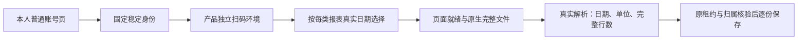

# 微信普通后台与五份实文件：恢复后的当场核验

用户明确答复“允许的”后，2026-10-09成功认领原Ego空间20，`taskctl resume T-1110`留下真实事件。沿既有已登录普通后台只读核查，未搬运Cookie或研究profile。本文是当前事实补充，不替换b1f0cc54时的缺失文件/控制停止记录，不宣布真人产品绑定与整体UI验收完成。

## 已取得的实际证据

公众号普通`/cgi-bin/settingpage`的当前账号信息明确显示AppID与名称。可修改的“公众号ID”不作稳定身份；固定采用当前账号设置AppID，不在以后遇到gh字段时自动换协议。本人字段SHA256为`56b7ddb9a2008cfefe09e731e8dcd3b6454a7b2636b908ff09802b05c4252952`；完整ID只在本机私人验收目录。微信支付[官方必要参数说明](https://pay.wechatpay.cn/doc/v3/partner/4013080340)说明公众平台公众号/小程序申请的AppID是唯一标识；[官方网页授权](https://developers.weixin.qq.com/doc/service/guide/h5/auth.html)另说明服务号appid唯一性。后者服务号范围不被扩写成所有公众号的API权限，本接入仍只读本人普通后台，不申请AppSecret或调用认证接口。

视频号普通`/platform`的`#finder-uid-copy.finder-uniq-id`可见文本与data-clipboard-text一致，`h2.finder-nickname`仅作展示。页面原生提示明确说明视频号ID唯一标识身份。本人字段SHA256为`24866f23b434a6cd0036756fa03e575529a50623c67b38d9e1b232fade378d75`；未使用uin、session、昵称或人工身份兜底。

五个当前原始文件均实际重新接收，公众号通过当前DOM真实原生href同会话fetch得到HTTP200，视频号监听native download并在同轮saveAs。文件只存本机私人目录，Git仅保以下安全元数据及`private-file-result-final.ndjson`。当前内容/单篇字节摘要与历史研究不同，未用旧摘要或历史结果代签。

| 原生报告 | 实际范围及含义 | 文件字节/真实解析行数 |
|---|---|---|
| 公众号内容分析 | 9月9日至10月8日，统计日期 | 45056；阅读趋势240、分享等趋势30、阅读来源60 |
| 公众号用户增长 | 9月8日至10月8日，统计日期 | 7401；31 |
| 视频号全部视频日报 | 9月9日至10月8日，统计日期 | 1100；30 |
| 视频号关注者增长 | 9月9日至10月8日，统计日期 | 998；30 |
| 视频号单篇视频 | 9月10日至10月9日，发布时间选择 | 5102；13，原生视频ID亦13个；指标累计范围仍未知 |

全部日期为2026年、Asia/Shanghai。单篇页面总数13、第一页10条，实际CSV13条。被动观察本次详情近30天引起的原生POST：startTime/endTime换算为上述9月10日至10月9日；响应成功协议为errCode=0、data.totalCount=13、第一页list长度10。只观察该UI实际发出的请求，不直接构造/调用平台内部接口，不持久化完整请求body或会话字段。

## 据此修正的实现

正式composition装配`wechat-dom-witness`，不再把缺witness的空工厂当作已可用。两平台身份固定读上述普通信息页；表格的近30天精确限定到`.filter-row:has(.filter-extra)`详情区域，避免同页趋势区控件抢先命中。单篇以本次新请求/响应、实际选择和总数共同就绪，监听前发出的旧请求即使同窗口晚回也不作证据。内部expectedRows随下载传到唯一真实解析器，CSV截断为10条时在commit前拒绝，保留已得前两份，不变成登录过期。

公众号内容页只有图表，用户增长表只有当前页10个日期；不能要求30/31个DOM日期或计算一组日期冒充表格。reader核当前可见日期输入与真实native href的日期相同；接收后解析器继续严格核统计表实际完整日期集合。下载前重新核同一状态，阻止过期href/总数变更。

实BIFF另发现阅读来源发表日期为YYYYMMDD；新增只在BIFF日期字段解码的兼容，raw仍保原八位字符串，非法日期仍拒绝。旧按横线日期合成的fixture不足以发现此问题，当前私人内容文件首次实际REPORT_DATE_RANGE失败保留，修复后五份文件全部解析PASS。

独评另指出隐藏登录提示、跨午夜重算窗口、无frame请求事件抛错。各项当场RED后修复：仅实际可见登录提示可判登录失效，本次窗口只冻结一次，无frame的无关请求只忽略；不会使合法采集失败。完整source+内置witness在等待原生response时取消/原剩余期限耗尽，实停后late response不再交第三份，原前两份保留。扫码弹窗去掉用户不需要的内部runId文字，原索引和可核对任务仍保留。

实际源码只读reader还通过Ego普通页运行：公众号身份哈希与私人字段一致；内容页返回真实日期输入/href证据，dates为空，没有假造30天表。最初桥接误把Ego异步url当作Playwright同步url，返回null；修正只读adapter后验证身份。内容页初次尚未完成加载同样null，后续实际读数通过；生产observe等待就绪，不以首次快照签成功。这些null不是登录过期或成功证据。

## 仍待完成

产品自身隔离Next实例已运行，临时PGlite与所有登录目录均在本次新建`/tmp/creatoros-t1110-fullpage.*`根，没有连接或迁移用户库。通过实际平台能力表→视频号弹窗→公开accounts.bind.start启动一次真实扫码任务；Ego空间20实际handoff后用户确认“已扫码登录”，根会话才takeOver继续原ID核对。

原任务`execution-task-4eb3a857-15`公开accounts.bind.status实际HTTP200但终态failed、accountId为空，错误为“该平台能力尚未接入可用的数据适配器”，组成员仍0。实际身份读取成功后，正式sourceAdapters仅登记nativeReports、漏bind，commitVerifiedBinding的原守卫因此拒绝。本次失败完整保留；不是Cookie过期，不称绑定成功，不把原失败ID改成功或自动重发。

补两平台公开composition行为回归：外部浏览器读数是明确合成fixture，实际start/status→profile采纳→原backend绑定事务→账号/组成员回读不替换。Vitest4签名错误导致0test的首次无效运行另存；修test后两平台真实行为RED（failed/null），再登记configured条件下bind/nativeReports两项，未绕过adapter、身份、成员或停止守卫。当前37个worker协议/停止/解析用例一次实际PASS，含两平台嵌套visibility:hidden/display:none反例和真实可见正例。

根会话继续核验修复后的产品绑定、2+3份完整采集及1366/1024页面旅程；研究空间已登录仍不等于产品绑定成功。
当前5份实文件、合成协议/公开DB链、类型及组件检查分别记录；真实产品扫码、完整browser采集与视觉旅程未签PASS。原全局46项失败与T1110-related-gates仍保留，不能据局部通过声称整仓全绿。

## 当前合并回归与保留的失败

当前一次完整worker三文件37 PASS（DOM11/source17/parser9），公开真实composition七例7 PASS，UI四文件57 PASS，frontend与worker类型检查实际exit0。公开composition首次正确签名执行为两微信行为2FAIL；修bind登记后5PASS/2FAIL，旧三平台case仅断言与当前批准SPEC的错峰时刻相反，修测试期待为小红书5/快手10，生产时刻未改，再完整7PASS。无效Vitest4签名0test运行另存，不记作行为RED。

LED047首轮并发8文件173PASS/1FAIL，原run-controls异步查询在并行负载下未及时满足；保此事实，不改断言/产品。同命令仅maxWorkers=1、retry0串行复验8文件174PASS。当前timeout-policy实际exit1，旧27个静态短预算项仍存在，无本次新微信文件；没有把动态35PASS的backend执行组误当worker用例。

新增独立闭合复核`t1110-witness-bind-closure-audit.md`核实际37/7/57与源码SHA；只签源代码接缝，没有代签真人或视觉。root曾误用三个不存在的check-*.mjs命令导致MODULE_NOT_FOUND，实际无Gate运行，日志另标command-invalid；随后按现有正式scan命令执行。此前context/progress唯一步骤缺失以及旧46个全局失败继续保留，不用局部回归替换全局事实。

产品已在同一隔离PGlite根温和重启配置，原failed扫码任务仍保留。root经实际表格弹窗明确开始新intent，公开索引为`execution-task-3eba3525-15`，实际页面等待扫码验证；Ego20已handoff给用户，未在用户控制时继续浏览。后续本人绑定和平台采集均仍待验证。

## 后续实际绑定与未通过的同步

第二次产品扫码的公开`accounts.bind.status`实际HTTP200、succeeded，accountId为`acct-3eba3525-70`，error为空。公开账号与账号组回读确认真实成员；稳定平台身份摘要与上文普通后台一致。初始化的视频号self.metrics任务实际启用，cron为`15 */2 * * *`。产品使用本次临时根中的独立登录环境，没有搬运研究登录。确认成功后才重新takeOver原Ego空间20。公众号产品扫码尚未执行，这些事实只签视频号绑定。

绑定后原计划任务实际`EXPORT_FAILED`、0报表。root未改变原任务ID或终态，随后为定位问题明确建立新的手动intent。`collection-5d521b69-104`实际failed、0页，安全诊断为prepare/channelsDaily/REPORT_WINDOW_MISSING。对普通页面的实际DOM观察表明：全部视频与关注者增长都有唯一`.filter-row:has(.filter-extra)`详情行，日期radio值仍为1/2/3；不是另一个日期协议。一次普通导航domcontentloaded后iframe数组尚为空；随后的观察发生平台逻辑异常与研究页登录跳转，不能把这轮桥接失败记成真实采集PASS。

代码另有可确定的渲染时序缺口：标签尚未出现时跳过点击，日期控件尚未出现时立即拒绝。两种日报标签/控件延迟用例实际RED（2FAIL/11PASS，继承仓库retry配置），改为沿原signal/剩余预算等待唯一可见标签并点击、再等唯一详情日期控件。完整30个实际日期、单篇新请求响应/真实总数及下载前复核均未放宽。新增重复标签用例明确拒绝，不能取第一项。

修复后的实际新intent `collection-dfe56a37-49`仍failed/0页，安全诊断为prepare/channelsDaily/REPORT_PAGE_MISSING；所以渲染缺口修复没有闭合实际采集。下一次分段诊断intent `collection-8d52aafb-55`更早在navigate发生BROWSER_OPERATION_FAILED/Error，同样failed/0页；没有证据证明两次同因，更不能推断Cookie过期。当前细分iframe、标签缺失/重复，并增加固定Chromium导航/目标关闭分类，仍不输出message、stack、URL、目录、身份或Cookie。

内部诊断首次5个必要用例均有当场RED，之后三文件42PASS；日期等待后完整44PASS、重复标签后45PASS；4个固定导航类别用例当场4FAIL，最新完整三文件49PASS。错误parser路径的一轮实际只运行两文件35PASS，另留`render-ready-wrong-path-partial.log`，没有当作完整回归。worker与frontend新类型检查实际exit0。安全索引见`diagnostic-source-verification-index.json`；独评只覆盖源码/已有日志，不代签真人采集。

双视口影子Next旅程还没有执行：首次启动器强制webpack，真实页面HTTP500（node:crypto UnhandledSchemeError），原启动日志保留。启动器改用产品默认Turbopack，并在HTTP500时明确失败；本次修正尚待实际启动与浏览器验证，不改产品配置或安全守卫。视频号三报表/公众号两报表完整公开入库以及实际页面验收继续待验，任务保持进行中。

## 标签观测与公众号原扫码失败

新增固定导航类别后，原手动intent遇到HTTP连接重置；再次提交使用已保存的同一个clientRequestId，公开返回唯一`collection-34ba48c1-55`。它在15:09:35Z实际failed/0报表，诊断为prepare/channelsDaily/REPORT_SECTION_MISSING，不能把正式iframe存在等同标签已经可操作，也不能据此判断Cookie失效。原ID及终态保留。

随后从实际平台表公众号行打开原弹窗并启动`execution-task-34ba48c1-61`，Ego20交还用户。该任务先waiting_verification，后15:16:09Z实际failed、accountId为空，公开错误为“微信后台页面或原生下载暂未完成，请查看原任务”。本次没有binding分段诊断，根因未知；窗口已结束，不再要求扫描旧窗口，也不称公众号绑定成功。后续新增binding脱敏日志须先完成实际检查，再启动明确的新扫码intent。

默认Turbopack的第二次影子Next启动也实际失败：隔离副本第三方依赖链接回原工作树，Next无法在其root内解析next/package.json。保留原next.log和启动失败；新QA准备器复制必要依赖，保留相对链接并校验副本inode/链接范围、原安装及HEAD首末一致。新增辅助脚本纳入PAGE_SPEC watched_paths。此修改仅准备验收环境，尚未执行复制、页面编译或Chrome旅程，未签PASS。

## 五字段观测回归与QA准备实证

root在正式树先仅加入测试，新增靶向实际7FAIL/60SKIP（67例、retry0），再采纳生产实现，完整三文件67PASS与worker类型actual exit0。五字段只在同一frame的typed标签缺失后读取一次，并独立验证/重构；取消、实际原期限、晚快照和停止未确认仍走原链。SDK显式120秒裁剪到同一原end，fallback重取余量；共享guard预检在其race前等待的既有边界未被这些mock测试覆盖，不称完整浏览器生命周期已通过。

新的公众号原扫码任务`execution-task-a1e2c022-51`收到用户“已扫码并选择公众号”后，实际readIdentity/IDENTITY_MISSING，仍未有绑定账号。该证据只说明普通稳定身份未读到，没有登录过期证据；不重写原failed任务，不自动把研究身份传给产品。

隔离QA准备实际成功于HEAD`88b663a6`：106220个regular文件、4986个链接，source/clone首末摘要一致、0共享inode/逃根/broken链接，Next16.2.9实际解析位于影子根；独评再次逐个核验，页面编译也已实际HTTP200。但首次旅程未进入页面：Ego服务进程没有收到shell自定义环境变量，先在参数检查失败；原server state另有spread覆盖schema的静态缺陷。这两处修复、准备预算按独评扩至1440秒（覆盖4git+archive/tar+5cp+收尾）。原服务经PID归属核对后停止，失败文件和日志保留；必须在新冻结源码上重跑，不能把准备成功当页面PASS。

下一次真实视频号intent`collection-b33854fc-50`仍failed/0。此次五字段实际为exactTabCount=0、visibleTabCount=0、frameElementVisible=false、documentReadyState=complete、bodyTextLength=162；只证明匹配统计frame隐藏且无标签，不据此断定Cookie或隐藏原因。普通身份核验通过后才进入prepare。后续须核顶层真实UI及实际导航，不强制显示隐藏frame或放松身份/窗口/完整性判断。

HEAD`72e207b2`的隔离页面也实际启动HTTP200，下一次旅程在进入页面前被Ego不支持Browser.getVersion阻断。失败另存，改为读取实际页navigator.userAgent并明确证据来源；真实Emulation/Network/Runtime API在空白Agent p5已调用成功，页尺寸1366×900，UA声明Chrome/152.0.0.0。该API烟测没有页面/扫码/报表PASS，原临时服务实际按归属PID停止，下一次仍从冻结代码准备。

新增timeout-policy完整命令实际exit1：原27静态短预算保留，本次账本组beforeAll另被既有10000ms hook上限拒绝，25例未执行、另10例通过。准备使用180000ms hook/test预算和单worker针对同组复验，原失败不改写，不以无断言运行称通过。

## 公众号分段诊断与首次进入页面的验收失败

root在HEAD ee79dfc45e417157275bb2c51359de54d476ae26先应用tests-only，完整三文件实际11FAIL/69PASS（80例），再应用生产后80PASS、整worker包类型实际exit0。首轮误写parser路径只执行71例另存，不代签完整RED。独评核公众号设置入口480秒→设置页导航120秒→字段480秒和视频号导航120秒→字段480秒真实串行预算，两新code只用于内部诊断；原父任务截止与普通失败/auth分类不变。共享guard预检既有边界仍未通过真人Gate。

同一Ego20研究p1经当前唯一实际设置href普通导航后，AppID唯一且固定wx格式成立，名称唯一非空，readyState complete；只记录机械布尔/数量，不复制身份或登录到产品。该观察说明研究页selector成立，不解释产品原IDENTITY_MISSING，更不作为产品绑定证据。

JYZ8N7影子Next@ee79已实际进入accounts1366并取得截图，但页面仍未完成客户端加载、没有报表fixture调用；原旅程actual exit1，扫码按钮120秒查找0。Next真实日志明确拒绝[::1]开发资源，故这轮不能验收交互或扫码入口。独立检查Next原blocking函数与正式loopback guard，准备把隔离QA hostname改为localhost，与root真人127.0.0.1仍分开；不修改产品安全配置。原失败与19条origin=null网络事件保留（协议未记录，不能断言外联），下一轮明确记录协议并排除开始前残留事件。原影子PID27550已按归属核对停止，p5才清为空白；未关闭研究/用户页面。

context-plan恢复实际exit2（progress缺T1110唯一pending/claimed step），已有欠债原样保留；不改变已审SPEC、BUILD阶段与看板进行中状态。

本次身份预算修改后再次完整timeout-policy actual exit1，唯一非零检查为原27个静态短预算，无新增微信文件；动态各组实际通过，包含账本执行35例。本次结果没有覆盖/改写此前10秒hook失败。索引保存独立日志SHA与本轮真实exit1。

## 第三次公众号扫码意图与待验页面环境

完整OA诊断修正已提交05db7f36并在原隔离产品根停止已归属Next、predev重建与温和重启。新明确intent execution-task-b8119204-56实际queued→waiting_verification，16:20:40.520Z开始；root交还同一Ego20并请求本次新Chrome扫码。至16:29:01.037Z原任务实际failed/accountId=null，readIdentity/ENTRY_NOT_READY；未收到本次扫码完成回复，不把这轮当已扫码仍绑定失败，不判断Cookie故障或设置页字段协议问题。原失败保留，不自动开第四个窗口。

localhost修正已提交9b0b1d14，新隔离72Dfef服务实际准备成功，正式页面HTTP200、identityProof=false；页面旅程尚未运行，因为原Ego20仍交给用户。不能把服务就绪签交互Gate。

私有失败截图候选先在root树tests-only actual3FAIL/104SKIP/107（retry0），尚未应用生产。独立实现审查发现unlink吞非ENOENT错误且无重试这一具体缺口，作者只/tmp修正中；原候选不签PASS，原RED保留。

私图清理修正在root当场先应用旧能真实截图的实现，再加入EIO例；正确筛选actual1FAIL/107SKIP/108，直接显示合成随机PNG残留。第一次错误filter全108SKIP另标invalid，不当RED/PASS。最多三次顺序unlink且ENOENT成功后，完整三文件108PASS，整worker及frontend类型exit0。独评复核修正无新增阻断，永久OS故障残留仍交root本次私目录最终删除，不引入清理定时器/生产者或公共路径。薄composition仅development读取显式env传worker私参，默认关闭；尚无真实截图或native采集PASS。

## 2026-10-10 · 重复统计页失败进入研究门

69ac739d当场实际新intent collection-35c561b7-54于16:36:10.068Z→16:38:31.910Z failed/EXPORT_FAILED/0页；prepare/channelsDaily仍REPORT_SECTION_MISSING，五字段0/0/false/complete/162。显式dev私图配置后目录0PNG/0part，跳过原因未知。后续公开status/list再次核实原54failed0、公众号56failed/nullaccount、reports.list 0份；已知受管Chrome0。绑定composition当场7PASS、timeout-policy实际exit1保原27静态失败、boundary无新增5基线、semantic通过、orphan0ERROR/100WARN的工具事实见section-failure-20261010.json；不引用不同旧log代签。

按skill重复失败规则，先实际taskctl block暂停T1110；遵用户唯一状态入口，用真实actor只登记OPEN后运行官方observe的已有OPEN分支actualexit2，BACKLOG SHA前后相同；官方audit actualexit0只证明有效暂停，不是研究validated或产品PASS。登记当时root串行、独立agent均只写/tmp，未用state-lock；不补拍锁证据，后续登记必须读现态并用原锁。研究卡最多120分钟/2次区分实验，当前仅准备实验1、未执行，shared worker源码69未改。

原已准备bqAkiI影子QA服务已按归属正式停止；其浏览器旅程未运行，clone转研究用途故prepared69状态撤销，不能日后直接当当前UI证据。原31410Next也确认所有已知任务终态后归属SIGTERM；不停止安装软件/外部Chrome，不takeOver用户Ego空间。

## 2026-10-10 两次窄研究实验与诊断清理（未恢复实现）

以上“实验尚未执行”是当时记录。本次已实际执行两次，完整安全摘要分别为 [EXP-1](section-exp1-result.json) 和 [EXP-2](section-exp2-result.json)。EXP-1在诊断后仍running，root只经公开cancel取消本次研究intent，不能称自然终态或正式停止收据已核；EXP-2经原profile正常checkout后自然failed/EXPORT_FAILED，均0报告，任何下载/提交前停止。首轮SKIPPED_CURRENT_PATH不能区分截图前后，先前口述“未执行截图”过早；只有第二轮同一拒绝快照证明本轮是截图前。

EXP-2实际一次快照为officialOriginMatch=true、reportPathMatch=false、pathCategory=homepage、hashReportPathMatch=false、snapshotPoint=beforeCapture；同轮prepare/channelsDaily仍REPORT_SECTION_MISSING，五字段0/0/false/complete/162。可确认当场未停留统计页，不能推断为什么回首页、Cookie过期或其他hash路由不可能。该结果淘汰此轮截图/保存故障解释，但尚未闭合实际进入机制。原54 failed/0、公众号56 failed/null、公开reports.list 0份都再次保留；不把独立研究导出代签产品结果。

第二候选Next在确认终态后，经state PID/PGID/精确命令归属核验SIGTERM；当场已知候选Next0、受管Chrome应用0。三个私图目录均实际为空，经uid/0700/canonical path核验后rmdir删除，私有日志保留；详见 [清理证据](section-research-cleanup-20261010.json)。生产69的worker源码/测试/composition摘要不变，研究候选未合入；不停止安装App或用户浏览器，不改profile/身份或手工释放租约。

研究卡仍researching，OPEN仍有效，最多两次实验已经用尽；无现场research_verify_commands，未恢复、未validated、未T1110 PASS。Ego空间20实际仍agentDelegatedToUser，root未takeOver或调用Page；已请求用户交回同空间后只读核对当前后台入口。旧QA clone已转研究，prepared69仍撤销，当前1366/1024产品UI旅程继续待验。

## 2026-10-10 用户继续后的原浏览器续接

用户答复“继续”后，root实际takeOver原Ego20；公众号p1设置页仍可读一个AppID，摘要与原研究身份一致。原源worktree已被清理，app从保留分支23c3bedc建立新隔离worktree，未修改主checkout或迁移Cookie。当前公众号的多设置入口只是条件性协议疑点，静态独评确认fixture未覆盖不同action菜单；实际p3链接计数读取失败，不能宣布原绑定56根因已查明。

视频号旧用户来源页p6只读evaluate触发真实15秒SDK安全超时（不补拍为120秒）；原页reload的120000ms预算实际耗尽，未关闭用户Page。随后p3只读CDP在Runtime 120000/request 150000预算下仍RequestTimeout，没有任何链接计数结果，不重试或切新空间。当前只证明研究页面读取阻塞，不能据pathname/login或超时推断产品Cookie失效。没有新公共任务、报表提交或生产实现改动；上次已知public0仍引用原时间，不冒称本次回读。当前研究OPEN、两个原生实验已用尽，需人工恢复原窗口后才能继续只读取证。

## 2026-10-10原窗口交回后的实际反例

用户答复“已经交还了”后，原Ego空间20实际takeOver。公众号发表页p3仅一个设置入口；账号信息页p1却实际有3个不同完整设置URL，菜单action为index/index/function，AppID标签数量为1。现reader先要求所有设置URL唯一，当前p1组合将停在入口观察、尚未读字段；这证明当前reader缺陷，不证明旧产品56当时页面或绑定失败原因。最小修正是已在官方settingpage时直接沿原字段预算读真实身份、其他页保原入口链。静态独立核对见[当前页核对](oa-current-page-review-20261010.md)，未改生产或补签TDD。

视频号原p6读取再次实际超时、截图Internal error；同原页goto官方首页后恢复响应。可见跨origin qrconnect iframe与语义快照显示本人微信快捷登录，正文“数据中心”只是文本命中，不能代签已登录。点击真实快捷登录入口返回，无同步dialog/popup；原身份元素等待120000ms超时，后续快照仍停登录入口。需用户手动完成原窗口登录；不推断产品Cookie失效、不重发旧任务。详见[本轮安全记录](handback-20261010.json)。

本轮仅只读证据、原用户已授权登录入口及文档；生产source/dom-witness/composition摘要与原69一致。没有启动产品服务、公开扫码/采集任务或第三次原生实验，没有当前产品回读。T1110仍paused/OPEN/researching；视频号导航落首页原因未闭合，必要verify_key/TDD/真人绑定与UI验收仍缺，原全局欠债保留。

### 2026-10-10 用户手动登录后：当前scope机制与实际只读验证

原space20/p6本人后台已实际登录，ef9887稳定身份摘要匹配；菜单数据中心/视频数据实际进入/platform/statistic/post。5c755f waitForURL额外waitUntil参数TypeError保留，1a9ffe仅timeout120000正确等待完成。可见画面在主Page唯一open WUJIE-APP；对应micro iframe display:none。c51212同快照三标签原生0/代理1/Shadow1，0c1055和87db32以parent原生Node.getRootNode与ShadowRoot.contains证明代理标签属于同可见host；无界修改node.getRootNode/ownerDocument，普通方法不能作根身份证明（81c71f/2f954c）。实际菜单anchors的固定文本/可见性由be7d6f核，href均javascript。历史EXP2落首页原因仍UNKNOWN。

新项目只读验证工具曾因Ego console输出stderr而捕获为空，758563/91f693/77fbf4/b7036d实际断言失败，不记PASS；修接收后c5eba1机制exit0、a813fe边界exit0、f47f73 full-card两key exit0。collection_audit在/tmp隔离复现源码/SPEC冻结遗漏及错误原文回显，初轮不签CLOSE。补全部生产四文件与本地authority冻结、固定2命令、固定异常及pathname类别；87db32新机制exit0，6cfbac full-card实际再次执行两个key均exit0，结果见research-validation-20261010.json。没有第三native任务/新QR/空间/Cookie迁移；原失败0与历史公开读时点保留，不冒称本轮DB新读或产品采集。

环境准备pnpm install --frozen-lockfile --ignore-scripts实际16.7秒完成（session2859）；锁文件未改变。原无--step context-plan仍exit2；按modules.config实际唯一已声明implementation显式传--step后197589实际exit0、4-build，未改progress状态或把原失败洗绿。原研究OPEN与T1110暂停在完整独立CLOSE复审前不变。

## 2026-10-10 研究闭合与原任务恢复（实际）

完整只读验证工件及独立CLOSE评审已保存。本轮第一次锁内登记（4996b0）因本地对输出摘要遗漏分隔换行而exit1；在追加事件前拒绝，BACKLOG/events未改。核实际验证器算法后，37ff86锁内重核22项输入/原OPEN/两实际输出/评审摘要均一致，仅追加真实兼容research_resume，BACKLOG字节不变。原OPEN与两次失败/取消实验保留，不重置次数。随后305fe7实际taskctl resume T-1110 exit0：⏸→🔨；faec7b实际research-gate audit exit0无OPEN。不是官方private validator/resume CLI执行，也不是产品绑定/采集/UI PASS。

## 2026-10-10 DOM候选修正与原产品环境实际重启

恢复后先新增formal source+内置witness两关键测试，actual2FAIL/retry0（新fixture原生Frame标签0而PageShadow标签1；OA起点落当前settingpage3href）。随后生产最小修正公众号当前页直读及视频号真实菜单、可见UI/运行时Frame两根关联，原身份/归属/窗口/文件完整性和runtime请求来源守卫不变。独评发现works注册response后才await根检查的具体问题，已移至注册前并关闭finding。

首次合并运行含原fixture父window.location未模拟导航，Wujie用例实际180000ms测试超时；原日志不作GREEN。fixture按真正导航reconfigure修正后2关键GREEN。旧合法iframe正常选择新增可见性确认；保失败5字段probe，仅把healthy notCalled改为正常frameElement一次和报表evaluate一次/参数kind证据。原99+parser9实际108PASS，后新18case包括三份完整source、普通可见iframe、重复/跨根、prepare后变化、取消/原deadline晚响应。早期预算case只在onReport推进时间，独评指出不能代签新消费者；已删除该写法，最终按实际SDK/观察每段110000、启动1090000、身份470000、callback即时的合法慢成功例通过，不补拍该后加例前置RED。

backend真实隔离公开DB+collector32PASS、公开绑定composition7PASS、worker类型exit0；boundary0新增/5基线、semantic通过、orphan0ERROR/100WARN。timeout-policy实际exit1仍原27静态短预算，动态组通过；不称全绿。见dom-correction-verification-20261010.json及独立源码/测试报告。

原隔离产品PGlite/profile在新源码启动，scheduler显式关闭避免周期意外提交；ready 2026-10-10T04:07:21.853Z。当前公开回读（04:07:20.359Z请求起点）HTTP200：原视频号绑定succeeded/acct-3eba3525-70、reports0、原54仍failed0。此为当下读，不把研究Cookie迁入产品。当前尚未进行本修正后的真实新采集或新公众号QR。
