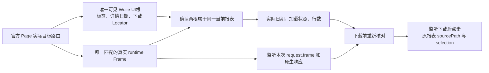

# T1110 最小 DOM 修正设计独立核对（2026-10-10）

本次为只读设计与源码消费链审查，评审模式为 homogeneous inherited。根目录为 /Users/zyongzhu/.codex/worktrees/wechat-stats-evidence/Thirdspace-creator，读取时 HEAD 为 b7a345592ee0abc6b6fa749b409967ad42ee83d1。没有修改共享源码、流程文件或任务状态，没有运行测试、浏览器、服务、API或新的原生实验；本文仅写 /tmp。

结论：公众号“当前官方 settingpage 直接读字段”和视频号“可见 UI Locator 与运行时 Frame 分开”是针对实际反例的最小修正方向。拟方案可保持现有 worker/backend 契约、五种报告、日期口径、逐报告提交、队列/profile归属和原期限。生产候选尚未提交给本评审，以下是采纳时必须核对的约束与必要行为 RED，不是候选实现或产品 PASS。

## 1. 本轮能依据的事实与恢复前提

公众号当前官方设置页实际有三个完整设置URL，action 为 index/index/function，且 AppID 标签唯一。这使当前无条件要求 settingpage 完整URL唯一的入口阶段构成反例；筛 action=index 仍有两个URL，不能解决。它不证明历史产品任务56的实际失败原因。

视频号同一现页已实际位于 /platform/statistic/post，唯一可见 open WUJIE-APP 中标签各1；对应 /micro/statistic/post 的隐藏 iframe 原生 document 标签0、代理 document 标签1。当前 Playwright Frame locator 从 utility realm 原生 document 查询，固定 Frame scope 无法找到主 Page 的可见 Shadow UI。过去 EXP2 落首页的原因仍未知，不能由这次已到统计页的证据倒推 Cookie 或导航根因。

已读取 /tmp/t1110-full-research-validation-20261010.json：记录两个真实命令 exit0、stateWrite=false/eventWrite=false。mechanism 是实际 CDP native/proxy/shadow 只读比较，不声称运行了 Playwright locator；boundary 是保留历史失败和原源码边界的核对，明确不是本轮公共DB新读。本评审不代替 collection_audit 的完整 CLOSE/兼容恢复核验。生产修改必须在该核验完成、有效 research_resume 事件及唯一 taskctl 状态恢复实际完成之后；不得用本文、TDD或另一个任务标签跳过仍OPEN的研究门。

## 2. 公众号：只消除重复入口前置条件

wechat-dom-witness.ts:150–161 的 identityWitness.read 应先以原 nativeUrl 校验当前官方 origin、无凭据和真实 pathname。当 pathname 已为 /cgi-bin/settingpage 时，直接进入原 readWechatIdentityDom 的 AppID/名称观察；不再收集菜单或 goto。其他页面保留当前完整实际href去重后唯一、导航再读字段的链。

保留原480000字段观察预算与 op 原期限；不是一次缺字段立即判未登录，也不是读到任意“AppID”文字就成功。readWechatIdentityDom 的唯一可见账号设置项、AppID格式、名称非空、来源pathname及 source.identity 的 expectedIdentity 匹配保持。不要改 action 筛选、取第一项、移除query后拼URL或用昵称兜底。

readIdentity/login 的公共 source 起步仍会先 goto 官方起点；因此仅测直接调用 identityWitness.read 不足。必要的真实source合成用例应模拟起点导航后平台实际落到 settingpage，证明该路径随后跳过入口收集而成功读身份。也保留非设置页唯一实际href链。

## 3. 视频号：两种 root 分工，不能只替换一个 getByText

当前 prepare（wechat-dom-witness.ts:164起）将 scope 同时用于 Frame.getByText、日期Locator、readWechatReportDom及 works request.frame。修正后建议函数内部分别持有：
- runtimeFrame：唯一、官方origin、精确 /micro/statistic/post 或 /micro/statistic/follower 的真实 Frame。
- uiRoot：唯一可见且 open Shadow 的 WUJIE-APP Locator；真实可见普通 iframe 的兼容路径以 runtimeFrame 作为 uiRoot。

所有标签、详情7/30天控件、下载入口必须同用选定 uiRoot。不能只把 tab 改 Page 查询后仍从隐藏 Frame 取日期和 download；也不能全 Page 宽搜后 first/force/show。Wujie host自身唯一还不够，原精确 section 和详情日期控件仍须唯一。普通可见 iframe 的原合法路径继续有效，缺 Wujie 不能自动把一个隐藏、空白 iframe 判为合法UI。

主 Page pathname 与 Frame pathname须按同一kind固定配对，daily/works 对 post，followers 对 follower；每次实际ready读取、下载前verify都要保有这个关联，防止宿主导航后旧Frame与旧日期仍“自证就绪”。无真实目标路由、重复匹配Frame/host、错误 section 或变化的根，不可静默选第一项。修正是协议定位，不新增语义/审美质量门。

### frame.evaluate 哪些可以保留、哪些不能机械保留

readWechatReportDom（:71起）使用 Frame.evaluate 的 main realm，Wujie代理 document 因而仍可能正确读取可见 Shadow 的 filter-row、加载状态、日期、作品总数；它与 Frame.getByText 的 utility realm 是不同消费者。不能因 locator 原生DOM为空就把所有 evaluate 也改成主 Page：现有 Page.evaluate 的 document.querySelectorAll 不会自行穿 Shadow。

但保留这个 evaluate 必须实际关联代理所读DOM与选定可见 uiRoot，不能只拼接“UI标签在唯一host中”与“日期在某个同pathFrame代理中”两份无关联证明。若同源 Wujie 的代理body/实际查询节点能够机械证明属于所选host的 open Shadow，该读取可以保留；实际选到普通可见 iframe 时继续原 Frame读取。若候选无法建立该关联，则要把同一字段读取限定到所选host Shadow，而不能假装未经约束的 frame.evaluate 已满足绑定。无需公开正文或URL；内部节点关联/布尔证明即可，也不应凭空增加已知事实没有支持的Wujie属性名。

readWechatReportDom 目前在整个代理 document 查询，且 visible() 只检查当前节点样式、hidden祖先和rect，没有完整证明宿主根可见。新分支不能依靠它替代 host可见性/所属根检查。详情行仍固定 filter-row 含 filter-extra；不选趋势控件。所有加载态、表格日期、作品页总数、visibleRows、response.totalCount 的原校验保持。新的UI定位成功不代表数据30天已刷新。

works请求必须仍以 runtimeFrame 判断 request.frame()；监听先于30天点击，只接受本次监听到的、官方固定endpoint、实际请求日期匹配的响应。不能拿 uiRoot/Page.mainFrame 替代真实请求frame，不能放宽到任意同源响应。

## 4. prepared.scope、sourcePath 与既有消费者

已搜索这两份源文件。WechatPreparedReport.scope 类型为 Page|Frame（wechat-browser-source.ts:78）；receiveReport（:165/:169/:180）使用它的 url() 做官方URL与原生href base校验，点击来自独立 prepared.download Locator。故可以保留 scope=runtimeFrame，并让 download 来自 uiRoot，不必修改共享接口为 Locator，更不应改backend/service契约。

readWechatReportDom 使用runtimeFrame.url精确检查 /micro/statistic/...；而最终 report.sourcePath 在 receiveReport 固定为 /platform/statistic/...。二者各自代表运行时页与对外脱敏入口路径，不应把含token/hash/query的完整URL写进回执，也不应将 sourcePath 改成隐藏iframe路径。原selection、expectedRows、文件bytes的下载后校验及回调时机不动。

另有通用 createWechatNativeDomReportWitness（browser-source.ts:318起），正式 persistence-client 装配的是 createVerifiedWechatDomWitnesses。最小修改应落实际正式装配路径，不借机改通用端口的既有行为。测试同样必须至少经过实际正式factory，不能只证明一个没有被产品消费的新helper。

## 5. 导航、预算与失败观察

公开研究 docs/research/2026-10-09-channels-native-export.md:11–13 给出的实际路线是“数据中心→视频数据”及“数据中心→关注者数据”，不是泛称“关注者”。现有公开证据支持这些实际文本与路线，未给出特定CSS/role属性；可从唯一可见 exact 文本建立定位，不可发明 class、role、test-id或猜新href。菜单尚未展开/路由未到时沿原预算等待；只点击真实唯一入口，不深链猜测goto、重选或重发。已在真实目标路由且有效关联UI时可避免冗余菜单导航。

waitForURL 使用当前SDK支持的 timeout；现场曾使用不支持的 waitUntil 导致 TypeError，不应复制。新增每次click、URL等待、Locator观察和Frame可见性读取都要使用原controls.signal/end/timeoutMs，正执行保120000消费者预算，剩余不足沿原期限截止。外层budget原有每kind十个120000串行槽；作者须据新增实际消费者复核串行覆盖，不能仅保持那个数组就宣称覆盖，也不能把30min任务期限续长。观察循环、菜单与日期切换不创建第二任务或新的期限。

原 readMissingSectionObservation（dom-witness.ts:31）明确以同Frame取五字段；不能直接传Page-host tab Locator与无关runtimeFrame组成混合快照，继续称“同frame五字段”。保持普通iframe分支原五字段与原错误。Wujie分支如果无法维持字段真实出处，可不附加可选observation；不可把host可见改名当 frameElementVisible，更不可新增正文、URL或auth字段。该问题是内部事实准确性，不要求扩大public DTO或新增用户许可。原 typed错误、cancel/deadline优先、single诊断、默认off私图和 stop所有权保持。

## 6. 必要 RED：行为反例，保留原验收断言

现有 surface() 将 evaluate 与模拟Locator放在同一 JSDOM 中，不具备 utility-native 空、main-proxy 非空、Page Shadow 可见的分裂；大部分 frame mock 也没有实际visibility/父路由。必要新增至少以下合成行为族（自造文案/ID，不复制真数据）：

1. **公众号当前页**：实际source起点goto落当前settingpage，三设置href index/index/function，唯一AppID/name成功；证明不枚举入口、不额外goto。当前settingpage字段缺失/重复仍FIELDS_NOT_READY，外站相同path拒绝。非设置页保唯一完整实际href链与ENTRY_NOT_READY。
2. **真正Wujie反例**：正式source + 内置witness，目标Page唯一可见open host、runtime iframe隐藏且原生Locator始终0、main代理实际日期有效；UI点击全部来自host。旧实现必须在该样例真实RED，新实现才能达到准备/下载链，不能将frame.getByText mock改成1消除反例。至少以works验证真实runtime请求归属、监听先于点击。
3. **根/路径不匹配**：重复可见host/匹配frame、错误mainPagepath、错误microframepath、UIhost与代理数据根不匹配、exact section重复；无force/first/日期点击/下载。不要只测试helper返回某enum。
4. **原合法iframe**：没有Wujie但真实可见匹配iframe，原daily/followers/works合法流程仍成功；保完整30天与publishedDates语义。host存在不能使合法iframe被不必要hardfail。
5. **实际导航与冻结选择**：合成菜单展开→唯一视频数据/关注者数据点击→目标路由；没有对应入口不能深链goto；日期仍tab→7→监听（works）→30，午夜不重新解释窗口。下载前根/path/日期/总数变化拒绝，不交报告。
6. **外层取消/期限与晚结果**：实际source在菜单等待、host读取或works响应期间中断；取消/原期限错误优先，晚菜单/根/响应/下载结果不点击、不回调；只有真正close/onStopped后释放。沿原source停止未确认测试，不把浏览器未停伪签完成。

现有healthy测试中的 frameElement.notCalled 原意是不取失败快照；新选择算法为了辨认实际可见iframe需要正常读 frameElement visibility，应分别证明“正常root选择”和“没有失败probe”，不要将该断言删掉却不补等价行为。原重复标签、真正missing五字段、probe异常/挂起、cancel/deadline及无正文/URL/auth泄漏的断言保留。

建议root先在生产尚未修正时应用上述测试并记录真实RED，再应用最小生产diff并记录GREEN。可使用：
`pnpm --dir ai-worker exec vitest run src/runtime/platform/wechat-dom-witness.test.ts src/runtime/platform/wechat-browser-source.test.ts`
随后按实际修改运行 worker typecheck、`node tools/timeout-policy/verify.mjs` 及SPEC所需公开调用链/边界验收。本文没有执行这些命令，不补签RED/GREEN；TDD合成通过也不替代正式原profile产品采集与QA。

本方案不要求新增报表/全量目录/发布能力，不恢复或改写旧failed0任务，不签历史首页导航根因。两次研究实验与原失败仍保留；合法恢复后的产品验收按原SPEC进行，不能借验收名称绕过尚OPEN的研究门。

