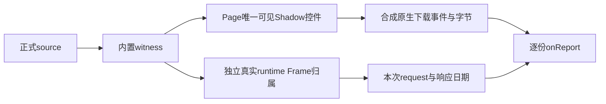

# T1110 Wujie／公众号当前设置页回归交付

仅新增工作树 `ai-worker/src/runtime/platform/wechat-wujie-regression.test.ts`，未编辑旧测试、生产、配置、任务或事件文件，未提交。当前 HEAD 为 `5f7648fa309fd4e5ab6df0ede5c32cda6e26ee79`。未启动浏览器、服务、账号采集、API或原生实验。

本次确实调用正式 `createWechatBrowserSource` 和内置 `createVerifiedWechatDomWitnesses`。浏览器对象、JSDOM、原生请求响应、下载字节和稳定ID为明确合成fixture。Wujie fixture由真实父窗口和iframe子窗口组成：原生Frame Locator查询原生空document；Frame main realm的代理query返回父Page实际open Shadow内节点。不存在把旧Frame标签mock改成1来掩盖分裂。

## 实际证据

- 前置RED：`/tmp/t1110-wujie-source-red.log`，实际exit1，2 tests／2 failed，retry0。原生产分别报 `REPORT_SECTION_MISSING`（原生标签0、iframe不可见）和 `ENTRY_NOT_READY`（公开login起点实际落在settingpage却有3个设置href）。完成后已告知主agent，随后才由其修改生产。
- 最终GREEN：`/tmp/t1110-wujie-source-final.log`，实际exit0，18 tests／18 passed，2.53s。命令使用retry0、maxWorkers1、no-file-parallelism，testTimeout和hookTimeout均180000。
- 指纹：`/tmp/t1110-wujie-source-final-meta.json` 记录本次测试前后3文件SHA及actual exit0，`inputsUnchanged=true`。
- worker类型：`/tmp/t1110-wujie-new-test-typecheck-final.log`，实际 `pnpm exec tsc --noEmit` exit0；空日志为真实无错误输出。
- 后加预算单例：`/tmp/t1110-wujie-source-budget.log`，实际1 passed／17 skipped；没有前置RED，不称为补拍TDD。

首个类型检查日志 `/tmp/t1110-wujie-new-test-typecheck-initial.log` 保留了fixture的Window类型错误，已仅在新增文件中修正。首轮扩展日志 `/tmp/t1110-wujie-expanded-first.log` 保留了1 failed／14 passed及未及时处理的assertion rejection：该fixture将父deadline设为240000，却先触发SDK120000等待上限，故错误地期望父期限错误。已将此deadline反例改为原父120000（正单次预算仍120000），并即时附assertion拒绝处理器；取消反例保240000。

早期用onReport两次各推进2900000ms的预算写法已删除。对应旧快照证据保留在 `/tmp/t1110-wujie-source-superseded-callback-budget.log` 和同名meta；不能将其当作新增消费者预算证据。最终预算case按正式source真实执行步骤推进合成时钟：启动1090000＜1120000、身份字段观察470000＜480000，其余各SDK动作／有限就绪阶段110000＜120000，下载及works响应监听与点击重叠不重复计时，onReport即时返回。实际断言逐段时间账本之和等于总耗时且5570000＜总耗时＜7370000，完整3份交回。它证明这一合法慢成功样例可完成，并未穷尽所有串行消费者最坏耗时组合。

## 覆盖及界限

18例包括首份日报交回后明确合成截停、三份完整source链及fresh request的真实Frame归属、普通可见iframe三份合法下载、重复host／frame／exact section、代理错根、下载前Page路径及pin host变化、日期切换期间取消、响应等待的取消／原期限及停止后的晚响应，以及公众号当前设置页3href成功和字段缺失／AppID重复／外站负例。菜单href为 `javascript:;`；完整source链明确只经真实可见视频数据／关注者数据点击导航，goto只用于原起点和普通身份首页。

合成链通过不代签真人扫码、实际产品采集、五份真实文件、Chrome可用性、QA旅程或整体任务Gate；未改写任何真实失败任务。

最终文件SHA：

- 新测试：`b581ee9f3448ecc73aecd3a092d68c3d1faa0cf228b5eb611713843c554c1548`
- `wechat-dom-witness.ts`：`10d7b940110ffc96316c2687bae539259c2ba22feabebde34a57d12144c1048b`
- `wechat-browser-source.ts`：`f172f920fefc08a2c00d39e753eda97a0e0391369bc7064f60d2c6bd48403d0c`
