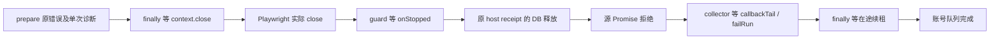

# T1110 EXP1 诊断后仍 running：只读源码审计

审计基线：共享树 HEAD `69ac739d8e355037eb7e3a8a9e3eb1249dfd0361`。产品源文件本轮未改；研究文档和控制面有未提交变化。只读源码及既有测试文字；未运行测试、公共 API、浏览器、进程检查、真实 DB/profile。EXP1 的实际状态均来自 root，不是本审计独立取证。candidate clone 与共享生产源是两个证据范围，不以 candidate 的输出冒充共享源部署。

## 结论

存在明确的等待链，当前证据不足证明死锁，也不足确定正在等待哪一个 Promise。诊断已发出，不等于浏览器源操作已经拒绝、更不等于 CollectionRun 已写终态。EXP1 的 `SKIPPED_CURRENT_PATH` 只证明取图前保护所见路径不符；0 图片、0 Chrome 采样、无 ready marker 均不能证明 profile DB 释放完成。不能据此改登录状态、换 Cookie、解锁 profile 或创建新 intent。



## 可核验的等待点

以下路径相对于项目根 `/Users/zyongzhu/.codex/worktrees/canvas-binding-fixes/Thirdspace-creator`。

1. `ai-worker/src/runtime/platform/wechat-browser-source.ts:263–272`：catch 在 264 先 emitDiagnostic，随后 finally 在 272 await closeProfile。137–141 的 closeProfile 只有 **close 拒绝** 才调用 onStopUnconfirmed；close 持续 pending 时不会进入此回调。故 pendingWechatStops 中没有登记也不证明关闭已完成。
2. `ai-worker/src/runtime/browser/chromium-guard.ts:293–299`：受管 ctx.close 串行 await 原 close，再 await release。256–262 的 notifyStopped 等真实 opts.onStopped；277–289 的 release 等其成功后才减少 liveContext、交还 profile 队列并取消 shutdown 注册。close 事件和 close 主路径共用 releasePending，不构成两个已证实重复释放。
3. `backend/src/application/collection/wechat-native-collector.ts:100–104` → `backend/src/modules/execution/host-browser-profile-lifecycle.ts:57–60` → `backend/src/modules/execution/execution-browser-profile-lease.service.ts:139–148`：onStopped 等原 owner、leaseId 对应事务；事务先 select for update，再写 releasedAt。当前没有实际 DB 等待证据，不能推断锁竞争。
4. `backend/src/application/collection/wechat-native-collector.ts:188–203`：当前正在等整个 browserOperation，包含上述 finally 关闭。源错误尚未穿出，就尚未进入 213 后的失败持久化。
5. 失败进入后仍可能等 callbackTail（215）、failRun（227），以及 finally 的 renewalInFlight（239）。`backend/src/modules/platform-collection/platform-collection.service.ts:512–523` 的 failRun 是另一事务。0 报告不能独立证明不存在未完成的解析/提交回调。
6. `frontend/src/server/persistence-client.ts:4690–4698` 为实际薄装配：renewLease/failRun/profile onStopped 均接真实服务，collectReports await worker 源。4888–4902 的 active attempt Map 与 `backend/src/application/scheduling/account-collection-queue.ts:12–20` 保留完整执行 Promise；只取消等待者不会提前交还已开始的账号槽。

这些是可重复定位的 await 接缝；现有安全诊断并未给出这些 Promise 的开始/完成 witness，因此不能给实际等待点签确定结论。增加接缝日志/实验属于新的研究步骤，本审计不实施、不消耗 EXP2 路径观察额度。

## 原期限与合法收尾

- collector 的期限是 `run.startedAt + 30min`（collector:56、85、160–161），没有从诊断时刻续期。期限/原父 signal 会中止 188–203 的外层等待，即使底层 close 忽略 abort，停止接收晚报表，并尝试以原世代记录 TASK_TIMEOUT/取消；不能把“独立外层到点退出浏览器等待”扩大解释为 DB 事务、在途续租也必定即时完成。
- 此行为已有源码测试 `wechat-native-collector.test.ts:184–204`；246–253 也明确关闭跨心跳时继续续原租约。本轮仅读，未重跑，不新增 PASS 证据。
- 若本次研究决定停止，现有公开 **取消原 attempt** 路径为 `POST /accounts/:accountId/collections/:attemptId/cancel`（contract/src/operations/platform-collection.ts:52；transport:58–60）。service:494–506 校验原 user/account/group，写原 run cancelled、generation+1、清采集 token；保留原任务 ID 与已保存日志、不创建新任务；该 run 的 reasonCode 会改为 CANCELLED。
- 该公开 cancel **没有直接给浏览器 AbortController 发 signal**。正在运行的 collector 通过下一次串行续租被拒而 abort LEASE_LOST（collector:105–117；service:399–406）；正常无在途事务阻塞时下一次调度间隔为 20s，但并非关闭完成的硬上限。旧 failRun/page 不能覆盖已取消新世代（service:517–519、537–540）。取消采集账本也不授权提前释放宿主 profile。
- 因而建议：保持原 ID，先按研究决定等待其原期限，或由 root 明确停止本次研究时取消该原 attempt；不另发 key、不把诊断后的 running 自动作为重试条件。若原期限以后仍无终态，应记录哪一 await 尚无完成 witness，而不是延长预算或凭 Chrome 数目写 releasedAt。

## 宿主停止与恢复边界

`frontend/src/server/browser-host-dispose.ts:6–10` 先 seal，再同时停 worker 和 drain，均成功后才关 DB。scope:15–19 会等已注册 close/launch 的真实 Promise；它本身不能证明 pending close 会很快收敛。源码不支持以“进程数为 0”跳过 drain 或先关 DB。

既有跨重启恢复仅在 acquire 读取 **精确旧 host receipt** 且证明旧宿主停止后释放（host-browser-profile-lifecycle:42–46；lease.service:129–135）。process-recovery:134 明确拒绝当前进程 owner，147 也检查其他宿主而非只 Chrome。不能在当前宿主中用通用 OS 0 冒充这一证明。温和停止应沿原 disposer；若停止链未完成，保留真实未完成记录，不能签已停止/已释放。任何强制终止、重启或实际租约操作不在本审计动作范围内。

## 文件 SHA 与复查命令

- wechat-browser-source.ts：`ec7c53bc4c83bb57b8f707acd2ba1602f6722f9626c6a3843f8b3031814df19a`
- chromium-guard.ts：`1cd4ced2481f5f4b69b757fa077d1a502924554dff77d41bd257cb9f017eac9f`
- wechat-native-collector.ts：`c09b829dc9ecf0b19b8b89ffa901a732f68500018d94b32d20d11d0a93f02dd9`

仅源码复查（不访问数据或服务）：

```sh
git rev-parse HEAD
nl -ba ai-worker/src/runtime/platform/wechat-browser-source.ts | sed -n '137,141p;247,273p'
nl -ba ai-worker/src/runtime/browser/chromium-guard.ts | sed -n '256,299p'
nl -ba backend/src/application/collection/wechat-native-collector.ts | sed -n '100,117p;179,245p'
nl -ba backend/src/modules/execution/host-browser-profile-lifecycle.ts | sed -n '42,60p'
nl -ba backend/src/modules/platform-collection/platform-collection.service.ts | sed -n '399,406p;494,524p'
```

本报告不代签真实平台、采集通过、稳定身份/日期或停止验收；也不修改 Research-First Gate 的至多两次区分实验限制。
