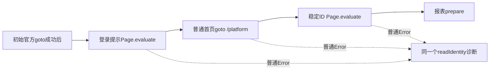

# T1110 本次readIdentity普通失败：只读分析

结论：本次只能确定在进入报表prepare之前，身份链中的一个操作抛出了普通异常。当前诊断把登录提示扫描、普通账号页导航和稳定身份DOM读取合并为 `readIdentity`，无法凭现有结果确定是哪一个，更不能据此判断Cookie失效。全量DOM扫描存在确定的重复遍历风险；尚无证据证明它导致这次真实16秒失败。

读取根目录 `/Users/zyongzhu/.codex/worktrees/wechat-stats-evidence/Thirdspace-creator`，HEAD `39dcfae6499c60222b31908411c391ee7a7d79f9`。未修改工作树、配置、任务或事件；未操作浏览器、profile、服务、API，也未读取Cookie、凭据或稳定身份正文。仅解析指定公开结果的安全元字段，并在 `/tmp` 运行明确合成DOM算法访问次数观察。

## 已确认事实

指定公开结果文件 `/tmp/creatoros-t1110-fullpage.BmfWDn/dom-correction-manual-sync-read-20261010.json` 的元字段为：nativeReports、failed、reasonCode=EXPORT_FAILED、committedPages=0；reports.list total=0。startedAt 为 `2026-10-10T04:16:03.635Z`，updatedAt 为 `2026-10-10T04:16:19.746Z`，两者相差16111ms。根提供的安全日志为 `readIdentity / BROWSER_OPERATION_FAILED / Error`，无failureKind。没有重发或改写原 `collection-51a95619-62`。

源码SHA与前次一致：browser source `f172f920fefc08a2c00d39e753eda97a0e0391369bc7064f60d2c6bd48403d0c`；DOM witness `10d7b940110ffc96316c2687bae539259c2ba22feabebde34a57d12144c1048b`。

`wechat-browser-source.ts:285–287` 表明collect/readIdentity先调用isLoggedOut，再调用read。`source.login` 在同文件:297传login=true，因此绑定成功路径跳过isLoggedOut。这是两条链的真实差异，原绑定succeeded不能证明登录扫描健康。

`wechat-dom-witness.ts:145–160` 的登录扫描先检查signal与官方origin，再执行Page.evaluate；`read:163`另做一次 `/platform` goto，之后:173以480000观察 `readWechatIdentityDom`；后者:50–68先核origin/path，再执行另一Page.evaluate。三个操作都可能在同一个readIdentity阶段拒绝。

`wechat-browser-source.ts:273–279` 在转换普通异常前只发一次诊断，保留取消/期限优先并最终关闭context。`protocolFailure:49–56`只识别四个固定message模式，所以无failureKind仅表示没有匹配这四项。`backend/src/application/collection/wechat-native-collector.ts:59–64` 把不认识的worker错误码归为EXPORT_FAILED；并不等价于下载实际开始或失败。

## 哪些普通Error有源码依据，哪些仍未知

| 操作 | 可产生普通异常的接缝 | 本次是否已证明 |
|---|---|---|
| 登录probe | Page.evaluate上下文销毁；DOM回调本身抛错；renderer/transport异常 | 未知，只有阶段合并日志 |
| `/platform`导航 | 导航被另一导航打断、页面崩溃、frame detach、未列入四项的网络协议失败 | 未知，没有该次导航的固定分段证据 |
| 稳定ID读取 | 第二次Page.evaluate上下文销毁或回调抛错 | 未知，未证明本次已到字段读取 |
| 普通字段缺失 | 正常返回null，继续原观察；耗尽后是typed IDENTITY_MISSING | 现有generic Error不支持将它直接当根因 |
| 明确登录提示 | isLoggedOut返回true后是typed LOGIN_REQUIRED | 本次诊断及公开状态未给出此证据 |

本机安装SDK1.60的 `node_modules/.pnpm/playwright-core@1.60.0/node_modules/playwright-core/lib/coreBundle.js:34278–34287` 会把某些非JS/非session关闭协议错误改成 `Error("Execution context was destroyed, most likely because of a navigation.")`；这一字符串不在目前四项分类中。:34336–34340、:34365–34368将浏览器回调的exceptionDetails包装为JavaScriptErrorInEvaluate；:15838该类仅extends Error，没有重设name。因此日志exceptionName=Error也不能排除浏览器回调内的TypeError或ReferenceError。:17619提供导航被另一导航打断的普通错误路径，:19848提供Page crashed路径。以上仅证明SDK存在这些通路，不证明这次命中任何一条。

当前源码回调在源级别没有外部词表、__name等闭包helper依赖；实际Next部署后送入evaluate的函数字符串没有在本轮取得，所以不能把编译helper缺失定为根因。可在隔离编译工件上检查该字符串的hash和固定自由helper存在布尔，再以合成DOM执行；不输出函数正文、页面正文或身份。

## 全量div扫描的确定风险

每个h1/h2/h3/p/span/div都重新创建TreeWalker，扫描其所有后代文本；每段文本又调用visible，并逐级读祖先getComputedStyle。嵌套容器使相同文本被多次扫描。源码没有节点访问上限、局部yield或回调内signal检查。`observe:26–28`必须等read返回才能检查局部时限；同理同步evaluate回调不能直接接收Node端AbortSignal。外层source原deadline与close仍在，不等于该局部扫描没有任何总限制，但局部扫描本身的工作量未被限制。

已执行 `/tmp/t1110-identity-probe-synthetic-20261010.cjs`。它从正式源码AST提取实际isLoggedOut evaluate回调，使用完全自造DOM、固定布局stub，只统计算法访问次数；没有浏览器、网络、真实数据或profile。

| 合成嵌套div深度 | TreeWalker数 | nextNode调用 | getComputedStyle调用 | 结果 |
|---|---:|---:|---:|---|
| 16 | 16 | 152 | 2088 | false，无异常 |
| 32 | 32 | 560 | 13648 | false，无异常 |
| 64 | 64 | 2144 | 97952 | false，无异常 |

实际输出保存在 `/tmp/t1110-identity-probe-synthetic-20261010.json`。这证明重复遍历风险，不测真实浏览器耗时，也不证明实际页面有这种结构或已经崩溃。16111ms失败同样不足以证明耗尽120000或480000预算。

## 下一步最小脱敏取证建议

先离线验证内部诊断细分，不优化DOM、放宽登录判断或重发原任务。最小分段是固定 `identityStep: loginProbe | accountNavigation | accountFields`，只在真正对应调用前设置，失败仍走原single诊断；不得改变对外错误码/状态、旧attempt、stop确认、signal或原deadline。直接记录call标记不需要另做Page.evaluate、截图或导航。

可再在既有message只读分类器中新增固定 `EVALUATION_CONTEXT_LOST / NAVIGATION_INTERRUPTED / PAGE_CRASHED`，依据当前安装SDK固定协议串；只输出枚举，不输出message、stack、URL或query。若需要辅助页面状态，只用当前Page的同步isClosed及官方origin/固定pathname分类布尔（root/home/other/invalid），所有取证异常忽略，保原错误和取消/期限优先；不额外读DOM、稳定ID或登录QR，也不扩大私图的typed prepare保护范围。

必要合成回归是把三处分别注入含秘密的普通Error，确认实际source均普通失败、正确固定identityStep、一次诊断、无秘密输出、close/onStopped；再注入上下文销毁及未知普通Error，确认分类白名单而不误报LOGIN_REQUIRED。若拟消除重复扫描，应另证明原隐藏文字、嵌套隐藏祖先、可见分段登录提示、普通有效页面和dense DOM的同一确定判断，先实际RED再修改，不能因node数量大就当作登录失效或hard-fail。

本建议不授权第三次原生盲试、追加研究额度、新采集intent、重新扫码或重放原failed任务；本轮未做任何这类操作。当前仍未知的是首次失败的准确子步骤与SDK错误类别，保留原失败作为事实。
