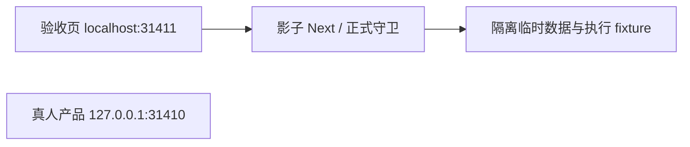

# T1110 开发资源 origin 与网络诊断最窄候选

只读基线 `ee79dfc45e417157275bb2c51359de54d476ae26`。只写本目录，不改共享树，不访问31410/31411，不启动Next，不操作Ego/Chrome。主任务已保存旧实际失败日志；本候选不重演服务或添加大批纯函数测试，不改当前dark视觉基线。

## 有依据的结论

安装的Next16.2.9 `dist/server/lib/router-utils/block-cross-site-dev.js` 77–113行：开发资源默认允许 `*.localhost`、`localhost`，再追加启动hostname。当前启动hostname为 `::1`，URL解析器将Origin/Referer `http://[::1]:31411` 的hostname解析为 `[::1]`；精确匹配不会把这两个字符串当同一个主机。因此Origin/HMR及带cross-site/no-cors的Referer可能被403拦截。该函数同时消费于HTTP请求和websocket upgrade。root的实际Blocked日志与此机械差异吻合；不能据此宣称后续hydration及完整页面已通过。

正式 `frontend/src/lib/loopback-core.ts` 明确包含localhost、127.0.0.1、::1，正式dispatch仍先调用同一isTrustedLocalRequest。QA starter保留原精简环境，未注入握手绕过。正式proxy、安全guard、Next config没有改动。

候选将QA origin和listener都设为localhost：默认Next allowlist直接匹配，监听仍由localhost解析到loopback。本机只读 `/etc/hosts` 显示127.0.0.1和::1均配置localhost。保留listener=::1、仅origin=localhost在Next origin匹配规则上也允许，但实际连接还依赖客户端localhost解析到::1；未实测该候选。统一listener/local origin更容易复用标准启动路径，无需增加allowedDevOrigins。

localhost与root明确的127.0.0.1产品不同主机；Host-only cookie不会因两者连接同一loopback IP而互通，localStorage也属于不同origin。端口本身不能隔离cookie。这里不声称新的browser profile，亦不声称隔离其它localhost应用；没有读取任何Cookie/profile来作该声明。正式session与当前组cookie代码均未设置Domain。

## 补丁范围

`localhost-origin-network.patch`仅含QA starter、runner、RUN_INSTRUCTIONS：

- starter origin与`--hostname`统一localhost；预算、临时data/auth/runtime、API fixture composition、binding proof边界全部保持。
- runner严格hostname断言同步；仍拒绝覆盖非空白/非本影子origin页面。stop只核PID+shadow进程归属，故无需变更。
- 开始监视前 `page.events()` 的旧buffer单列preJourneyEvents。Ego文档确认events()会返回并清空buffer；只对root指定测试Page作用。首页goto后的新事件改为正常drain，避免静默丢失真正的本轮浏览器错误或外联尝试。
- 当轮HTTP/HTTPS/WS/WSS记录protocol、origin、method；WS映射HTTP、WSS映射HTTPS后严格核同源。真实其它http(s)/ws(s) origin仍进入external并使全绿检查失败。其它协议单列nonHttpRequests，不把opaque origin=null称作外联。URL无法解析单列unparseableNetworkRequests且阻止全绿。

旧19个 `{origin:'null',method:'GET'}` 未保存protocol，无法证明是哪类请求，也不能据此断言没有外联。旧失败不回写PASS、不重分类为通过。下一轮记录真实protocol与本轮监视范围，再由root检查当场截图/状态/日志。

## 已做与待做

本轮实际 `node --check` 两候选脚本和 `git apply --check` 全退出0；没有运行浏览器、服务、Next纯函数或fixture。源码关键输入SHA见candidate-manifest.json。

root唯一writer review后采纳补丁、冻结新HEAD，再按原准备/启动命令产生新server-state。旧[::1] state不用于新runner；不得直接覆盖旧失败截图或结果。root已停止旧helper并将指定Page恢复空白，下一轮页面操作和截图仍由root统一执行。当前产品config/security/组件不需要改动；若下一轮仍停在加载中，以新的真实日志定位，不能预签页面PASS。
