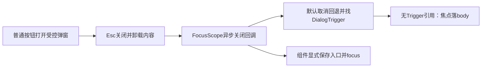

# T1110 平台扫码弹窗焦点失败独立只读诊断

日期：2026-10-10T04:24:24.466452+00:00。冻结失败源码：`39dcfae6499c60222b31908411c391ee7a7d79f9`，实际repo：`/Users/zyongzhu/.codex/worktrees/wechat-stats-evidence/Thirdspace-creator`；指定shadow：`/var/folders/0f/yn6rgq1j2lj2n8_868n28jzc0000gn/T/creatoros-t1110-shadow-59QWfo/source`。本次判断用上述冻结影子源码与git show核对，不用main分支当前不同源码代签。

结论：存在真实UI焦点返回缺口，同时原QA即时断言缺少异步焦点等待。不能仅靠放宽测试把这次失败变成通过。root提出的单组件ref/onCloseAutoFocus修法与该缺口直接对应，范围合适。

## 实际失败与证据边界

root实际same Ego20/p5旅程在1366×900打开公众号扫码弹窗，按Esc后`noDialog()`完成，接着即时检查activeElement文字为原按钮返回false。journey outcome=failed，receiptWritten=false，browserErrors=[]，external=[]，只保存3个截图，尚未开始剩余完整旅程。没有activeElement详细值或延时观察，因此单靠此receipt不能证明焦点一直不返回。

已实际查看 `entry-dialog-wechatOfficial-1366.png` 与 `failure.png`：前者显示扫码弹窗，后者弹窗已关闭、原表格扫码按钮仍在页面。图像支持弹窗可开关，不证明DOM实际焦点身份，也不签其它视觉/业务步骤PASS。

随后root新增真实Radix组件等待式测试，在修改production前实际2FAIL/18SKIP：公众号和视频号都先等待无dialog，再waitFor原button.toHaveFocus，接收元素均为body。这份当场RED独立于原Ego即时断言，说明实际缺口不能解释成仅仅没等一拍。本子agent只读RED日志，没有重新运行测试或浏览器。

证据SHA：

- `/var/folders/0f/yn6rgq1j2lj2n8_868n28jzc0000gn/T/creatoros-t1110-shadow-59QWfo/evidence/run-1791605930465-52512963/journey-results.json`：`e3943608b9fa8948c8920ca117ce09c65374c6066e28b6eb313dea577e067170`
- `/var/folders/0f/yn6rgq1j2lj2n8_868n28jzc0000gn/T/creatoros-t1110-shadow-59QWfo/evidence/run-1791605930465-52512963/actual-visible-copy.json`：`c8c73d68773ab6d6894638f82e1615cf5b125e020d566e1d45c5e00aa1c7f709`
- `/tmp/t1110-ego-journey-final-20261010.log`：`2c60969128676f4d87d0cda58eef5e2824b5a7d3b6be505da9eabf4804726b9d`
- `/tmp/t1110-bind-focus-red-20261010.log`：`1dcf409b3af82bb343447fbc1c7fe9fa59df88fb01327697b4c8a455ddd85c53`

冻结shadow源码SHA（与对应失败版本吻合）：

- `frontend/src/features/platform-account/account-group-manager.tsx`：`c0f3bc1a27a64ee7c4500b31d311e854e32464260b5ca50535d4ddbf653235a2`
- `frontend/src/components/ui/dialog.tsx`：`05ef54740d8ebb6dc0628bb1a35caabc4445717dab8e6bf73ad1bff87323d21b`
- `docs/verification/t1110/browser/run-ego-journey.mjs`：`cd514a5a2752140bf7d83ceb0e26796cb208e96a4a58538dc621e2f25e33e29e`

已读项目oil-ui-pro 0.10.0与UI_RULES；UI_RULES第43行要求Esc与焦点返回，oil interaction-and-state第103行明确Esc关闭后焦点返回打开元素。按既有组件模式修交互，不需要更换主题、样式或视觉方向。

## 根因与关闭时序

冻结AccountGroupManager第128行附近用普通Button的onClick设置bindingPlatform；它不是DialogTrigger。第140行的受控Dialog/DialogContent未提供onCloseAutoFocus，也未保存入口button引用。

本机真实Radix Dialog默认modal=true，triggerRef初始null，只由DialogTrigger的composed ref登记。modal的onCloseAutoFocus默认处理是先event.preventDefault，再context.triggerRef.current?.focus()。本组件没有Trigger，因而后者无目标；preventDefault又取消了FocusScope通用previouslyFocusedElement/body回退。关闭内容移除后焦点留body，和root等待式RED一致。

FocusScope卸载的AUTOFOCUS_ON_UNMOUNT另放在setTimeout(0)内。因此仅等待dialog消失不能在所有运行时保证onCloseAutoFocus已经执行；正确UI修复后，QA仍应该等待实际焦点条件。不能用固定sleep或测试主动focus原按钮来制造通过。

实际Radix主源码SHA：

- `node_modules/.pnpm/@radix-ui+react-focus-scope@1.1.10_@types+react-dom@19.2.3_@types+react@19.2.17__@types_f0bbe21e5a221b3c5e107190ad2e8f6b/node_modules/@radix-ui/react-focus-scope/dist/index.js`：`135b1e1b00ff36395cffc3d77343064247b4a2cb0c5081f1b104ff562f77b172`
- `node_modules/.pnpm/@radix-ui+react-dialog@1.1.17_@types+react-dom@19.2.3_@types+react@19.2.17__@types+reac_ad1055f68b3e879430d1360f6167c272/node_modules/@radix-ui/react-dialog/dist/index.js`：`63315a8a6f53cb011c61f3868ed656ee8f0201b4f2f84f63fec70e32bc9ffde3`

## 对root最小修法的复核

支持只改AccountGroupManager：保存点击event.currentTarget的ref；该扫码DialogContent.onCloseAutoFocus取ref，isConnected时preventDefault并focus。它精确聚焦本次入口，兼容Mac点击按钮不自动focus，避免把document.activeElement误当触发元素。现有NativeReportPanel已采用相同模式，可直接复用。

ref保存与focus不增加API、绑定任务、真实身份proof或异步服务动作。trigger已卸载时不强行聚焦脱离DOM的节点。不改Dialog全局、不改其它转组弹窗、不改扫码payload/后台任务、tokens/样式。root当前单组件最小改动可读见该模式，但未据此签生产修复PASS；实际GREEN、后续新HEAD及完整Ego均由root记录。

## 最小QA候选

文件：`/tmp/t1110-platform-binding-focus-audit/focus-wait.patch`；SHA256：`e4f26f29596ec2b2aac2ff8ea0dac5ce271a51a3156c022f9ee59a29feafbe54`。候选只改run-ego-journey：增加focusReturned(name)，在120000ms内等待真实connected/enabled原button焦点；替换平台表与native needsAuth两处即时断言。没有调用focus、没有固定sleep、没有绕过失败。超时附active tag/role/ariaLabel/dialogPresent诊断，避免下次只剩false。

本轮node --check与git apply --check各实际退出0。候选未应用、未运行Ego/服务/组件测试。旧39dc失败保持failed，不改截图和JSON；其余双视口、报告、同步/取消、切组及真实绑定恢复仍待实际验收。Ego20当前已handoff用户扫码，本子agent未访问浏览器或用户Cookie/profile/数据库。

## root 实际最小修复后只读复核

本子agent于收尾再次读取指定repo的git diff HEAD与生产文件。此时HEAD仍为`39dcfae6499c60222b31908411c391ee7a7d79f9`，生产小修尚在工作区。AccountGroupManager只新增`bindingReturnFocus` ref，扫码按钮保存`event.currentTarget`，对应扫码DialogContent的`onCloseAutoFocus`在ref节点仍连接时preventDefault并focus；与前述建议及NativeReportPanel既有模式吻合。没有修改扫码任务payload、服务端绑定逻辑、全局Dialog或样式。两项新增组件用例通过等待无dialog、再等待原入口有焦点检查公众号和视频号；测试打开前focus属于模拟键盘/已有入口焦点，不是关闭后替页面focus。

root报告当场执行：三组件文件（account-group-manager/native-report-panel/account-binding-panel）56PASS，session43915 exit0；frontend类型检查session55271 exit0；LED047八文件174PASS，session22869 exit0。这些结果明确归属root实际执行，本子agent未运行或读取完整GREEN日志，不能据此代签完整真实Chrome旅程。当前仅确认最小修源码匹配根因，QA候选仍未运行；新冻结提交及后续same Ego双视口实机焦点/其它旅程仍待root执行。旧失败证据保持原状。
