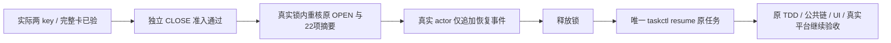

# T1110 研究门 CLOSE 独立终评：PASS（仅恢复准入）

**结论：本次完整研究验证与兼容登记条件已闭合，可以由 root 在原 state-lock 内完成 event-only research_resume，再释放锁、唯一执行 taskctl resume。** 这不是已执行关闭/恢复的回执，也不是 T1110、真人采集、公众号绑定、五报表、UI 或发布验收 PASS。任何输入/原 OPEN 漂移都须停止登记并重核，不得复用本结论。

工作根：`/Users/zyongzhu/.codex/worktrees/wechat-stats-evidence/Thirdspace-creator`；HEAD `b7a345592ee0abc6b6fa749b409967ad42ee83d1`。卡、配置及项目验证器尚未提交；本结论绑定实际文件 SHA，而非仅 HEAD。独立 actor 为 `/root/collection_audit`，homogeneous inherited。共享实现由 root 修改，本 agent 只读复审，写 /tmp 报告与隔离合成目录；没有浏览器/CDP/API/真实数据库/任务状态操作，没有新增 native 实验。

## 实际依据

已完整读项目验证器、只读观察 shell/helper、validated 研究卡、原实验/失败/清理工件、机制独评，以及 root 当场实际 full-card 输出。研究卡保原 T1110/task/research_task/family/card/open-trigger，两个原实验仍 EXP1 取消、EXP2 自然失败，原 54 failed/0 未被改写；EXP2 导航落首页原因仍 UNKNOWN。卡的 recommendation 为原 option 的准确 ID，至少两个候选与两个 criteria，证据 SHA、暂停动作、时间/实验上限均有检查。

项目 full-card 等价覆盖当前 vendored 完整卡要求，并对本次纯机械实现选择收窄为 `decision_impacts=['none'], decision_ids=[]`；遇任何高影响声明均拒绝，不能替代未来必要用户 DEC。程序与结果明确未调用官方 private validator 或 research-gate resume CLI，没有状态/事件写入。

root 最新实际验证：2026-10-10T03:47:47.251Z，tool chunk `6cfbac`，`/tmp/t1110-full-research-validation-20261010.json`。完整检查实际执行两条不同 key 的精确命令，各 exit0；本 agent 没有重新运行真实浏览器命令，仅核输出、摘要及当前文件：

| key | 实际命令 | 输出 SHA |
|---|---|---|
| t1110_wechat_section_mechanism | zsh tools/verification/t1110-scope-observe.sh | b8ca8d8c0b172706401f7cf16ff45c9f2a534a6a937491349ef58d5a5af43fa7 |
| t1110_wechat_section_boundary | node tools/verification/t1110-research.mjs boundary | 038dd00ab3e1ee79041c4d87ee65528e673f28d11e964393ce9e58c368f1e596 |

机制输出是原 space20/p6、ownership=agent、官方固定 post 页、唯一可见 open Wujie ShadowRoot，三标签 native0/proxy1/Shadow可见1；新增 native Node.getRootNode 与 ShadowRoot.contains 布尔证明确属同一可见根。测量方法是 CDP 主 realm，不冒称 Playwright locator 调用或产品 profile 实测。官方机制与本机 utility 查询链由已有独评支持；它淘汰当前“隐藏 sandbox 原生 DOM 是可见数据画面”的解释，不解释全部旧失败。

边界输出明确 `currentPublicDatabaseRead=false`、历史时点2026-10-09T17:23:42Z；它签历史失败/0报告与原两实验、生产四文件对69ac的字节比较、只读动作及原 OPEN，不签当前 Cookie/DB 或正式停止 receipt。本轮没有第三次 native 运行。

## 初轮 finding 的实际闭合

初轮完整报告保存在 `/tmp/t1110-close-review-initial-20261010.md`；反例及旧脚本副本保存在 `/tmp/t1110-close-fixtures-8v4ogiwy`。当场证实：验收检查后变更生产源或 authoritative SPEC，旧 full-card 仍 exit0；缺观察结果时旧 helper 回显合成私密标记。这些历史失败不删除、不补拍。

最终源修复已核：

- research.mjs:19–20 将生产四文件及所有本地 authoritative refs 纳入前后 inventory；:54 捕获期间漂移，返回 inputSha 供真实锁内重核。
- :45 固定两条精确命令；:53 不回显原始子错误。
- scope-check.mjs:5 缺结果用固定错误；scope-observe.sh:18 主 pathname 仅固定报告页或 other，:17 的 frame path 已按固定 micro path 筛选。
- shell/helper 仅原 taskSpace(20)/p6 的 Runtime 读，120000ms 执行与150000ms请求，full-card240000ms外层；无导航/点击/下载/新空间/新任务/Cookie读取/业务提交。

本 agent 对最终实际脚本做 **14 项隔离探针，全部符合预期**，tool chunks `de8d59/57d4db`；汇总 `/tmp/t1110-close-final-fixtures-z0wzq8nc/summary.json`。配置保持实际精确命令，仅 PATH 内 Ego/git 为明确 /tmp 合成替身：

- 正常控制接受，返回库存包含生产源码和 SPEC。
- 错 OPEN family、错 evidence hash、缺命令、任意 exit0 替身、未批准 high impact、researching 均拒绝。
- 证据/生产源码/SPEC/配置在末次源码检查后发生漂移，均拒绝。
- 错官方 origin、代理标签不属同一 Shadow 根均拒绝。
- 缺观察 JSON 的合成错误被拒，私密标记不进入 stderr。
- 所有探针 BACKLOG/events 摘要前后不变，无真实浏览器/API。合成结果仅验证工具边界，不签真人。

## 可用于登记的冻结指纹

本 agent 当场重新计算 root 最新结果的所有 **22** 项 inputSha；与当前文件全部相同。两个 command 输出摘要及原 OPEN 摘要重新计算一致。详情保存在 `/tmp/t1110-close-input-fingerprint-20261010.json`。

- full-card 工件 SHA：`2a13bacebc99f762d269848510c4f2f412fc7838a87f326d5e596bedc51bb3fd`
- 原 OPEN SHA：`cdd51a96cca098f547217fe6aee8d28a286f808b039b9dc5ce037700b696c065`
- validated 卡 SHA：`445a6df493fedc352c0e8c4f5f35dee5e059ba91598161f2567b6e4f700bebbf`
- 22 项排序库存摘要：`5c6b74abcd304de379f640739c607e62fef882980a8c95530d63636516a53c00`，算法为 UTF8 的 `JSON.stringify(Object.fromEntries(Object.keys(inputSha256).sort().map(k=>[k,inputSha256[k]])))` 后 SHA256。
- 最终 research.mjs SHA：`0af3df108810916f283844dc975d383c26645ddc7d3b2ebed108f209ee094f46`
- observe.sh SHA：`c1ee5509b4c41dd45f1ef3509b74cb7865a0eab8bd64ce214a431fcd5d3069e5`
- scope-check.mjs SHA：`d88ebcb3c11f34b0dc24d631b437160c1d152265a4a0c3d83adb3ce8878b3a83`
- vendored research-gate.mjs SHA 仍：`75203cb538a65b776ee1b75db08b4335b4cbb29fd9e829792565f669891d9ab6`，未修改 vendor。

## 允许的实际下一步及限界

root 唯一 writer 在真实 acquireStateLock 下重新读取原任务仍⏸、同一 active OPEN、上述完整输入及实际输出/本报告 SHA，全部一致才 append-only 登记一个 `research_resume`。actor 使用真实 `codex-policy-compatible-registration`，明确 compatibility/non-official/state_write=false、原 lineage、卡/验证结果/本次 CLOSE 评审摘要、decisions=[]。此步 BACKLOG 字节不变，不冒用 research-gate actor 或官方 validator 调用；不重写 OPEN/失败/实验记录。

释放该锁后由 taskctl resume T1110 带真实闭合证据唯一转换原状态并留原事件。若原审核 receipt、状态或其他准入拒绝，保留实际拒绝与暂停，不手改或换 start 绕过。当前 taskctl 研究检查在最终写锁之前；本方案依赖 root 唯一 writer 的串行窗口，不宣称已修复通用并发 Gate 竞态。登记与恢复间若有重开 OPEN 或输入变化，就停止。

恢复准入不重置两次 native 实验、不许可同族新一轮盲试，不扩大契约/身份/归属/日期/发布标准。后续实现及原公共链验证遵守原任务审核与 Gate；当前研究页读证不能代签生产 profile、五报表或整体任务完成。
