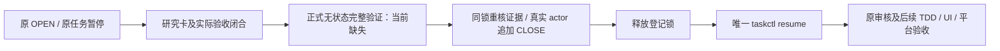

# T1110 Research Gate 恢复入口兼容核对（静态）

工作根：`/Users/zyongzhu/.codex/worktrees/wechat-stats-evidence/Thirdspace-creator`  
源码基线：`b7a345592ee0abc6b6fa749b409967ad42ee83d1`。技能与项目记录均为 `3.29.0`。路由仍是 BUILD 中 OPEN 研究门的受限分支，不是新阶段。本轮只读源码、看板、研究卡、流程与既有事件；仅生成本 /tmp 报告。未运行 browser/API、任务状态命令、研究验证命令、合成流程测试、audit/reconcile；因此没有本轮命令 PASS 或 CLOSE 收据。

## 结论

**当前没有满足用户 taskctl 唯一状态入口要求的正式恢复入口，不能现在登记 research_resume 或恢复 T1110。** 完整研究验证与状态写入被绑在同一个私有 CLI 分支；不是“加一个已存在的 verify-only 参数”即可解决。

从真实验证结果、真实 actor、真实共享锁登记 event-only CLOSE，再唯一由 taskctl resume 写状态，逻辑上可以兼容用户规则；但前提是先补正式的无状态完整验证/关闭接口并实际验证。现在仅手工追加 research_resume 会被浅审计接受，这只说明程序可被绕过，不构成合法研究闭合。

本报告不评审 ShadowRoot 修正方案、不代签它的机制结论或稳定平台验收，不继承 OPEN 审查作为 CLOSE 批准。两次 native 实验仍用尽，不可换族、新卡、新任务标签或从 resume 事件重置额度来获得第三次原生实验。



## 已核实的程序入口与缺口

所有定位相对于上述工作根。

| 接缝 | 真实代码 | 结论 |
|---|---|---|
| CLI 命令 | `orchestrator/process/research-gate.mjs:289–295,339–357` | 仅 observe/resume/audit。没有 verify、verify-only、no-state、closure-only。 |
| 导出接口 | 同文件:261 | 唯一 export 为 auditResearchGates；完整验证 validateCompleteCard(:158) 与 validateDecision(:245) 是私有函数。 |
| 完整恢复校验 | 同文件:340–351 | 核卡 task、最近 active OPEN 的卡/research task/family/trigger，再核完整卡及 DEC。完整卡验证会现场 spawnSync 配置命令(:229–235)，不能用静态“看起来通过”代替。 |
| 用户规则冲突 | 同文件:352–353 | 校验后直接 setTaskStatus(⏸→📋)，随后追加 research_resume。不能在真实根运行此分支来绕用户唯一状态入口。 |
| 未知 flag 危险 | 同文件:48–50,339–353 | 参数只按名称取值，没有未知 flag 拒绝。**resume 后附 --verify-only / --no-state 不会取消 352 的状态写入**；切勿试探。 |
| 浅审计 | 同文件:261–279 | OPEN 事件只核任务暂停、research task 存在、卡 v2 可解析；不核 validated、证据摘要、验收命令、DEC。任意 actor 的 research_resume 都在 268 清掉 OPEN，不核 CLOSE 自身证明。 |
| taskctl 准入 | `orchestrator/process/taskctl.mjs:221–241` | resume 必须原状态⏸，拒绝仍 OPEN，复验原审核 receipt；随后直接⏸→🔨(:252)，仍是原任务。 |
| taskctl 写锁 | 同文件:317–328,361–370 | acquireStateLock 后重比 BACKLOG 快照，再写 BACKLOG/event。不是可以从外层持同一锁后嵌套调用的可重入事务。 |
| Gate 自身写锁 | research-gate.mjs 全文件 | 未使用 acquireStateLock；观察/恢复的事件写入与状态修改没有共享写锁。不能冒称其现有 CLI 已有此保护。 |

taskctl 的研究检查只看 `research.open.includes(taskId)`，且发生在获取写锁之前。故“手工 CLOSE 让它通过”不证明研究已通过；若之后允许并发登记 OPEN，仅重比 BACKLOG 也不能检测只改事件而未改看板的重开。root 当前唯一 writer 的串行操作可约束本轮并发，但不能代替程序级闭合验证。

## 当前真实恢复证据仍缺什么

- BACKLOG.md:12 的 T1110 仍⏸；events.ndjson:1279 为真实 `codex-policy-compatible-registration` OPEN，1280 是实际官方 observe 事件。保留两者原 actor、顺序、内容，不重写或补拍。
- `docs/research/t1110-wechat-statistics-visible-section.md:10,112–136` 仍 researching，明确两个实验已用尽、现场两项 verify_key 未配置/执行，不满足恢复条件。
- 当前 `reconcile.config.json.research_verify_commands` 没有 `t1110_wechat_section_mechanism` 与 `t1110_wechat_section_boundary`。本轮未运行任何替代命令。
- 新的 WUJIE ShadowRoot 只读证据和方案机制评审由另 agent 承接；本审计不认为它已经进入该卡、验证命令或正式收据。若今后补证，应更新当前同一卡的证据与实际结论，保留已失败实验原件/摘要/次数，不倒签旧失败根因。
- 前次 `docs/verification/t1110/research-gate-policy-compatibility-review.md:38–40` 明确只批准 OPEN，未批准人工 CLOSE；不能复用其报告标题或合成 OPEN/audit PASS 代签本次恢复。

## 最小程序/流程修正建议（仅方案，未实施）

优先抽出一个 **正式无状态完整验证函数**（例如 verifyResearchResume）并增加 verify CLI。它复用现有 340–351 的完整卡、lineage 与 DEC 校验；实际执行现有 verify_key 命令，返回/输出可复核结果及输入摘要，**不写 BACKLOG、不追加 research_resume**。不要复制一套弱化规则，或在 /tmp 改写官方程序跳过 setTaskStatus 后称“官方 resume 已执行”。

输入快照至少绑定：规范化项目根、task、原 OPEN 事件指纹/事件快照、当前卡完整 SHA、配置中实际 command 的摘要、证据文件 SHA、必要 DEC 文本摘要、verifier 源码摘要。现场结果保留实际命令、exit、输出摘要/路径和时间；失败则不签验证通过。验证过程不得隐含新的原生采集、QR、真实任务重发或突破卡内两次实验。

之后可采用以下两种等价而诚实的登记方式之一：

1. **最少手工状态面**：新增正式 closure-only / event-only 入口，调用同一完整验证，沿 acquireStateLock 锁内重核快照及最新同一 OPEN，只追加研究恢复事件，不改任务状态。若实际执行该官方入口，事件 actor 才可如实是 research-gate。
2. **保留真实 Codex actor 的兼容登记**：实际运行上述正式 verify 后，root 用既有 acquireStateLock 串行重读原任务仍⏸、原 OPEN 未被关闭/替换、卡/配置/DEC/证据摘要与验证结果未变，然后 append-only 追加一个 research_resume；actor 用实际 `codex-policy-compatible-registration`，声明仅登记关闭、验证命令真实来源/结果及 policy compatibility 评审，不冒用 research-gate，不宣称官方 resume CLI 已执行。事件继续绑定原 task/card/card_sha256/decisions/原 OPEN lineage，保留历史。

二者都必须先完成本次独立 CLOSE 兼容及机制结论评审；不是本报告批准立即登记。登记锁释放后才调用唯一 taskctl resume，避免嵌套抢同一不可重入锁。若 taskctl 被原审核 receipt 拒绝，保留暂停并处理真实审核，不撤销/重写历史 CLOSE 来掩盖失败，也不换 start 绕过状态要求。对于可并行写入的正式工具，还应在 taskctl 最终写锁内重核研究门或绑定事件快照，拒绝验证后重开的 OPEN。

这只修复流程工具的状态入口兼容，不改 T1110 的产品契约、身份/归属、窗口、采集、暂停范围或实验上限。若只允许用当前未修改工具，结论就是保持 OPEN/⏸，没有现存正式验证通道可合法闭合。

## 必须实际完成的检查（本轮均未执行）

正式工具修正至少用隔离合成根验证：

- 无状态 verify 成功时，BACKLOG/events SHA 前后相同，配置验证命令实际 exit0；输出绑定当前卡/原 OPEN/命令摘要。
- researching、缺验证 key、证据 SHA 错、实验超过上限、错卡/family/research task、缺用户 DEC、现场命令 exit非0：均失败，事件与状态不变。
- event-only 成功仅追加一个真实 actor 的 research_resume，任务仍⏸；占锁、卡/配置/DEC/原 OPEN 在验证后变化时拒绝。
- 仍 OPEN 的 taskctl resume 拒绝；合法 event-only 后原审核有效才原任务⏸→🔨；若恢复前重开门应拒绝。不得将原失败实验或 OPEN 记录替换成 PASS。
- 明确验证未知 flag 不再被误当成只读模式，至少证明正式新 verify / closure-only 命令确实不会调用 setTaskStatus。

源定位可重复命令（只读，非验收；本报告已经读取这些源码）：

```sh
rg -n 'export|verify-only|no-state|closure|validateCompleteCard|validateDecision|setTaskStatus|research_resume' orchestrator/process/research-gate.mjs
rg -n 'auditResearchGates|acquireStateLock|latestBacklog|actor' orchestrator/process/taskctl.mjs
rg -n 't1110_wechat_section' docs/research/t1110-wechat-statistics-visible-section.md orchestrator/process/reconcile.config.json
```

将来验证闭合且接口已正式新增后，合法最终状态命令为已有 `node orchestrator/process/taskctl.mjs resume T-1110 --reason "<本次真实验证/评审/关闭事件证据>"`；**当前不可执行**。不能现在运行旧 research-gate resume 或给它附假想 verify-only flag。

## 源码摘要

- research-gate.mjs：`75203cb538a65b776ee1b75db08b4335b4cbb29fd9e829792565f669891d9ab6`
- taskctl.mjs：`f5d9660c87023b1320ba3703bd3b7ef6df9044356b271f6751d0343ea366e65d`
- state-lock.mjs：`2ad93fca030eccf4097d8fd5ae4770f63de0e483a2decd50292e3fd8e0e6e2e3`

本报告是静态兼容缺口及条件建议；不是研究已 validated、Gate CLOSE、实际 command PASS、真人平台或 T1110 完成证明。


## 续接方案意见：项目自有只读入口（尚未实现/验收）

root 提出的 `tools/verification/t1110-research.mjs` 可以满足本报告所需“正式无状态完整验证入口”，**不要求修改 3.29 vendor 或外部技能仓库**。这是一项兼容方向的条件同意，不是 CLOSE 评审。当前 HEAD b7a34559 未见该脚本；没有其实际代码、命令结果或完整卡验证的新 PASS。本轮也未运行 CDP/API。

该项目工具必须明确“独立等价验证，非调用官方 validateCompleteCard/Decision”，绑定本次所核官方源码 SHA，逐项覆盖原恢复校验；可增加拒绝陈旧输入的保护，但不能删原条件。三个模式不得改 BACKLOG/events、任务或浏览器页面；full-card 不可只读两张布尔 PASS，不可把静态审阅当现场命令执行。

必要补检查：

1. full-card 复用/等价覆盖原完整卡、实际摘要、同 OPEN lineage、DEC 用户授权校验，并实际执行两个不同 verify_key。配置不能递归指向 full-card，也不能指向写状态/业务/原生导出命令。命令超时、signal、null exit、非0均失败；记录真实 command/code/output 摘要。至少验证运行前后卡、配置、证据、DEC 与 OPEN 快照没有变化，防验收命令改证据后还接受旧卡摘要。
2. mechanism 只能在已授权原 space20/p6 当前页做 CDP 只读观察，target 必须真实绑定该页，不能任取第一个匹配 tab/iframe；不得导航、点击、下载、触发 API 或采集意图。按原 timeout 规则执行有限请求，只输出固定 bool/count/enum，不输出 URL/query、正文、身份或认证材料。一次机械读证不是第三次 native 实验；仅研究页机制证据也不是产品 profile 同态或采集成功。
3. boundary 逐项核原 EXP1/EXP2 ID、结果和 SHA、原失败任务见证、明确冻结的生产文件摘要集合及完整可核的操作记录。不能自动把“当前文件”重新作为预期基线；不能因只有卡内两项就假称完整运行账本恰好两次。历史公开快照只能签其时间点；若声明当前状态须有实际当下只读 service 结果。缺操作日志完整性时保留未知。
4. 两原生实验的失败、取消、耗时和次数保持原状；研究恢复也不是重置实验额度后继续排障的授权。新 ShadowRoot 证据在原卡补充且保旧证据，不换族或新标签逃门。
5. 我必须读到最终卡、脚本、配置中两个真实命令及实际结果，才能单独给 CLOSE 评审；方案评审、原 OPEN 报告及 audit 通过都不能替代。若条件未闭合则不登记关闭。
6. 正式关闭时，root 使用真实 state-lock，锁内重读原 task 仍暂停、同一 OPEN 未变化、全部已验证输入/结果摘要仍匹配，再以真实 actor append-only 写 `research_resume`，显式 `compatibility/non-official/state_write=false`，绑定原 lineage、本次验证工件与 CLOSE 评审摘要。不冒用官方 actor、未执行 CLI 或未发生的 PASS。释放锁后唯一 taskctl resume；原审核 receipt 失效仍应拒绝。
7. root 唯一 writer 串行是当前事务窗口的实际约束。当前 taskctl 并未在最终写锁内重核研究事件，因此不能声称已获得通用并发安全；两步间若发现新 OPEN/输入变化，停止恢复，不复用旧验证。

最少合成负例应覆盖：完整有效卡三模式不写状态/事件；researching、缺 key、错 evidence hash、超实验上限、错 OPEN 卡/族/research task、缺用户 DEC；命令非0/timeout；验收期间证据或配置变化；CDP目标/官方来源不符及未知数据；边界漏一项或基线变动。合成测试与旧真实见证须标不同来源，不作为真人产品 PASS。

## 后续实际闭合（不改写上述时点结论）

项目自有完整只读入口已实现并由独立最终CLOSE评审验收，详见 research-close-review-20261010.md 与 research-validation-20261010.json。22项输入及两输出摘要在实际state-lock内重核，真实兼容actor event-only登记；随后唯一taskctl实际恢复原T1110。历史缺口及初轮CONCERNS保留，未声称调用官方private validator或resume CLI。
