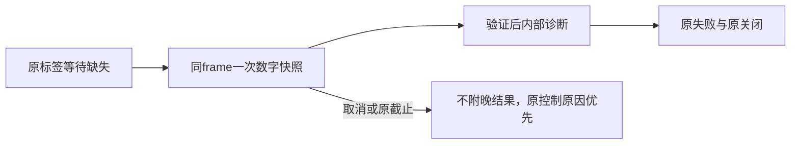

# T-1110 已采纳四文件：作者只读闭合复核

本次已查五字段诊断、取消/原期限、迟到快照与 SDK 预算没有新增确定性阻断问题。此结论是候选作者对 root 采纳后源码的只读复核：候选由本代理编写，不能作为独立于实现作者的另一评审签署，也不签真人采集或整个任务 Gate。

## 版本和范围

- 工作树 `/Users/zyongzhu/.codex/worktrees/canvas-binding-fixes/Thirdspace-creator`，HEAD `88b663a6d445a242c9c34aa14db68c4fac1ef6b3`，四文件为未提交改动。
- 四文件 SHA 与 `/tmp/t1110-section-candidate-o0rugobl/manifest.json` 完全一致。
- 仅读源码、候选 manifest 与 root 的隔离回归日志；未启动浏览器/服务，未操作31410、用户数据、profile、Cookie，未写共享树或控制面，未重跑测试。

| 文件 | SHA256 |
|---|---|
| `ai-worker/src/runtime/platform/wechat-browser-source.ts` | `a9ca0d9cc6022062abb837f49c8be14a64d8d2f87fa77810c49914fb65cd2c76` |
| `ai-worker/src/runtime/platform/wechat-browser-source.test.ts` | `f425b8515b339ad056a3e94dafdac9e16d144356a0b54a9c501c64aacbc018b4` |
| `ai-worker/src/runtime/platform/wechat-dom-witness.ts` | `86820824428503fc30ded78f056da8e7b1e12095c5052390ce14cf18f953bb6e` |
| `ai-worker/src/runtime/platform/wechat-dom-witness.test.ts` | `c9e6ee55a7e7b9abfa78532ee3bc70078d4fe68d52ab67e6708815c8b6e2b113` |

## 已核源码

1. **只输出五字段**：source `:11–18,41–50` 新类型只含数字、布尔与 readyState 枚举；emitter 仅为 wechatVideo / prepare / 合法报表 kind / typed SECTION_MISSING 接受 observation。它重构新对象，数值必须为 safe integer 且在边界内，非法/不一致快照整体省略，未知键不复制。原 message/stack/URL/Cookie/profile/身份与正文不进入事件。诊断消费者抛错仍被原 catch 隔离。
2. **同 frame 一次**：witness `:176–185` 的原标签等待只在 typed SECTION_MISSING 分支调用 helper；同一个选定 Frame 和 exact/visible locator 被传入，没有重选、导航、点击或额外 observe。`:31–48` 一次 Promise.all 读取五字段，正文只在浏览器内算长度；frameElement handle 局部 dispose。成功和 AMBIGUOUS 直接保持原行为。
3. **控制原因优先**：helper `:32,45–48` 使用原 signal 和 controls.timeoutMs(120000) 的剩余预算；前后均核原 signal/真实剩余期限。普通 probe 失败或 probe 自己的上限保同原 missing；witness `:181–185` 不吞取消/实际原截止。source `:193–212` 仍保原唯一 end、组合 signal、finally 关闭，并在 deadline timer 尚未派发但 end 已耗尽时优先原截止。
4. **迟到结果不回写**：race 后唯一附字段点是 witness `:183`，之前再次检查原 signal/预算；超时/取消路径不取得晚 tuple。底层 probing 没有写 Error/任务/诊断的副作用，晚结果只完成局部 Promise/handle 清理，不再发事件、不触发 onReport、不重发。局部 timer/listener 清理，宿主租约仍由原 source/guard 实停证明释放。
5. **SDK 与总预算**：source `:117–128` 的真实默认 open 每次调用 SDK 前重查 signal 和同一个 managed.deadlineAt，明确 timeout=min(120000, 原余量)。fallback 再调用该闭包时重取余量，没有新 end。`:24–27,189–196,227–231` 明确 guard 370000、startup 1120000 的串行预留；managed 写唯一归一 end，显式 controls.timeoutMs 或父 deadline 继续取更早值，不写持久预算、不续期。default-open 测试走真实 source/open/launchWithBrowser，但 SDK 和 guard/preflight 是明确合成替身。

## 已读 root 当场证据

- `/tmp/t1110-section-root-red.log`：root 在生产采纳前的真实 test-only RED 为 **7 FAIL / 60 SKIP（67 例）**，retry 0，开始 23:36:56；日志有实际 exit 1。SHA256 `7dc4e601ef586f17c2ed657e879a0f9691bf3f0ecfb332f8ab5005509763c350`。
- `/tmp/t1110-section-root-green.log`：正式树实际 **3 文件 / 67 PASS**，开始 23:38:28，耗时 28.12s。SHA256 `00a8edf4e20f7be2f60c30e19b5fedf87c22ef64cc9bdc78cb0a4a262caa7929`。未重跑大套，也没有用 tmp 作者自测代替这份正式树日志。
- `/tmp/t1110-section-root-type.log`：读取时仅显示 ai-worker 的 tsc --noEmit 命令，无错误诊断；SHA256 `5ede27c831cd531d5db5d6d3168185b27337cce2d5b124b5a95c3e7219cf1bc8`。root 的执行退出状态尚未在本次消息中确认，本代理不把读日志的 exit 0 或无错误输出当成编译器 exit 0。
- 新 source `test.ts:173–234` 覆盖固定 clone、额外秘密键、非法字段、错误分支 gate、默认 SDK 120s、fallback 原余量、managed 原 end 和取消不再 SDK；DOM `test.ts:164–203` 覆盖真实 source+内置 witness 组合的单次观察、probe 保因、挂起时取消/截止、晚结果、自身上限、截止已到但 signal 未派发及成功/重复标签不 probe。

## 尚未覆盖和仍待验

共享 `ai-worker/src/runtime/browser/chromium-guard.ts` 的 ensureChromiumLaunchable 预检在 attempt race 之前 await；SDK options 与计划外层预算不证明预检挂起时可以及时取消。此边界已在候选交付中保留，本轮没有改共享 guard。清理仍以实停/宿主释放为准，370s 预算数字不能替代实际清理完成证明。共享 launchWithBrowser 的既有可执行路径解析及 raw console 分支也未由此次增量改动或验收。

真人平台尚未通过本轮完整采集验收。原 failed / 0 页任务及无 stage 的早期绑定失败均保留；当前五字段尚未提供真实执行结果。本复核不推断 Cookie 过期、不把 iframe 可见/complete/bodyTextLength 当作页面或报表 ready，也不确认真实原生文件/公共提交/实际终态闭合。正式公共服务组合、资源心跳/停止、真人报表与任务整体 Gate 仍由相应实际证据验收。
