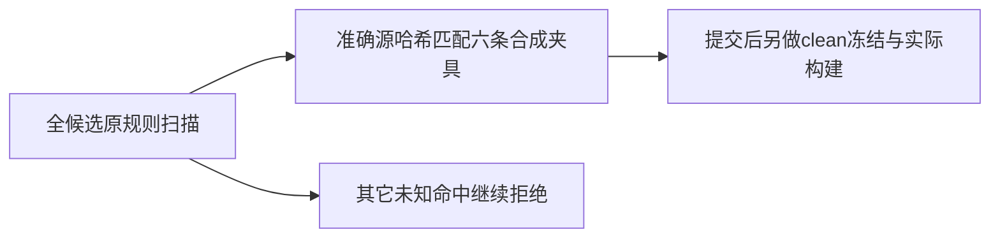

# T1125 私有预检修复实际验收

私有helper已按独评精确识别3个脱敏测试文件6条合成命中，18个未知/变化用例仍拒绝。原321.259秒exit1保留；修订后7172候选blob全数扫描11.186秒exit0，13088 tracked源码哈希、原5规则和文件名门保留，未改产品/vendor/build/正式扫描器。实际范围和命令详见CURRENT_VALIDATION.json及独立实施复核。

当前scan-only明确clean=false、buildFreezeAuthorization=false，不能拿它开始构建。文档/任务审计提交后必须另运行最终clean冻结及原45打包基本测试；本任务只完成私有helper分类修复，父任务继续真正出包安装和原ID数据回读。上一真实完整对账7de源码41原失败保留，不签当前全绿；产品五根与8复核源hash不变。

