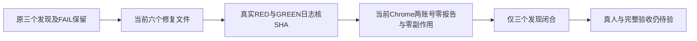

# T1159 当前修复的独立窄复查

结论：**PASS（仅 I001 / I002 / I003 当前闭合）**。三个原发现已由 T1165 / T1167 / T1166 的当前字节及真实隔离证据闭合。原 `IMPLEMENTATION_INITIAL_REVIEW.md/json` 的 **FAIL 保留**；本报告不改仓库、任务状态或历史记录，不代签完整 Gate、UI视觉、真人微信或安装。

大白话：身份不完整时，现在页面能准确提示扫码恢复；采集结束后不会继续等一笔永不返回的心跳；新浏览器测试的外层等待也足以包住串行步骤。报告仍为真实 0，尚未证明真人微信报表采集成功。

实读 HEAD 为 `aa7de1e91183ec0236a82cd954a4f4bf9bb1aeb1`，源码为该基点上的未提交冻结实现；技能与项目均为 3.29.0，阶段为 4-build。当前 Chrome 冻结 **61 路径** before/after 完全一致，也与本复查读取的现字节逐项一致；详细路径、SHA、日志、receipt 和 33 项 manifest 条目核对写入 `REVIEW.json`。

| 原发现 | 当前判断 | 实际证据及边界 |
| --- | --- | --- |
| I001，正式身份拒绝丢失协议码 | 闭合，T1165 | 合同仅登记固定 `SCOPE_MISSING` 并保持原 HTTP400。原 `dispatchErrorResponse → errorEnvelope → createHttpTransport` 新回归实际 1 RED；原 route / HttpTransport / NativeReportPanel 三文件 **69 GREEN**。未知码仍 string，网络及5xx仍沿原key核对，不按中文猜扫码。 |
| I002，finally被pending续租拖住 | 闭合，T1167 | 相对冻结293d来源唯一产品差异为不再 `await renewalInFlight`；renew自有catch、active/abort及服务端lease/generation/status守卫均保留。公开execute六例在续租仍pending时核原deadline、取消、完成，再晚resolve/reject核无新增心跳/报表/失败写。实际 **6 RED → 原四文件63 GREEN**，没有假释放或新claim。 |
| I003，新旅程串行外层不足 | 当前闭合，T1166 | 实读case **25,200,000 ms**，runner **26,400,000 ms**；内层 **120,000 ms**、0retry和原断言保持。已审200×120秒串行上界及结算/启动/退出余量闭包一致。runner源冻结新增T1165两路径，原56来源manifest不改；预算不是已发生52秒错误的归因。 |

I002 的结论只闭合原发现的 **finally等待在途续租** 反例；这里的合成 failRun/commit 等端口照常完成，不能据此推导任意后端事务卡住时全部执行都保证按时返回。正常完成仍须真实 `onStopped`；deadline/取消未实停仍保留 `stopUnconfirmed`，只有晚真实停止才释放。

本轮完整 Chrome 外层命令真实 **exit0，78.33353570796316 秒，0retry**；内层一例 PASS，原两账号×三窗口公共进入、刷新、返回、展开管理/取消转组均走完。两次正式 start 都为 **HTTP400 + SCOPE_MISSING**，均出现中文恢复文案和“扫码绑定账号”，恢复标记重载后保留。无 domain response 替换；手工账号真实 `externalAccountId=null`，两账号 before/after 都是 `items=[] / total=0 / nextCursor=null`，`bindingStarts=0`。

runner退出后才打开同一fresh PGlite的原证据：两个原accountId对应 `platform_collection_runs=0`、`platform_native_reports=0`、`platform_bind_attempts=0`，微信profile文件为0；外层最终输出 `postStopObservationPassed=true`。本复查只读该证据，没有打开数据库。Chrome当前日志SHA为 `4f94eac463ade394ee4b66f38ed37301b7c85b74c9f79bcd9b5521048084da95`，私有原日志存在且SHA相同；外层命令日志SHA为 `33ecac16ad95fca57e8dd4044b90522030ec664d9b47868c9b57f978f8e270da`。四workspace当前typecheck的原receipt均exit0、日志SHA匹配。

必须准确保留的历史差异：初评 I003 的诊断文字写旧 **1,500,000 / 3,300,000 ms**，但初评JSON `sourceHashes` 对case和runner已经记为现文件SHA（分别 `0ef12c19cd0c5357099c2559ca50c7fa9e656c69a956aa4e42a63bda3c2a6213`、`8c2ca0103be7c954043db4ae1e88f9385c5d6f3ae0802b8076857456e31ce98f`）。不能把该初评快照当成旧预算字节证明，也不能改原报告来制造一致。本复查独立读现配置并绑定本轮61项SHA；首轮失败Chrome另有不同case/runner SHA，仅说明那轮文件不同，未由SHA反推旧文件内容。

本次没有发现新的产品缺陷，没有运行测试、服务、模型、产品CLI、App或进程控制，没有修改仓库。测试GREEN receipt本身没有逐路径sourceSHA，本报告没有补造运行时快照；当前源码绑定以随后本轮Chrome真实before/after和实读字节为准。截图manifest字节已核SHA，本复查未作审美或现场UI操作判断。

T1159仍不可记为全绿：完整implementation Gate、正式UI视觉、真人五报告、真实调度与安装未由本复查签署。来源族 `wechat-statistics-visible-section` 仍researching，原2实验耗尽、剩余0，报告0、导航原因UNKNOWN，真人执行暂停保持。后续源码或验收组合变化需重新绑定实际证据。
