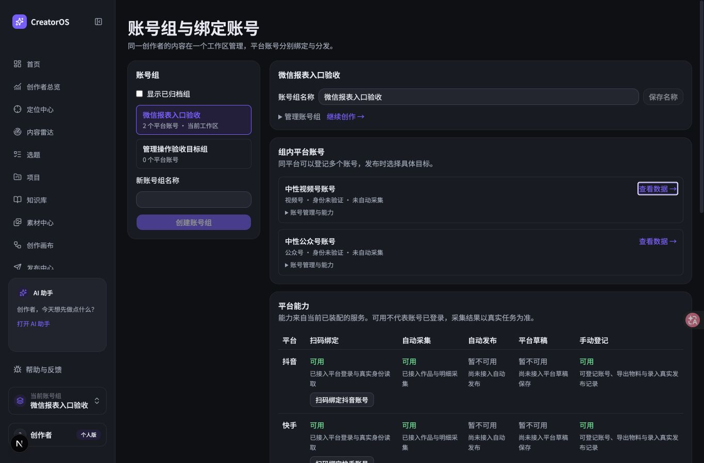
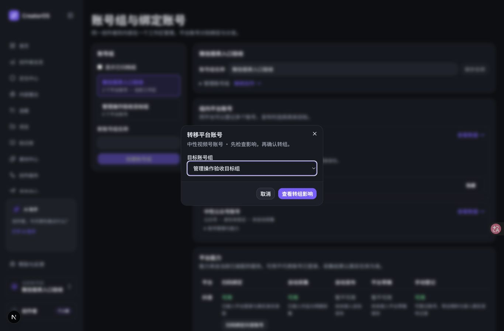
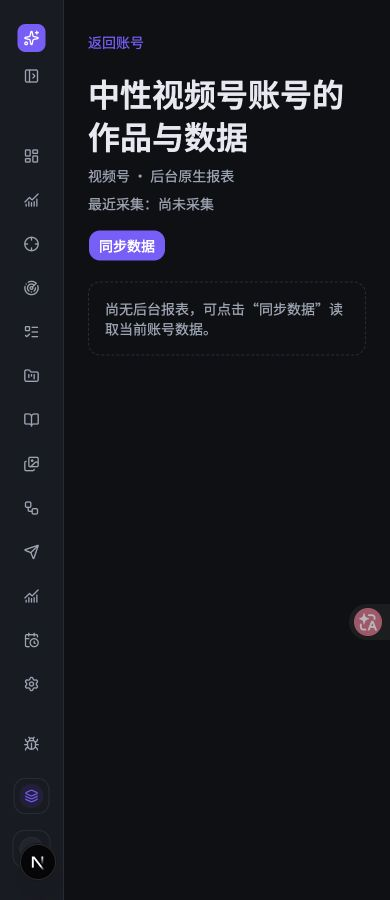

# T1159 独立真实任务走查

核心报告导航完成；转组 Esc 的焦点返回有缺口。本报告只评操作，不打审美分。

- 本轮首份证据：2026-10-09T20:17:03.554Z；结束：2026-10-09T20:21:25.860Z（UTC，真实运行时间）。
- 入口：`http://127.0.0.1:31469/accounts`。仅访问该隔离实例，新建专用 Chrome 标签页。没有重启或停止服务。
- 测试组：微信报表入口验收。两个中性账号均显示身份未验证、未自动采集；报告显示尚未采集、尚无后台报表。未将空数据伪装成指标。
- 使用 Cua 原生 AX、实际点击、Tab/Enter/Esc；没有读源码、Playwright操作脚本或任意执行。只读了 oil-ui-pro 0.10.0、visual-review.md、UI_RULES.md。
- 已实际设置并查看 1366×900、900×900、390×900。已保存 JPEG 由 sips 核出实际尺寸一致；临时 viewport 已 reset。

## 结果

| 任务 | 实际结果 | 步骤 |
| --- | --- | --- |
| 视频号查看数据→报告→返回→再进入 | 完成。报告对应中性视频号账号，标记视频号·后台原生报表；第二次 Enter 进入一致 | S01–S07 |
| 公众号查看数据→报告→返回→再进入 | 完成。键盘到入口并 Enter，报告对应中性公众号账号，空状态一致 | S08–S11 |
| 管理内找到转组与隐藏 | 两个账号都可找到。只打开转组，不执行变更 | S12–S17 |
| 转组弹窗 Esc | 两个平台都关闭成功；两次关闭后 AX 焦点均是页面根节点，未回触发器 | S14、S17 |
| 390 窄屏主要任务 | 视频号入口、报告、返回完成；报告多行标题与空状态可读 | S18–S20 |
| 纯选择绑定弹窗 | 未执行。完整 AX 只见直接名为“扫码绑定视频号账号”“扫码绑定公众号账号”的平台控件，未见可确认的纯选择入口；未点击，不作焦点失败推断 | — |

## 发现（按影响排序）

1. **转组 Esc 后没有返回触发按钮焦点。** 视频号 1366×900（S14）与公众号 900×900（S17）均在 Esc 后返回列表，工具同时返回 `The focused UI element is 0 AXWebArea CreatorOS`。视频号截图后再读完整 AX 仍是根节点。UI_RULES 明确要求“键盘Tab/Enter/Esc与焦点返回”。这会让键盘用户退出弹窗后失去原操作位置；应恢复到对应账号的转组按钮，并用两个平台的 Esc 实测。截图显示打开和关闭状态；焦点判断依据实际 AX，而不是静态截图。

2. **报告返回后的重复键盘路径有成本。** 返回后焦点为根节点；首个 Tab 到“显示已归档组”，视频号共 8 次 Tab 到查看数据，公众号共 10 次 Tab。两者 Enter 都可再进入。这里只记录操作成本；没有读取到要求路由返回必须恢复成员链接焦点的合同，因此不称为违约。

没有出现任务卡住或走错；入口名称与账号对应清楚，没有实际犹豫记录。转组焦点缺口尚未修复，因此完整键盘验收不能写成全部通过。

## 过程与时间

| 步骤 | 时间（UTC） | 动作 | 结果 |
| --- | --- | --- | --- |
| S01 | 2026-10-09T20:17:03.554Z | 选择微信报表入口验收组 | 当前工作区包含中性视频号账号与中性公众号账号，各有查看数据链接；身份未验证、未自动采集 |
| S02 | 2026-10-09T20:17:13.019Z | 点击中性视频号账号的查看数据入口 | 报告识别为视频号·后台原生报表；最近采集尚未采集、尚无后台报表，未显示伪造指标 |
| S03 | 2026-10-09T20:17:30.674Z | 使用报告页的返回账号链接 | 返回后AX焦点为页面根节点；首个Tab进入显示已归档组，未回到原账号的数据入口 |
| S04 | 2026-10-09T20:17:36.118Z | 返回后按Tab检查焦点 | 第1次Tab焦点为显示已归档组 |
| S05 | 2026-10-09T20:17:47.888Z | 从返回后的起点再按7次Tab，共8次Tab | 焦点到达查看中性视频号账号的数据；焦点环可见 |
| S06 | 2026-10-09T20:17:52.244Z | 在视频号查看数据链接上按Enter | 第二次进入相同视频号报告；无额外弹窗与采集动作 |
| S07 | 2026-10-09T20:18:05.922Z | 第二次报告内Tab一次到返回账号，再Enter | 返回列表；纯键盘可返回 |
| S08 | 2026-10-09T20:18:10.385Z | 从返回后的起点按10次Tab | 第10次Tab到达查看中性公众号账号的数据 |
| S09 | 2026-10-09T20:18:16.244Z | 公众号查看数据入口按Enter | 进入公众号后台原生报表空状态 |
| S10 | 2026-10-09T20:18:25.290Z | 公众号报告返回账号 | 返回账号列表，焦点根节点 |
| S11 | 2026-10-09T20:18:33.836Z | 返回后Tab10次再Enter | 第二次进入相同公众号原生报表空状态 |
| S12 | 2026-10-09T20:18:40.130Z | 展开中性视频号账号的账号管理与能力 | 展开后可见转组与隐藏；未执行管理变更 |
| S13 | 2026-10-09T20:18:44.203Z | 打开中性视频号账号转组弹窗 | 打开后焦点在目标账号组；Esc关闭后焦点结果见S14 |
| S14 | 2026-10-09T20:18:52.106Z | 转组弹窗按Esc退出 | Esc关闭成功；关闭后AX焦点为页面根节点，未回到转组按钮。截图后再次完整AX仍为根节点 |
| S15 | 2026-10-09T20:19:10.249Z | 900×900下展开公众号账号管理 | 900宽度侧栏折叠，公众号转组与隐藏可见 |
| S16 | 2026-10-09T20:19:23.909Z | 900宽度打开公众号转组弹窗 | 公众号身份与目标组可读，初始焦点目标账号组 |
| S17 | 2026-10-09T20:19:33.912Z | 公众号转组弹窗按Esc | Esc关闭；AX焦点页面根节点，未回到转组按钮 |
| S18 | 2026-10-09T20:19:43.663Z | 切换390×900并回到账号页顶部 | 390宽度视频号查看数据入口可见；组名输入内容被窄窗裁切，但旁边完整组名仍可见 |
| S19 | 2026-10-09T20:19:52.877Z | 390宽度点击视频号查看数据 | 进入视频号报告空状态 |
| S20 | 2026-10-09T20:20:23.870Z | 390宽度报告返回账号 | 返回账号列表；窄屏主任务闭合 |

## 实际看过的截图

- [01-accounts-desktop.jpg](01-accounts-desktop.jpg) — 2026-10-09T20:17:03.554Z，1366×900，微信报表入口验收组，两个中性账号的查看数据入口
- [02-video-report-desktop.jpg](02-video-report-desktop.jpg) — 2026-10-09T20:17:20.014Z，1366×900，视频号后台原生报表，尚无后台报表
- [03-video-keyboard-focus.jpg](03-video-keyboard-focus.jpg) — 2026-10-09T20:17:47.888Z，1366×900，返回后第8次Tab到达视频号查看数据入口，紫色焦点环可见
- [04-publication-report-desktop.jpg](04-publication-report-desktop.jpg) — 2026-10-09T20:18:21.590Z，1366×900，公众号后台原生报表，尚无后台报表
- [05-transfer-dialog.jpg](05-transfer-dialog.jpg) — 2026-10-09T20:18:47.657Z，1366×900，中性视频号账号转组弹窗；焦点在目标账号组，未查看影响或确认
- [06-transfer-esc.jpg](06-transfer-esc.jpg) — 2026-10-09T20:19:00.301Z，1366×900，转组弹窗Esc后，管理仍展开；AX焦点为页面根节点
- [07-accounts-900.jpg](07-accounts-900.jpg) — 2026-10-09T20:19:14.485Z，900×900，900宽度侧栏折叠；公众号管理展开
- [08-publication-transfer-900.jpg](08-publication-transfer-900.jpg) — 2026-10-09T20:19:28.682Z，900×900，公众号转组弹窗，初始焦点目标组
- [09-accounts-390-top.jpg](09-accounts-390-top.jpg) — 2026-10-09T20:19:47.205Z，390×900，390宽度账号页顶部
- [10-video-report-390.jpg](10-video-report-390.jpg) — 2026-10-09T20:19:56.867Z，390×900，390宽度视频号报告，标题多行与空状态可读

## 未做与证据限制

- 未重复同步身份拒绝验证；父任务已说明单次正式Chrome验证，本次不引用为本轮证据
- 未人为制造失败、断网、慢响应，因为本轮禁止触发同步、采集、扫码等执行动作；失败恢复不标为通过
- 未执行转组、隐藏、归档、查看转组影响、保存或重新登记
- 未打开纯选择绑定弹窗，未点任何扫码绑定控件
- 未验证200%缩放、1280×800、reduce-motion、持久保存、发布回执
- 未核取CSS标题字号；实际图可读但不能据截图精确确认24px要求
- 900×900只检查账号入口/管理/转组，未在该视口进入报告；390×900只复走视频号主流程，未复走公众号完整窄屏流程

本轮未改仓库、未执行账号数据变更、未调用采集或模型、未碰微信源标签页或用户真实 App/DB。没有删除文案或做视觉修正；当前实例版本未从源码核取。
