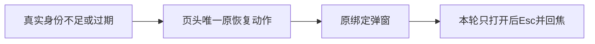

# T-1168 独立 SPEC 初审

评审时间：2026-10-09T20:25:54.366841+00:00；实读HEAD：`aa7de1e91183ec0236a82cd954a4f4bf9bb1aeb1`（dirty，产品未写入本UI修复）。

**PASS（仅本精确局部UI修复准入）**。用户应在身份不足时先完成账号恢复；现画面却同时要求先扫码和点击已禁用同步。本方案把同一个已有恢复动作放到页头，保留真实状态与原执行链，不新增平台能力、合同、数据归属或视觉方向。

已实际查看原视频号identity-required PNG，恢复按钮为红字描边且上方同步仍占主动作；下方空态保留同步指令，支持原独立视觉评审VR-01/02。NativeReportPanel第112/114/115/117行与该图一致。标题不是从图估值：当前h1用text-2xl，globals第76行映射creatoros-text-2xl，tokens第41行为32px；text-xl经globals第75行及tokens第40行为24px。修复后仍须在真实浏览器取computed style确认24px。

精确产品写集只允许NativeReportPanel：bindingRequired或真实run.needsAuth时使用原“扫码绑定账号”或“重新扫码登录”主按钮，复用原Dialog、AccountBindingPanel和returnFocus；移除提示行/状态区的重复恢复按钮。错误正文继续保留，恢复主按钮沿现Button品牌样式，不继承父错误色。普通同步、取消、核对状态、unknown/5xx核对原请求、timeout后仅用户重发、已保存报表和按需表均保持。空态对绑定/过期、能力关闭、正常可同步分别表达同一下一步；能力关闭继续禁止扫码和同步，不因为按钮移位推断身份端口已ready。

现AccountBindingPanel fresh挂载只读本地索引；没有runId时不会开始扫码，startAccountBinding仍由其内部真实按钮调用。因此新Chrome可明确选页头恢复按钮，只打开Dialog后Esc，不点内部最终扫码；sessionStorage有旧runId的恢复读取语义保持原样，不由本修复改变。本轮没有操作浏览器，也未验证该新旅程通过。当前Panel已有onCloseAutoFocus实现，现测试尚未包含返回聚焦断言；新增Chrome观察须真实验证，不能声称已有焦点PASS。

测试写集为原面板测试与T1159新case。RED应来自同状态无冲突文案、唯一页头恢复主动作，不是删掉旧拒绝断言；needsAuth与SCOPE_MISSING两族都保留原key、真实ID、能力门、已有报表和未知响应保护。既有“禁用同步”断言仅按新唯一恢复动作位置校准；原两平台×三窗口真实0/refresh/back/repeat、单次400 SCOPE_MISSING及同fresh库0run/0report/0binding/0profile证明完整保留。恢复入口打开/Esc/回焦与实际24px新增，120秒内层、有限外层、0retry不缩短。按SPEC运行原面板全测试、frontend type、原Chrome、LED047、boundary/semantic/orphan与diff，之后同状态同视口比图。

该范围属于oil-ui-pro既有方向精修：原紫色工作台、tokens、Button/Dialog、14px正文与自然换行保持，无需新候选或再开一轮审美评分。原8图和原FAIL不得覆盖成新成功。只允许控制/证据中登记本实际增量；不改原来源manifest、验证器、执行deadline、权限和研究预算。

本次只审SPEC、必要源码、测试和已有证据，未写源码、状态或正式review输出，未执行测试、服务、数据库、模型或真人扫码。PASS仅允许先取RED并在上述边界内实施；未签UI成品、真实报表、真人恢复、安装或全局Gate。旧全局失败不作为新增局部SPEC阻断；其实际状态由根会话对应证据保持。

本审实际读取的字节绑定如下；上次窄复查中的五个相关产品/测试文件SHA仍完全一致。

| 实读路径 | SHA-256 |
| --- | --- |
| `docs/features/t1168-native-report-recovery-actions.md` | `7da66499530d7ad4b82b3302272eafcb2dae028a723e8f7e1905c1008297ad7c` |
| `docs/产品定位.md` | `86bc2c8add6a01ebf5b2ecf9de05d448770ca14a4e0bdbbf376fffc6387e3800` |
| `docs/features/t1022-account-group-workspace/UI_RULES.md` | `a19d209281fe1a51463c7c2b8a063c3fa117d53679762f33d8c9637004bc8d76` |
| `.agents/skills/oil-ui-pro/SKILL.md` | `a623059117b5afdeaf437a6ac0944040ba666b0847e520cfe4fa42cc1ea1cec2` |
| `.agents/skills/oil-ui-pro/references/existing-project.md` | `82a39fe64cb7fc183e1b3349d1829f6e163aee214c268ce2b921fd30c7f74aed` |
| `.agents/skills/oil-ui-pro/references/interaction-and-state.md` | `34e8961d11f70522e3b10d18f2f59263a3e9eaf4662a3940dcef3ea7ba6f7915` |
| `orchestrator/process/modules.config.json` | `add6fb4f11a5384f3c7fa569d56926adc72e7ea775ea2f84e1c9d1bc2aed14d2` |
| `BACKLOG.md` | `852e7c811bc0c0dc3af02ffdfcf34757ccbef082f2fe2e295f93c060da6c4eb0` |
| `frontend/src/components/ui/button.tsx` | `7d3e97a7bbd62bce2ccbdedfd291e05a8ccd58cf2277f49702d169f0afce8937` |
| `frontend/src/components/ui/dialog.tsx` | `ef0a8b1da82a5079c59979e364c69cd7051e6c6992cea5ffaf02530b6566f2e5` |
| `frontend/tests/e2e/t1159-wechat-native-report.spec.ts` | `0ef12c19cd0c5357099c2559ca50c7fa9e656c69a956aa4e42a63bda3c2a6213` |
| `docs/features/t1159-current-wechat-native-report-integration.md` | `b95d6954c52e5251f3b4b430ae6af2fb6e4a571c3839e0f9230ee33abae59073` |
| `frontend/src/features/platform-account/native-report-panel.tsx` | `c79e758d4821cfb1e01f407999e83d75f84c71ac234e85b08853ee52764d2bec` |
| `frontend/src/features/platform-account/native-report-panel.test.tsx` | `02bce911e5b4ec7d19296565a861d22195fcd7a2f984a5d7ed28cb5b394a84a7` |
| `frontend/src/features/platform-account/account-binding-panel.tsx` | `eb3bab8297d784b9715c1d8bfdbcd9ec1564261712a5aa32a7e6c241bf1c6ee2` |
| `frontend/src/styles/tokens.css` | `9a61b49eee0c84da8c820b7d9175afa0a9350edf603aa584eb5dfafe4c6af675` |
| `frontend/src/app/globals.css` | `89a8702d4958e924039f9e59838312267631b51e0434d8b8a29d3786e0bbf15c` |
| `docs/verification/t1159/current-visual-review/REVIEW.md` | `bd15629d479bec3a90d496159698ad1e840430ab59441075a580246849d85dc6` |
| `docs/verification/t1159/current-visual-review/REVIEW.json` | `d08f4d598cbb295a12495a79feb6e0cd906e53c0c33f966d76e5685fae4a763b` |
| `docs/verification/t1159/fixed-beforecommit/screenshots/wechatVideo-identity-required.png` | `54d4a5fabb618061cd7b4d34ec98c739828e2a542ccd16add517c78206178685` |
