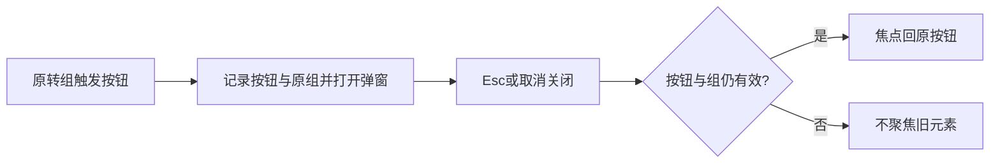

# T-1169 独立 SPEC 初审

评审时间：2026-10-09T20:25:54.366841+00:00；实读HEAD：`aa7de1e91183ec0236a82cd954a4f4bf9bb1aeb1`（dirty，产品未写入本UI修复）。

**PASS（仅现转组Dialog焦点恢复准入）**。键盘用户关闭转组弹窗后应回到原账号的转组按钮，避免失去原操作位置；本方案只恢复这个已有交互要求，不改变转组执行或账号数据。

独立任务走查S14/S17分别在视频号1366×900、公众号900×900按Esc关闭弹窗，实际AX返回0 AXWebArea，并明确未回触发器。报告保留了操作时间、截图和未执行转组/preview/扫码的范围；未从源码核取实例版本，不能把它冒作当前冻结源码运行时SHA证据。本审实际看过05-transfer-dialog JPEG，确认对应原转组选择表面；静态图不证明关闭焦点。当前AccountGroupManager第122/123行两类原转组按钮只setTransferMember/targetId/preview，第141行DialogContent无onCloseAutoFocus，静态链与运行观察一致，足够支持窄修复准入。

精确产品写集仅AccountGroupManager现转组打开/关闭路径：两个现触发器记录event.currentTarget及原所选组，关闭时核触发器仍连接、仍属于相同所选组/上下文才preventDefault并focus；已移除元素或真实组上下文已改变时不得聚焦旧元素。可复用现selection.current实时读以及NativeReportPanel已存在的onCloseAutoFocus做法，不改共享Dialog或全局默认焦点。旧元素/切组保护必须在现组件fixture中分别观察，不能仅用isConnected代替上下文核验。

原preview/commit、digest/expectedMembershipVersion/idempotencyKey、历史资料归原组、在途任务拒绝及busy关闭守卫保持。只打开、Esc或取消不能调用preview或commit；再次打开仍识别原成员并保留原可用目标。管理折叠、隐藏、绑定、路由及平台能力表不纳入本产品写集。两份证据没有确认纯选择绑定入口，也没有发现绑定弹窗焦点失败，因此本审不授权新增绑定焦点修复；路由返回后的Tab成本只是原记录，未冒作焦点合同违约。

测试写集为原账号组管理测试与T1159新case。先在未改产品时取得Esc/取消关闭后触发器focus的真实RED，再保留原管理测试并补零preview/commit、重复打开、旧元素和切组保护。原公共Chrome两账号×三窗口每次展开管理/转组/Esc后加toBeFocused，保留真实进入0报表、refresh/back/repeat、单次HTTP400 SCOPE_MISSING和同fresh库零run/绑定/报告/profile全部断言；不真人执行转组或扫码，不缩120秒内层/有限外层，不增加retry。SPEC要求的frontend type、LED047、boundary/semantic/orphan与diff在实施后执行，本审没有运行这些命令。

此为oil-ui-pro局部交互修复；复用既有紫色方向、Button/Dialog和同页本地打开，不为小焦点修复新增审美评分。原AX/截图缺口保留，修后主Agent应按原浏览器键盘路径取得真实回焦证据；合成旧元素测试不代签真人或安装。

本次只读初审，未改源码/任务状态/验证器/正式review输出，未运行测试、服务、数据库、模型、CLI业务或真人微信。产品尚未写入本修复；PASS只准先取RED再按精确范围实施，不是焦点GREEN、完整UI、真人微信、安装或全局Gate通过。原研究family、2实验耗尽/剩余0和真人执行pause保持；本修复不创建任务请求、第三实验或执行权限。

本审实际读取的字节绑定如下；上次窄复查中的五个相关产品/测试文件SHA仍完全一致。

| 实读路径 | SHA-256 |
| --- | --- |
| `docs/features/t1169-account-transfer-focus-return.md` | `1dcc665eabff281ded9c8c91be135a3eed10745d75a10c60d1be557c4e45a4fe` |
| `docs/产品定位.md` | `86bc2c8add6a01ebf5b2ecf9de05d448770ca14a4e0bdbbf376fffc6387e3800` |
| `docs/features/t1022-account-group-workspace/UI_RULES.md` | `a19d209281fe1a51463c7c2b8a063c3fa117d53679762f33d8c9637004bc8d76` |
| `.agents/skills/oil-ui-pro/SKILL.md` | `a623059117b5afdeaf437a6ac0944040ba666b0847e520cfe4fa42cc1ea1cec2` |
| `.agents/skills/oil-ui-pro/references/existing-project.md` | `82a39fe64cb7fc183e1b3349d1829f6e163aee214c268ce2b921fd30c7f74aed` |
| `.agents/skills/oil-ui-pro/references/interaction-and-state.md` | `34e8961d11f70522e3b10d18f2f59263a3e9eaf4662a3940dcef3ea7ba6f7915` |
| `orchestrator/process/modules.config.json` | `add6fb4f11a5384f3c7fa569d56926adc72e7ea775ea2f84e1c9d1bc2aed14d2` |
| `BACKLOG.md` | `852e7c811bc0c0dc3af02ffdfcf34757ccbef082f2fe2e295f93c060da6c4eb0` |
| `frontend/src/components/ui/button.tsx` | `7d3e97a7bbd62bce2ccbdedfd291e05a8ccd58cf2277f49702d169f0afce8937` |
| `frontend/src/components/ui/dialog.tsx` | `ef0a8b1da82a5079c59979e364c69cd7051e6c6992cea5ffaf02530b6566f2e5` |
| `frontend/tests/e2e/t1159-wechat-native-report.spec.ts` | `0ef12c19cd0c5357099c2559ca50c7fa9e656c69a956aa4e42a63bda3c2a6213` |
| `docs/features/t1159-current-wechat-native-report-integration.md` | `b95d6954c52e5251f3b4b430ae6af2fb6e4a571c3839e0f9230ee33abae59073` |
| `frontend/src/features/platform-account/account-group-manager.tsx` | `c0f3bc1a27a64ee7c4500b31d311e854e32464260b5ca50535d4ddbf653235a2` |
| `frontend/src/features/platform-account/account-group-manager.test.tsx` | `6d096c4410a259edb8c1d63f5f1848f03cdd7f5832cb80593b24a0a97c20eccd` |
| `frontend/src/features/platform-account/native-report-panel.tsx` | `c79e758d4821cfb1e01f407999e83d75f84c71ac234e85b08853ee52764d2bec` |
| `docs/verification/t1159/independent-task-walk/REPORT.md` | `ea891017403bcf694c7f0b779e5f325c71cb4c3be821a89beec5c3b4cf1bd7c5` |
| `docs/verification/t1159/independent-task-walk/REPORT.json` | `e89b724489288910d287cb18ddef63806ad8ed881db1a2ac9df4efe7717d0984` |
| `docs/verification/t1159/independent-task-walk/final-ax.txt` | `ebe405f8282258007e7e24ad5a4d6ae06d9499fea61a09406ae857b6b9738f73` |
| `docs/verification/t1159/independent-task-walk/05-transfer-dialog.jpg` | `1a24d551217ce8feeb7f5ef580473d43171baed2f73783d1fe09790825640d71` |
