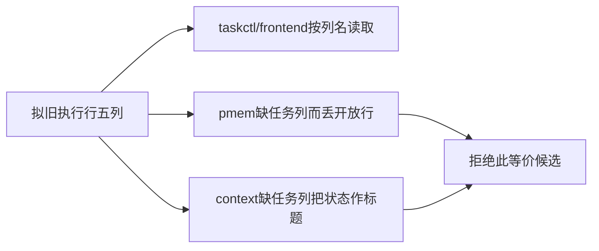

# T1171 五列旧执行索引候选独立只读评审

结论：**REJECTED_NON_EQUIVALENT_CURRENT_CONSUMERS**。当前 HEAD `3d4444934a618542747dd9839a299c6d769adad1`，阶段 `4-build`。本五列候选不实施，不修改消费者/validator；按根指示停止其它方案探索。T1171消除RUNAWAY但硬30KB尚未闭合，继续如实未完成。

| 实际消费者 | 有正确五列表头时的源码结论 |
| --- | --- |
| taskctl | 按列名保ID/状态/审核/验收/文档；strict review receipt、原SPEC及UI contract门仍在。仅静态兼容，不签执行 |
| frontend-validation | 按列名保验收/文档与原completion/report绑定；保直接SPEC/验收合同才能继续守旧门。仅静态兼容 |
| pmem | **拒绝**：第60/65行要求“任务”表头；缺该列整表continue。143个现旧开放/进行中/阻断任务会从derived开放集合消失 |
| context-compile | **拒绝**：第113行缺“任务”列退回cell[1]，五列时是状态；一句话退回文档列，无从details恢复标题的解析 |

具体反例 T1018：原标题「清理本轮测试暴露的全局类型与边界欠债」，五列下实际taskName会是「📋 待办」。原task集合、title/目标摘要与上下文命中不能共同等价；现暂停池的五列支持不授权隐去旧开放任务。两个其它消费者按列名支持，并不能消除这些真实解析差异。

此次最终实读 BACKLOG 为 **59,487字节（58.09KiB）**，原七列216行，现五列暂停索引78行；拟保T≥1062的七列57行、改变更旧七列159行。仅删除旧title/一句话两列而保原doc的静态原始下界为 **40,424字节**；混合新旧表的表头估算为 **40,704—40,829字节**，30KB硬阈值实际 **30,720字节**。完整原行历史引用与SHA映射成本未计入该下界，所以它不证明一个合法实施结果会达标；消费者不兼容已足以拒绝。详细字节分项见 [measurement.json](measurement.json)，它是静态估算，未执行任何消费者/健康门。

最终读取的T≥1062所有当前七列原行、phase、审核、验收及直接链接完整收在 [REVIEW.json](REVIEW.json)，保护根并行正式验收更新。本报告只保拒绝结论/读集/容量估算，未提供可应用的看板替换，不删待办、不抹元信息、不把旧FAIL当PASS，未改repo/事件/报告或运行测试、服务、CLI、DB、模型。
