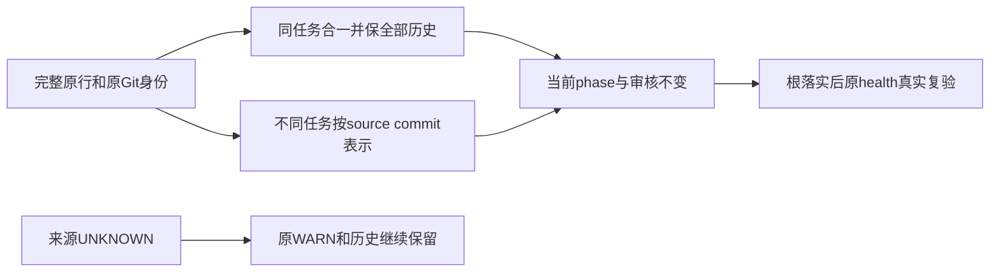

# T1173 历史任务身份与机械候选独立复核

结论：**PASS_MECHANICAL_IDENTITY_CANDIDATE_BUSINESS_STATUS_UNREVALIDATED**。当前 HEAD `3d4444934a618542747dd9839a299c6d769adad1`，阶段 `4-build`，技能/项目版本均3.29.0。只批准下面的表示候选，尚未应用；不签原任务业务完成、审核迁移或健康门通过。[candidate.json](candidate.json) 含每个原行/SHA、精确替换、完整历史追加段及前置文件SHA；[REVIEW.json](REVIEW.json) 含实际读集和原事件绑定。

| 当前问题 | 独立判断 | 可直接做的表示修复 |
| --- | --- | --- |
| T1018 两执行行，列数7/8 | 同名、同phase、同审核/验收、同证据；第8列是2026-10-07诊断续文 | 第一处保当前状态并合为唯一七列索引；两完整原行、旧八列及既有详情全部保留，第7/8列诊断完整外置，不与portrait历史任务合并 |
| T1017/1018/1019/1020/1021 执行与归档 | 不同任务；current client任务与旧 durable-chat/portrait/确认按钮/guide夹具/Mac产物验收相撞 | 仅旧归档使用精确source-commit别名；原审核均—，phase/验收/原证据逐字保留；旧事件/报告仍原ID |
| T1004/1006/1009/1015/916 执行与归档 | 同任务的不同时间/来源状态快照 | 当前执行行唯一索引、状态/审核/验收不变；旧完成表示转完整历史引用，所有旧字段与证据保留，不据旧✅把当前待办/进行中改完成 |
| T1014 两归档行 | 全文逐字相同 | 同身份合一，原完整行/SHA保历史，不改原完成字段 |
| T1016 两归档行 | 旧SDK边界与9月27日外部Agent调研两个任务 | SDK一条使用已读source-3d5dc732别名；不串用9月20日SDK与9月27日调研的同ID completion |
| T357/356/488/489/627 旧归档警告 | 标题显示不同事情，但本轮精确Git/事件来源未闭合 | 保 **UNKNOWN**、原完整行和WARN；本候选不修、不删、不伪迁PASS |

不同来源候选别名均已读原 Git 对象：

- `T-1017-source-31eb30d3-durable-chat`
- `T-1018-source-31eb30d3-portrait-timeline`
- `T-1019-source-31eb30d3-confirm-candidate`
- `T-1020-source-da970ced-guide-fixture`
- `T-1021-source-526070b3-mac-artifact`
- `T-1016-source-3d5dc732-sdk-boundary`

这些仅为历史身份标签，完整source commit/原行/对象SHA在候选中；不改原审计链、SPEC或旧报告task ID。只有发生新的真实原任务复验才能另生成当前证据，不能靠表格别名获得新PASS。T1009原归档 `PASS[REV:a57fadb33099]` 只保留在完整原历史，不写入当前执行审核列或新别名。

原归档字节的保留方法已写入候选：每条 `raw` 是完整UTF-8表格行，空格、竖线、各列及旧ID不变，行SHA明确不含换行符；原文件SHA/行号及同SHA各出现位置另存。根落实时先将这些原行逐字追加到 `BACKLOG-details.md` 的非执行历史段，再将同任务归档索引替换为历史指针、不同来源索引表示为精确别名。原95.1KB看板、archive与INDEX的本机快照及根T1171无损gzip/逐行映射继续保留；新身份对应关系不修改旧事件/SPEC/报告/审核。

已按根的并行控制更新重读当前BACKLOG/details/events：T1108/T1117原taskctl完成行与实际验收值逐字纳入保护，候选不覆盖这两行。details当前SHA为 `2ee3a8173783e8e59787e5cfc641c87f423a2f1f70101fcfedbd72754f7397d3`；候选仅追加历史段，保正文与EOF清理结果。当前BACKLOG SHA为 `bf8c9fbd338e2c0d4b019db497a77c234eeaa2ff7bb61e46687030989b742e13`。旧base先被私有前置SHA断言拒绝，未写任何仓库。

原健康证据确为失败，receipt/log实际SHA一致：T1171原RED exit2；原工具compact exit0仍95.1KB→67.1KB；after exit2；sized exit1仍58.8KB、4ERROR。原RED已有12个执行/归档复用与T1018重复；T1014/T1016执行完成行被原工具归档后变为10个复用、7个archive警告，来源问题先前已经存在。健康源码本身不检查列数，八列是本次直接分列原行核实，不能冒称原日志单独诊断了八列。

私有候选静态集合推导可消除执行重复/执行归档复用，并保留五个原归档来源UNKNOWN警告；这不是运行健康门的PASS。候选看板仍约58.1KB，30KB硬阈值未改变，容量仍由T1171处理，不能用删待办/历史来过门。

需要原任务独立复验的范围：若要重新判T1004/1006/1009/1015/916当前业务完成，或把不同来源任务的旧验收用于当前/alias准入，先按原任务实际scope、SPEC和当前字节独立核验并走原taskctl。T1017/1019/1021 current原审核事件明确绑定当前SPEC；不能借不同原main任务的complete销账。未闭合的五个旧归档ID需独立来源核对后再表示；本轮不猜。根应用候选前须复核文件/原行SHA，先保完整历史再改唯一索引，随后执行原健康命令保真实exit/log。本会话只写指定私有三个工件，未改repo、原事件/审核、产品/验证器，未执行测试、健康门、服务、CLI、数据库或模型。
