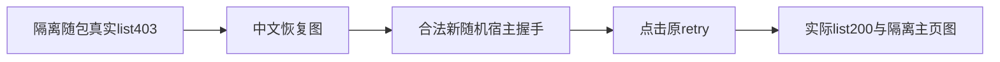

# T1175 新包实际证据独立补核

**PASS，仅限当前包的离线字节与隔离随包403恢复链路；findings为`[]`。** 实读main HEAD `5a1929ca98ab6cba8cb8b3a4020ece68faaff2b8`。本次不是再次源码签收或新增门；不签完整Gate、原生App、真实用户安装/激活、真人微信/模型或研究恢复。

## 真实页面与原公共重试

两张归档PNG均实际看过并与N原图逐字一致，均1280×720。恢复图显示中文“登录状态已失效或没有权限,请重新登录后再试。”，原英文不再出现，主重试、账号组与绑定账号、设置入口可读；重试后图为真实隔离主页，原上手引导、问候和卡片可见，不能据图签全部主页功能。

已读原探针及原结果/日志：使用包产出的Node/server和生产resolver选出的full Chromium1223，fresh隔离data/auth和随机master key；先不向浏览器注入宿主握手，实际公共`accountGroups.list`403仍拒绝；之后才注入24字节随机握手值并点击原“重试打开工作区”，实际list200后恢复卡消失，workspace error0/pageerror0（原记录观察点）。没有mock list或数据库直写。原sidecar日志确有startup verified和periodic driver启动，因此只能签fresh隔离场景，不能推导真人profile启动安全。

原`dispatchStatus=404`属于smoke.noop、原sidecar按SIGTERM清理code143保留；不是把所有错误改成0。`pageTextSha256`是原探针注入前body文本的哈希，不冒称成功主页全文哈希。

## 实际包与SHA闭包

本审实际只读计算Downloads DMG、构建DMG、canonical tar、构建App内tar、所选Chromium/Node和App壳的完整SHA；并只读流式读取tar内所选Chromium及Node成员，没有解压写盘、挂载或运行产物。

- Downloads及构建DMG均841,300,012字节：`1c9278135e77f22e9861c43eab006bdc8db3ffeafa2c8833c5ed073e72d1eb05`。
- canonical及构建App内tar均830,791,334字节：`fc40a57afbc221a159ea2b4ab32053251c0686ad8fd6ac1ff908b61606a64233`。
- tar内所选full Chromium可执行成员、当前探针实际文件及观测SHA一致：`2447c7bdea8e8ad38b52594f1ba53e18821c05445e8a07ad1cf3b0f23931d89d`；68624字节。
- tar内随包Node与探针进程文件一致：`5ed0e129e708e36048981aed983f7302b0c18139f5a174e4b8d5fabbacb6d59d`；68416字节。

原offline inspection确实只读挂载DMG后核App/生产canonical tar一致、hdiutil verify和deep/strict codesign exit0，随后detach0；原receipt/log与当前真实文件SHA支持这项有界结论，本审不重跑操作。attestation精确绑定5a和当前DMG。**仅ad-hoc，未公证**；release manifest仍validation not-run、signed false/notarized false，attestation仍claimEnabled/publishAuthorized false，没有冒称Developer ID或正式发布通过。

冻结原始JSON SHA `6e72ad34f9cc33413ac16bd4f86aefa6aa883f8cab3dfcdbd9c2407174deccc4`与归档gzip解压原字节一致；绑定旧3d独立A `af9a44974eb6239ab5a3048d2dfa746b70ba57b0e613f89d9e7f62900ca3b0a2`及原两文件独评报告/读集和批准SHA，只有这两条增量、unreviewedProductDiff空。原冻结14124路径、包后原offline逐路径哈希变化0与原脚本/日志一致；本补核没有重跑全源验收或代签全合并。

## 实际receipt与原失败

下列N原日志SHA与各原receipt一致，归档gzip解压也逐字相同；报告引用的8个receipt与原文件一致。

| 原证据 | exit | 外层秒 | 实际log SHA256 |
|---|---:|---:|---|
| t1175-reviewed-source-commit | 0 | 0.174536 | `6b2e2601d538418a79278d726532d94a1a6d0656bfe47c7a507d26a816aae642` |
| t1175-freeze-negative-fixtures | 0 | 7.161845 | `8ed1df9e49807e1512caffafb175d4a05c1256d531c2ccd577e92c0b99984660` |
| t1175-final-source-freeze | 0 | 18.441205 | `52ab0a9bae65f5ade51263375b87d9c5d1634b985931f799d27dec16d49c88e9` |
| t1175-package-basic | 0 | 2.020341 | `1446f5daf891b2e0b39876016a8bae3d4721b249af06f13996acd2fd05d87705` |
| t1175-local-package | 0 | 361.786036 | `fd809626ed74afe3b527bdcff697720852964bb0815ad16dac3f120ce9ab15ff` |
| t1175-offline-package-verify | 0 | 16.043987 | `4dc113b69d83b3fb0fdfff2ce8fb92926c56e180ba751483b95ffa7c1a80a4d6` |
| t1175-package-verdict-scan | 0 | 10.397125 | `f29176a29f551cd1648e1ee475d6de2eb631c8a069675f8fd3c473107f42588f` |
| t1175-packaged-recovery | 0 | 32.897519 | `f55f4a26fc7ed9e1d38462bdbbfee3f2271b14a590d49a189426932ffb8958a7` |

四文件基本打包45PASS、固定skip-install构建361.78603550000116秒exit0、实际恢复wrapper32.89751912502106秒exit0均成立。构建原日志明确额外冒烟/TLS/扫描未在打包入口运行、Developer ID/公证跳过；另取得的offline/verdict/恢复证据只是其各自实际范围，未补成完整打包Gate。

原完整canonical原receipt仍exit1、971.5171989999944秒，实际日志SHA `4f02bc4640d79a0f4dbfe50b78b3e03876faefc2c393c20983d4220fed942456`相符且末尾仍40ERROR；BOUNDED_CLOSURE/IMPLEMENTATION均明确保留，未洗成全绿。root正在进行的fresh完整reconcile不在本审范围。T1159真人profile边界、原d414失败、原生App/真人安装限制继续，不新增开关或绕过。

逐一路径、真实SHA、tar成员与两张实际图、原收据和范围限制见READ_SET.json。只写本私有目录的两个报告，没有仓库/任务/验证器变更或服务、产品CLI、测试、模型、真人profile执行。
