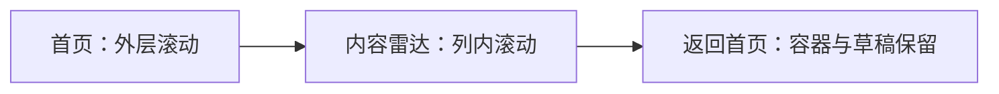

# T1176 当前导航与封面恢复回归

两处测试前置条件已按当前真实合同校准。导航固定检查全部13个入口；填满模式保留同一滚动容器和未保存的子状态。封面用例先建立同用户、同账号的真实项目与稿件，再执行原删除文件、补采与版本回读；不存在、跨用户和跨账号父稿件仍被拒绝，且两张发布表均无写入。产品、合同、服务守卫和执行预算未改。

## 当场结果

| 原检查 | 修改前 | 修改后 |
|---|---|---|
| LED048完整串行命令 | 209 PASS / 1 FAIL，退出1 | 213 PASS，退出0，215.310秒 |
| LED049完整串行命令 | 前端76 PASS / 3 FAIL，退出1；后端未执行 | 前端81 PASS、后端49 PASS，退出0，153.833秒 |
| 精确最终导航文件 | — | 43 PASS，退出0 |
| 精确封面文件 | — | 5 PASS，退出0 |

前端首轮类型检查真实退出2：本轮误将 Playwright 的 `exact` 参数用于 Testing Library。原错误收据与日志保留；移除不适用参数后类型检查退出0，最终导航43项再次退出0。后端类型、边界、语义及orphan检查退出0；边界5项既有基线与orphan100项警告保留。

当前产品源码仍是5a1929ca对应的安装包。三轮使用该包实际Node和full Chromium1223、新随机数据/认证目录的公开页面验证退出0；第三轮通过UI建立隔离账号组，真实导航首页→内容雷达→首页。13入口、滚动容器和viewport身份保留；720高时外层首页可滚663px，填满页外层不滚；360高时内容雷达中间列自然溢出并实际滚217px，外层仍0。页面错误为0。截图在本目录，`home-after`截图早于首页滚轮测量，663px以实际结果JSON为准。

这不是原生App安装、真实平台采集或模型验收。扫码、付费模型、真实用户数据和微信原研究均未接管，网络下载仍沿用原测试stub。不因测试校准重建相同产品安装包。

## 证据与收尾

`CURRENT_CHECKS.json`记录每条原命令、起止时间、退出码与原日志SHA；相邻 `.receipt.json` 是实际收据原字节，`.log.gz` 解压后与其SHA相等。`SOURCE_INPUTS.json`、`IMPLEMENTATION.diff.gz`冻结精确两文件。独立SPEC与实施复核、实际读取集合在相邻文件中，实施局部PASS不代签完整Gate。

完整当前reconcile及任务完成记录将在共同收尾证据中记录。T1015整体和范围外历史审核/教训失败不随本片销账。
