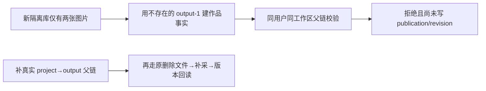

# T1176 独立只读核因与 SPEC 初审

结论：当前精确 SPEC 初审 PASS，findings 为 []。这是初审准入；两测试尚未修复，本报告不签实施或任何 Gate 通过。当前工作树 HEAD `335b1b5e055b1c8cb0935fe7f512409532236592`。实际读集逐路径与 SHA256 见 READ_SET.json，正式初审输入见 review-input.json；未写仓库、状态、审核快照或旧报告。

## 当场失败与历史边界

根本轮原 LED048 包装实际 exit1 / 219.2516386秒，15文件共209PASS/1FAIL。fresh 日志栈为 publishing.service.ts:372 的 assertOutputParents，经:355 的 withTarget；log SHA256 `2d2b5e9666245e51a6b7ffb8e53427f7195d0a9eaf8fa0cb942de7e361f25964` 与收据一致。故本次核因已有当前 inner 实证，不借 aggregate 推断。当前 SPEC 首段已更新为本轮实际完整失败；范围与验收未变化，最终已重读并绑定其当前 SHA。

根本轮原 LED049 实际 exit1 / 5.08274秒，frontend七文件76PASS/3FAIL，log SHA256 `aa2b61e313b29fee3bb168d8571504db2563d1f6906dc3a5182c566e5be27ce7` 与收据一致。三处均在 shell.test.tsx；命令的 && 后 backend 未执行，不把历史44PASS冒作本轮后段结果。

当前完整 canonical 原 exit1 / 1101.5300179秒，32 errors / 1 warning，log SHA256 `20408be0bca5ffef9a5415bdb35c2d9054d02058e776ad5da76ff0cd21317140` 与收据一致。这只是未闭合全局事实。T1014治理与T1101/canvas来源的旧 FAIL、旧任务归属保留。只读 Git 比较上述封面测试、publishing service/repository、douyin-cover-backfill 四文件相对 `68dfffb372ee9f1a0c7c692b018ce803733b7576` diff 为空，不外推其它源码或其它失败。

## output-1 的实际缺失链

cover-file-repair.test.ts:15调用 createDb()，无dataDir，是新隔离内存库；库入口做schema迁移，没有为本例创建项目或稿件。:22–23只创建两张image资产。:24随即以字符串output-1调用createImportedPublication，:25拟再用output-2；文件未调用ProjectsService或seedAdjacentContent。

service:1085–1089先校验平台与output owner，再把[output-1]传入withTarget。此测试无group及membership端口，但outputIds非空，所以不会走无父校验的早返分支；:354–356仍在事务中调用assertOutputParents。:371按projects.userId=u、当前legacy account=a工作区过滤，将project→contentOutputs真实父链innerJoin并加共享锁。没有项目/稿件，返回0行，:372拒绝，尚未执行repository的publication/revision写入。

因此:26设封面、:28真实删除文件、:30补采均未发生。当前失败性质为测试前置夹具漏建真实父链；没有证据指向封面补采产品回归。这个判断也不证明补采已经通过：原完整修复链须在合法父链后重新执行。

seedAdjacentContent现已被publishing.service.test.ts使用，直接按ctx建立真实projects/contentOutputs；本例可只在测试中复用它建立u/a的output-1/output-2。仅补父链，不改helper，不改原ID、source=user、服务守卫、数据库过滤或锁。不得改source为ingestion、直接调用repository绕过服务、stub所有权或删除原失败断言。

## shell 的实际合同

sidebar真实PRIMARY_NAV为固定13入口，“创作画布”/canvases位于素材中心之后；每个Link已有prefetch=false，收拢态以aria-label保名称。旧测试:183漏画布、:203仍数12，与本轮两条失败一致。期待值须独立固定标签+href，不能从产品数组生成以自证。

旧:368–370要求contentFill不存在PageScrollArea，第三条实际失败正是它存在。T1069 §“实际Tab丢稿根因与精确容器补充”明确原true直接div/false PageScrollArea会卸载SessionHost、丢未保存稿，已要求同PageScrollArea与app-page-content只切CSS。当前app-shell恰是稳定同树；填满态仅限制外层viewport、直接wrapper满高/min-h-0、直接scrollbar隐藏；普通页仍由viewport滚动，列内滚动保留。现app-shell.test.tsx已有真实ScrollArea/local-state child双向切换验证。T1176把对应保护纳入LED049的shell测试，并要求随包真实计算样式/滚轮/内层滚动补证，符合原合同；不得恢复卸载迎合旧断言。

## 负测与原断言保留

SPEC已明确本次需要追加缺父稿、其它user、其它account拒绝并无publication写入，保留第二例未知封面只延后该项。实现复核宜同时看publication/revision相对调用前计数不增加；本例已有两张图片，不把数据库全表0当作副作用零，也不拿纯owner stub代替真实数据库父链。正确u/a父链须仍走原public service成功。

原实文件删除、isAssetFileAvailable=false、attempted1/filled1/failed0、缺图列表清空、修复revision指向新可读图片、回读实际PNG字节和另一张好封面不变全部保留。第二例unknown不发fetch/download/save，missing继续补齐及settled顺序/计数保留。对应完整publishing服务回归继续保留缺账号、跨工作区/用户、成员或父链变化、不可读新封面拒绝与旧revision不变等已有防线；不把这些守卫从产品移走。

shell保唯一Root/viewport/content实例和有本地未保存状态的child，双向contentFill后DOM身份及mount/unmount不变；填满模式不得外层滚动，普通模式保外层滚动，内部区域仍可滚。仅检查class不能代签真实浏览器CSS与滚轮行为，SPEC已另要求实际随包隔离旅程。

## 写集、待验与范围

唯一测试写集为 frontend/src/components/shell/shell.test.tsx 和 backend/src/application/collection/cover-file-repair.test.ts；产品、其它测试、shared fixtures、reconcile配置、所有权/安全/滚动实现及执行预算均不可改。当前stage4-build维护，技能3.29.0匹配；此轮是既有合同测试校准，没有页面设计变更，无新增产品方向/能力授权。

根后续仍须正式record/start、精确实施、两条原完整命令（LED049含后段backend）、SPEC约定服务/宿主回归、两侧类型、boundary/semantic/orphan/diff、独立源复核及当前随包Node/full Chromium隔离浏览器证据。pmem/reconcile保真失败，T1015整体及其余30项不因此闭合；LED053短预算旧债另守原归属。本报告未执行任何测试、服务、验证器、产品CLI、DB、模型、浏览器或真实profile。不签真实抖音采集、原生App安装/启动、模型、真人微信研究恢复、全功能或完整Gate。

## 关键字节

以下路径均相对实际W，完整实读集逐一路径与哈希见READ_SET.json。

| 路径 | SHA256 |
|---|---|
| `docs/features/t1176-current-regression-preconditions.md` | `5ace50c84add624b358409d21ee26447b9845aff96dac9e60a6fb848c2327f02` |
| `backend/src/application/collection/cover-file-repair.test.ts` | `db2456e9a9fe6e605c8b73e90fc1cc6b69b11dd05ded9033e0a93fe5acde63b3` |
| `backend/src/modules/publishing/publishing.service.ts` | `5c741ec2fa1924ca2035a9c953a79cc5f3a5f75e91754bd4ee25f8fba15b07e9` |
| `backend/src/modules/publishing/publishing.repository.ts` | `d81d5ec29ca293164ace45777a51d1c28269503e43ddd340f321f14f1cbfb54e` |
| `backend/src/integration/adjacent-domain-fixtures.ts` | `d8aaf4ab031d9fb6a6be45b779511d18ddd91b1f7193037918bdf0c6e0e974ae` |
| `backend/src/application/collection/douyin-cover-backfill.ts` | `eecb015615551fc1c92ec2fd4b0e8720eb2fdefaccd66fbc8ac3fbd654ea8b1d` |
| `frontend/src/components/shell/shell.test.tsx` | `afe0f0bcf27d1be79aefee1eedade7259726125f53d7d8c5652cf9457e96bf2a` |
| `frontend/src/components/shell/app-shell.tsx` | `eb734f9c2b85f3fec5c7dfc16712aa48f52fd11339bdf6c01a96368eb282c76f` |
| `frontend/src/components/shell/sidebar.tsx` | `5a233257d2980e42b3e846fca826f11aa1f95a6c2047a09baf826924b3d3a3a9` |
| `docs/features/t1069-installed-media-and-binding.md` | `0363fa6014a11328af557cf01f3a1f3151ff524ac6b0cbb95acaff4d4983327d` |
