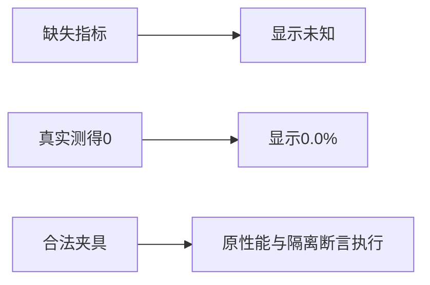

# T1177 首页性能回归的指标夹具

旧测试用不完整对象冒充真实指标合同，漏了完播率字段，性能断言执行前已发生异常。本轮仅在该测试文件按实际AnalyticsService返回类型补齐13个字段。未知指标为null，已知计数与原例的12次播放、2赞、1分享、粉丝增量0或9保留；产品代码、合同、预算和归属守卫未改。

原四个用例全部保留：120项目批量读取和空集合短路、同请求复用与后续/跨账号隔离、慢项目摘要与日历/执行并行、粉丝基线失败未知与恢复。新增真实完播率0和38.5两例；缺数显示“—”，实测0显示“0.0%”，38.5显示“38.5%”。

原LED050完整命令当场退出1：前端7 PASS、后端45 PASS / 3 FAIL；原日志SHA `fe316b0286d3656c9418af7704379d25e49650ad284060c4f9371fd755db4f84`保留。修改后原完整命令退出0，124.841秒：前端7 PASS、后端50 PASS，含原发布服务44项。精确文件6 PASS，后端类型检查退出0。最终边界、语义、orphan检查退出0；既有基线及警告保留。

实际收据、日志与源文件SHA见 `CURRENT_CHECKS.json`、相邻 `.receipt.json`/`.log.gz`、`SOURCE_INPUTS.json`。正式SPEC独立复核与当前实现复核分开留存；完整reconcile由本轮共同执行，范围外失败不洗绿。这些测试不代签真实安装、模型或全功能。运行时代码与安装包产品源码5a1929ca相同，不为测试修改重打包。
