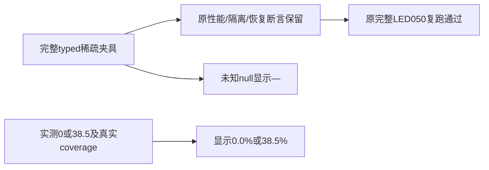

# T1177 精确实施独立只读复核

结论：PASS，仅限当前单测试实施及已发生的原LED050/focused/type与相关边界检查；findings=[]。HEAD `335b1b5e055b1c8cb0935fe7f512409532236592`，工作树本片测试SHA256 `1cd1d0eb842c0d62f3b727153dc7d551faf8787094cc0e84586edf4a1e5eed34`。当前未提交源码另有已独立复核T1176的两测试，不冒作干净HEAD，也不将它们计入本片越写集。

正式SPEC全文与已记录initial packet/snapshot已实读，SPEC SHA256 `3af9e931d3449e51684a2cd7b23f4474c53e5ad607d3185a9536cf6cc8751331` 与正式PASS[REV:e7019c7dcc42]绑定一致。原record/start包装均真实exit0，log分别写PASS和已记📋→🔨事件；本复核没有改审核、事件或任务状态。

## 13字段合同与精确diff

相对 `335b1b5e055b1c8cb0935fe7f512409532236592` 的T1177源码diff仅backend/src/application/queries/dashboard-read-performance.test.ts。新增type-only AnalyticsService import及 `Awaited<ReturnType<AnalyticsService["getDashboardRollup"]>>` 完整sparseRollup，fixture本身没有unknown强转，仍按实际服务返回类型约束。当前必填13字段：finishCount, ctrCount, plays, reads, likes, comments, shares, favorites, followerGain, ctrAvg, finishAvg, snapshotCount, metricCoverage。backend strict/include src涵盖此测试，真实backend类型exit0支持当前字段约束。

稀疏fixture保snapshotCount1、plays12、likes2、shares1、原followerGain0；其它未知读数/率为null，finishCount/ctrCount0。metricCoverage保真：已测plays/likes/shares/followerGain为1/1，未知reads/comments/favorites/ctrAvg/finishAvg为0/1。两个旧mock均复制同fixture，dashboardPorts仅保持原followerGain9差异；没有更改产品null语义、指标格式化或真实账号/工作区范围。

原4用例全保：120项目批量/去重/空集合短路及账号传递；同请求共享三处解析且后续/跨号请求独立；慢项目摘要不阻塞排期/执行、下一次实时读；账号基线失败为总粉丝—、恢复显示期内9增长。完整diff未删除或放宽原error为空、12播放、次数、真实ctx/IDs、calendar/execution与粉丝结果断言。whole-port unknown强转是原已有测试局部端口组装方式，本片未扩大它；rollup值先经真实类型独立约束，避免旧漏字段再被此cast掩盖。

在原同请求例增加finishAvg=null→平均完播率—断言。新增it.each两例按真实已测值0、38.5设置finishCount1/coverage1:1，实际Application返回error=null，并分别显示0.0%、38.5%。没有把未知造0，没有只测helper或放宽error断言。底层analytics实际完整null/计数返回、dashboard消费、query composer/缓存与sharedfixture均无diff。

## 原RED与当前GREEN

9组实际包装收据与对应原log字节逐一核SHA一致，receipt本身SHA另记在READ_SET.json，没有混称log SHA。原RED的完整退出1、125.031秒和三失败仍保原字节；它证明旧fixture在目标断言前漏字段，不证明真实合法稀疏产品回归。新增正常边界首跑PASS按实际记录，不伪造过去不存在的红测。

| 实际证据 | exit | 秒 | 结果 | 实际log SHA256 |
|---|---:|---:|---|---|
| 原完整RED | 1 | 125.031 | frontend7PASS、backend45PASS/3FAIL，原toFixed/空metrics失败 | `fe316b0286d3656c9418af7704379d25e49650ad284060c4f9371fd755db4f84` |
| focused当前 | 0 | 2.333 | 单文件6PASS，原4例+0/38.5两边界 | `46ae4f5601dcb6b17556c24ce4aa0f343406d7e4c5fa8ca511ee3ec8c817d162` |
| 原完整GREEN | 0 | 124.841 | frontend2文件7PASS + backend2文件50PASS，含原publishing44例 | `b595f6280698f2f6338a136845314ef5cf260d179ecd89faf67bbe855d125ffa` |
| backend类型 | 0 | 43.756 | 原tsc --noEmit，strict include src | `e3b0c44298fc1c149afbf4c8996fb92427ae41e4649b934ca495991b7852b855` |
| boundary | 0 | 0.552 | 0新增；原5基线违规保留 | `21063424253db0601ff571f39f0474072b3476d34ee10a8920361b20db642f24` |
| semantic | 0 | 0.364 | 实际exit0，原语义边界不改 | `b972b2b1d6a12435c4034d60290afc2db036e5e439f96cc3f617e5e78a476923` |
| orphan | 0 | 0.117 | 实际0 errors/100 warnings，旧warning保留 | `ee3224654cf1b13b1bcd3948dd942050a0435380b5b2a84bbb61e9058d056b0e` |

原完整GREEN实际124.841124秒退出0，两个原串行阶段均执行；后端50=dashboard6+原publishing44，前端7与原完整RED相同。GREEN log SHA256 `b595f6280698f2f6338a136845314ef5cf260d179ecd89faf67bbe855d125ffa`，与收据完全一致。原RED日志SHA仍为 `fe316b0286d3656c9418af7704379d25e49650ad284060c4f9371fd755db4f84`；收据文件自身SHA仍是 `c0f4455f7c91ab2ed17936e8a1e18d6fc86e8f86b0339b83d6c02820859e8a7e`。

完整RED/GREEN均传两项相同显式隔离PG变量，原LED050配置、串行&&、retry0及预算无改。boundary原5基线、orphan100 warning、frontend localstorage提示保留；exit0不代表旧告警清零。

## 范围与未签事项

只读Git确认当前src改变只有T1177本测试和已审T1176两测试；本片analytics/service/repository、dashboard runtime/composer、缓存、sharedfixtures、reconcile配置与Vitest/tsconfig/预算diff为空。没有runtime/helper/归属守卫修改，不需要靠重建同产品包证明测试变更。

这些是以合法mock返回喂真实Application的测试，保证本片性能/隔离/恢复及诚实展示断言继续有效；未运行真实DB采集、平台、模型或安装版旅程。完整canonical与pmem/reconcile/正式任务收尾仍由root处理，旧全局失败、T1015整体与各原owner不因本片PASS销账。不签完整Gate、安装/原生App、全功能、真人微信研究或真实profile执行准入。

本复核未运行任何测试/验证器/CLI/服务/DB/模型/客户端或真实profile，未改仓库/代码/消费者；只写本私有REVIEW.md与READ_SET.json。实际读路径、文件哈希、完整单文件diff、各argv/log/receipt与未改路径逐项见READ_SET.json。

## 关键字节

以下路径相对实际W。

| 路径 | SHA256 |
|---|---|
| `docs/features/t1177-dashboard-rollup-fixture.md` | `3af9e931d3449e51684a2cd7b23f4474c53e5ad607d3185a9536cf6cc8751331` |
| `backend/src/application/queries/dashboard-read-performance.test.ts` | `1cd1d0eb842c0d62f3b727153dc7d551faf8787094cc0e84586edf4a1e5eed34` |
| `backend/src/modules/analytics/analytics.service.ts` | `7c59961587df8df933ab54956a2ed14d689cacbd641da781adff7d0e9f617cba` |
| `backend/src/modules/analytics/analytics.repository.ts` | `631ec714af3e62c72895a291e40d99c8d55bd49b2fca05e03d6687250a9ad295` |
| `backend/src/application/queries/dashboard.ts` | `2935ed2b83f5feace29fc952ac0c54c9c33b919215d0ed67530925f4009f86a5` |
