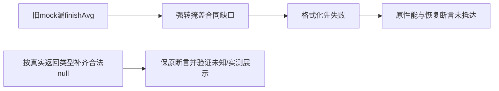

# T1177 独立 SPEC 初审

结论：当前SPEC初审 PASS，findings为[]。HEAD `335b1b5e055b1c8cb0935fe7f512409532236592`；最终SPEC SHA256 `3af9e931d3449e51684a2cd7b23f4474c53e5ad607d3185a9536cf6cc8751331`。这只批准按精确写集校准测试前置，不证明修复或验收已经通过。正式输入为review-input.json；READ_SET.json逐一路径绑定实际SHA与所读范围。

## 本轮实际失败与链路

原LED050完整命令实际125.0312553秒exit1，frontend两文件7PASS，backend两文件45PASS/3FAIL。本复核已读原log和receipt：日志SHA256 `fe316b0286d3656c9418af7704379d25e49650ad284060c4f9371fd755db4f84` 与receipt.logSha256一致；收据文件自身SHA256 `c0f4455f7c91ab2ed17936e8a1e18d6fc86e8f86b0339b83d6c02820859e8a7e`。SPEC首段已据此澄清，不混称两种哈希。两段确实都执行；不虚构额外红测。

dashboard-read-performance.test.ts:24、:48的两个rollup mock只给snapshotCount/plays/likes/shares/finishCount/followerGain，漏finishAvg等必填项。:32、:57、:65把不完整ports经unknown强转，掩盖静态缺字段。实际dashboard.ts:365的 `r.finishAvg !== null` 对undefined成立，随后toFixed抛异常。query-services真实composer捕获后返回dashboard_compose_failed且metrics=[]，因此两例error为空失败，第三例粉丝卡find得到undefined。当前RED没有证明合法稀疏产品数据同样失败，也没有抵达三个用例要保护的性能、并行与粉丝恢复结果。

真实AnalyticsService.getDashboardRollup明确返回Promise<DashboardRollup>，按ctx.userId/requireWorkspace/ctx及publicationIds传给repository；frontend投影缓存原样返回同类型，不构造漏字段对象。真实DashboardRollup有13个必填字段：plays、reads、likes、comments、shares、favorites、followerGain、ctrAvg、finishAvg、ctrCount、finishCount、snapshotCount、metricCoverage。repository:391–413始终返回全部字段；未测值为null，未测数量为0；真实0与null区分。旧service注释中的“all-zero”措辞不能取代当前实际类型和返回字节，现既有无快照测试也明确期望null。

## 写集与测试约束

唯一写集为backend/src/application/queries/dashboard-read-performance.test.ts。使用实际AnalyticsService.getDashboardRollup返回类型建立完整合法fixture，可用Awaited/ReturnType类型约束；两mock复用它，禁止把fixture本身unknown强转或只补finishAvg而仍漏合同字段。backend tsconfig.strict/include src包含该测试，原backend typecheck能落实新增字段静态约束，不需要改配置或运行时代码。

稀疏例保snapshotCount=1、plays=12、likes=2、shares=1与各例followerGain=0/9这些既有测量。其它未知指标null，ctrCount/finishCount=0；metricCoverage的measured/total应与这些事实一致，不能填假测量。实测finishAvg的边界应同时带合理finishCount/coverage，让真实百分比展示通过；null仍显示—而非0%，真实测得0可显示0.0%。这些是同合同测试，不授权补数据库数据或改变产品格式化fallback。

四原用例都要保留：120项目批量与空集合短路；同请求共享且后续/跨号独立；慢项目摘要仍让排期/执行先读且下一次实时读；账号基线失败为未知、恢复显示真实期内9新增。保first.error=null和所有ctx/ID/次数、原metrics断言，不能删error断言、改期待错误或退回假0洗绿。SPEC新增稀疏未知与实测完播率，足够捕获本前置校准且保诚实展示。

## 范围与待验

产品定位R-DASHBOARD要求真实0/—/错误卡，不编增长；R-ACCOUNT要求切号指标同步；当前SPEC保这些既有合同和原单请求/缓存行为。无新方向、页面、服务合同、sharedfixture、守卫或预算变更，属stage4-build维护。未发现当前SPEC实施范围或验收的阻断缺口。

根仍须正式record/start、仅改本测试、复跑原LED050完整frontend与backend（含publishing全部服务测试）、backend类型、boundary/semantic/orphan/diff及独立实现复核；pmem和完整reconcile保留范围外失败与原归属。本片不关闭T1015整体、不改变其余失败、不重建相同产品安装包。真实平台、模型、安装或全功能不由这些stub测试证明。本复核未执行任何测试/验证器/产品CLI/服务/DB/模型/浏览器或真实profile；未写仓库或正式审核快照，也未评T1176本轮实施。

## 关键字节

路径均相对W；所有实读路径及hash详见READ_SET.json。

| 路径 | SHA256 |
|---|---|
| `docs/features/t1177-dashboard-rollup-fixture.md` | `3af9e931d3449e51684a2cd7b23f4474c53e5ad607d3185a9536cf6cc8751331` |
| `backend/src/application/queries/dashboard-read-performance.test.ts` | `9000ac33284295a044e5df19ce8dce563afb36b7e94b2f8350938c26a9b83f24` |
| `backend/src/modules/analytics/analytics.service.ts` | `7c59961587df8df933ab54956a2ed14d689cacbd641da781adff7d0e9f617cba` |
| `backend/src/modules/analytics/analytics.repository.ts` | `631ec714af3e62c72895a291e40d99c8d55bd49b2fca05e03d6687250a9ad295` |
| `backend/src/application/queries/dashboard.ts` | `2935ed2b83f5feace29fc952ac0c54c9c33b919215d0ed67530925f4009f86a5` |
| `backend/src/modules/query-services/query-services.service.ts` | `ab01647a1eb9cb5a30099207d4d50639579be31543907ea204b38d7874fa1077` |
