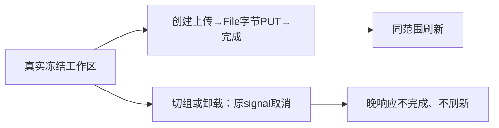

# T1179 素材上传回归校准

仅修改 assets-interactions.test.tsx：局部合法上传/完成回执按真实合同约束，经真实 workspace.capture、HTTP transport 和 dispatch 消费；原11例及文件名、MIME、size、相对路径实际File PUT、complete和refresh断言保留。新增纯组成功链的冻结范围与三段同signal、无范围0请求、切组和卸载真实abort及晚响应不回写。产品、守卫、共享fixture、合同、配置和预算未改。

原LED022当场18 PASS / 1 FAIL、退出1，retry x2保留；修改后原完整命令22 PASS、退出0；精确文件14 PASS，原scope/transport20 PASS，frontend类型、边界、语义、orphan及diff退出0。既有5项边界基线和100项orphan警告保留。独立实施复核只签精确代码与当前测试，不签完整浏览器旅程或任务完成。

真实随包Node/full Chromium首轮21.852秒退出1，File请求体SHA观测断言失败且最终结果未生成；原Buffer值没有保存，保持UNKNOWN。T1180核当前SDK后在新私有路径将缺body记为未知，保存在时严格比对及两媒体公开下载size/SHA；新轮139.349秒退出1，视频上传完成提示已显示，文件名列表等待120秒超时，仍无最终结果。原失败均保留；列表问题登记T1181，真实图片/短视频完整刷新、下载与跨组旅程尚待通过。

本片暂不完成，不代签工程导入、原生App、真实用户媒体/平台/模型或全功能。共同pmem与完整canonical另实跑；其它已通过切片可保范围外全局失败单独收尾，T1015整体仍保留。
