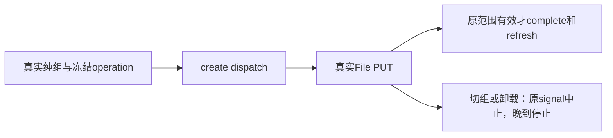

# T1179 当前补充 SPEC 独立初审

结论：**PASS，仅最终当前补充 SPEC 初审**，findings=[]。当场失败与旧测试前置缺失相符；不能据此声称实际素材/视频导入失败。后续真实公共链仍是验收条件。

当前 HEAD `335b1b5e055b1c8cb0935fe7f512409532236592`；最终 SPEC SHA `a27e32dcbfca6eec2a5666f5e5e2ed840ee2e8b688d6a3f6e2250964e3a94868`；产品宪法 SHA `86bc2c8add6a01ebf5b2ecf9de05d448770ca14a4e0bdbbf376fffc6387e3800`；原11例测试 SHA `aa9e050d8d56c82057c7b7147b19ab5464829bbb2c3099610467a01b9d405d2e`。初审前受审代码无实施diff。全部实际读路径、SHA与读段见 READ_SET.json。沿用maintenance 4-build流程与3.29.0技能；本轮没有实现派发或Task Packet声明。

原LED022收据实为exit1、6.676512166042812秒，完整日志18 PASS / 1 FAIL。唯一失败是上传E2的completeUpload全局mock期待1次、实际0。实算日志SHA `311a66a99c29aad1c54907878d4c36ced8b8720177180852dd9e3ab8ad3d25bd` 与receipt.logSha256吻合，收据自身SHA独立记录。原retry x2、FAIL、退出1、localstorage与jsdom navigation警告保留，不写成GREEN。

源码独立核对三个缺失层次：

1. 旧测试直接render按钮，没有设置真实组/旧账号范围。实际assertCurrent仅在groupId与accountId都缺失时在请求前拒绝。最终SPEC已澄清，合法纯组无需平台账号，旧账号工作区保原范围规则。
2. 按钮使用真实hook与capture独立createClient，经fetchCreatorApi→dispatch；旧全局contract-client mock不拦该调用。只补组选中仍不足以恢复旧mock观测。
3. client返回data前解析真实successEnvelope。上传要求assetId及合法ISO expiresAt等字段，旧对象漏assetId、expiry为“t”；complete要求完整AssetResource，旧对象仅id/status。旧fetch默认200空body也不提供合法data/meta.requestId。

局部typed HTTP夹具校准合理，不能stub useCreationWorkspace/assertCurrent、放宽schema或改生产。代码写集只有assets-interactions.test.tsx。原11例应全部保留：上传、下载、复制入口退役、跨平台定位及反馈、收藏、回收站确认/取消、还原确认/取消、空态、附到项目旧入口退役。上传继续断言真实File原名/MIME/size、PUT body为该File与Content-Type、相对URL字节PUT、complete和refresh；adapter记录实际dispatch input后返回合法typed数据，不直接伪造组件成功。

正测捕获一次真实operation：create/PUT/complete三段同一AbortSignal，create/complete冻结原group且无account header泄漏。冻结header先删除旧group/account，纯组不会沿用平台筛选账号。负测缺范围明确为groupId=null且accountId=null；PUT待确认时通过真实范围事件/卸载生命周期产生signal.aborted，不伪造AbortError或手调假权限对象。晚到PUT后实际assertCurrent在complete前拒绝，应证明0complete、0成功回写、0refresh。现有workspace/HTTPtransport守卫测试已读，仅存在不代表本轮已执行通过。

dispatch仍从真实身份与group/account所有权校验生成ctx；group可为真实空组，组/成员版本及旧账号属主检查保留。AssetsService创建即绑定upload所属workspace，complete按原user/workspace取原upload，已完成沿原asset幂等回读；真实headObject及大小校验不变。组件HTTP夹具只证明意图冻结、合同解析、取消与回写，不能冒充后端授权或落盘字节证明。

T1069既有确认要求保原File/owner/intent与未知回执、正常图片/视频/音频链和跨组隔离。本片素材库上传与剪辑工程导入/native插入/保存/跨Tab恢复分别验收，不用本片代签T1069全范围，不宣称未经测量的性能改善。

后续证据安排足够：原LED022完整四文件命令及该文件、CreationWorkspace/HTTPtransport守卫、frontend类型、boundary/semantic/orphan/diff、精确实施独评；使用当前未改产品包随包Node/fullChromium、fresh私有data/auth与新合法握手，经真实UI建立纯组，生成中性图片/短视频实际create→PUT→complete，核素材列表/刷新公开回读、第二组无混入，保截图/网络/结果/日志。不得route/mock替换真实dispatch/PUT或直写库，不用用户媒体/profile、扫码或模型。本次尚未取得这些结果，不记当前实施/GREEN或浏览器PASS。

pmem和完整canonical保留其它原历史失败及T1015整体责任。本初审不签任务完成、完整Gate、工程导入、原生App/Windows安装、真用户安装或微信研究恢复，不重打相同产品包、不push/tag/Release。本次只写私有目录，未改仓库/任务/消费者/配置/验证器，未执行测试、服务、DB、产品CLI、模型或浏览器。
