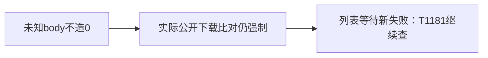

# T1180 私有上传请求体观测校正

已核当前Playwright1.60.0真实Chromium消费者：缺带bytes的postDataEntries时请求体Buffer可为空。原驱动却把未知记为0字节/空串SHA。原首轮未记录Buffer值，不能补造null证据；原驱动、失败收据和日志字节冻结。

新私有驱动只对观测改为requestBodyAvailable及nullable bytes/SHA；Buffer存在时严格比对保留，两媒体公开下载size/SHA、刷新、跨组与返回仍必须通过。无产品、测试、SDK、合同、配置或预算修改，新随机data/auth与本轮中性媒体，不碰真实用户或原生App。

新轮实际139.349秒退出1：MP4上传完成提示后，精确文件名列表可见等待120秒超时，未写最终JSON。因此机械修正尚不代签完整公共链或T1180完成。原始失败及T1181责任记录保留，下一条诊断仅补实际UI、网络与公开列表观测，不删除或放宽断言。

