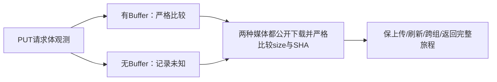

# T1180 维护探针补充 SPEC 独立初审

结论：**PASS，仅当前补充 SPEC 初审**，findings=[]。将不可观测请求体记录为未知、并保两种媒体无条件的真实公开下载size/SHA核验，足够校正这一测量问题；不是取消文件字节保护。

当前HEAD `335b1b5e055b1c8cb0935fe7f512409532236592`；SPEC SHA `9058b972318db39a1279f26a343b7f0ed9beaa36a042853e24b2921f6365c8f4`；产品宪法SHA `86bc2c8add6a01ebf5b2ecf9de05d448770ca14a4e0bdbbf376fffc6387e3800`。实际完整读集/路径/SHA见READ_SET.json。当前新driver尚未存在；本轮没有实施或执行。T1179源测试及完整结果的实施独评留待下一轮。

原receipt实际exit1、21.851652499986812秒，日志SHA `e2dedba1db02934f74b46854129dac6b081d1590cb8c1fa6a83a583b97e1dafa` 与receipt.logSha256相等。原driver SHA `a41b0314d635c33474743a7d81ee19f8032766990949b71b52318990fb503576`，实读错误为其第57行“上传字节SHA不相等”。该行位于上传成功文案、素材名可见、三段顺序与200、冻结header等前置检查之后；这是由代码到达关系作出的有限推断，不补造当场network数组或原请求体Buffer记录。最终result JSON当前不存在，首轮完整旅程仍FAIL。

原sidecar日志SHA `07016a60650b402034c493facc65562f4959b3ac440cbc661fb75a24f292a52f`，保实际启动验证、持久driver启动、CLIENT_CONFIG_PENDING和SIGTERM优雅退出。finally先写侧车日志后异常继续抛出，不能由此补签完整清理结果JSON或全日志无错误。

已安装Playwright包version实际1.60.0，coreBundle.js SHA `f74353fcb8e406756a70a6af0dfc4a5069acd577e35ec9d923ccf36ac009c2f5`：35180–35198的Chromium构造仅过滤postDataEntries里带bytes的项并拼接Buffer，无可用项保持null；54732–54733的客户端直接返回已有Buffer或null。可得Buffer也未必包含所有文件条目，因此只要Buffer存在仍须原strict比较，不能凭该机制放过真实可观测差异。

原driver对同一PUT使用`postDataBuffer()?.length ?? 0`、`postDataBuffer() ?? Buffer.alloc(0)`，使不可得与真实空Buffer混为0字节和空串SHA。首轮并未保存原Buffer值，现源码机制不能追溯证明首轮返回null；原首轮raw Buffer值保持UNKNOWN，不能改旧日志或补造首轮null/完整PASS。

精确写集是本SPEC/独评与root控制证据，以及新私有 `N/t1180-upload-probe-corrected.mjs`。原driver、receipt/log/sidecar保持冻结；产品/测试/SDK/配置/预算不变。新driver应只取一次原Buffer：实际存在时记录available=true及真实bytes/SHA，包含0长度Buffer也继续strict比较；缺失时available=false、bytes/SHA=null，仅代表未知。

无论请求体是否可得，中性PNG和MP4都必须沿原公开assets.get取真实asset与currentFileId，再经assets.fileDownloadUrl、GET取得实际文件，独立计算下载长度及SHA并与原本轮输入严格相等。实际服务按user/workspace核asset/file关系后签名，transport继续原service与envelope；新probe不得route/mock替代该公共链、直写库或用metadata/checksum字段代替下载字节。原driver已写有此严格下载段，新校正要使两媒体必达并保其断言，不只删除早期请求体比较。

保真实UI建纯组、create→相对PUT→complete、刷新回读、第二组库存/页面无混入、回原组及截图/网络/日志。必须使用新随机fresh data/auth/握手，不重发首轮同组未知写，不碰原真实用户数据、媒体、profile、平台/扫码/模型。原120000ms内层等待与清理预算保持，不能改SDK或产品来迎合探针。

本初审不签新probe执行、真实下载字节、浏览器PASS、T1179当前测试实施、工程导入、原生App/Windows或真用户安装、完整canonical/Gate、T1015整体或微信研究恢复。实际新probe与两任务精确实施独评仍待，pmem/canonical按真实失败归属收尾；仅探针机械闭合可以关闭T1180，不能销账产品范围。仅写本私有目录，没有执行测试/探针/服务/浏览器/DB/模型或修改仓库、原driver与旧证据。
