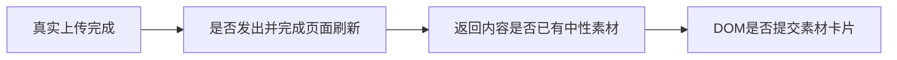

# 上传列表刷新：待用户决定的一次额外诊断

现有两次最小区分实验均失败，预算2/2用尽。真实按钮控制排除了“全部由隐藏input绕过按钮造成”，但没有保存Next页面刷新请求、返回投影与提交状态，无法选择有证据的产品修补。本文件是待决定候选，不是新实验许可，不重置原研究预算，也不把卡改为validated。

建议用户明确允许额外一次诊断，仅用当前包的实际Node/full Chromium、新随机data/auth、现有178字节中性PNG，通过真实上传按钮与filechooser操作。保原create→PUT→complete、归属和文件名等待断言、120秒预算；只加观察，不改产品、不force、不mock接口、不写库、不打开真实用户profile或模型。

执行前独立核精确新驱动diff，并保存全部目标路径不存在的实际清单。新输出均用独立t1182-rsc-observation前缀，旧日志/驱动/截图冻结。只记录/assets刷新网络请求的开始/结束、pathname、状态、请求失败、返回content-type、长度/SHA以及是否包含本次中性文件名；仅记录当前账号组/账号镜像cookie值，不记录认证cookie、handshake、完整请求头、绝对媒体路径、模型响应或凭据。另记录真实按钮disabled、浏览器DOM卡片及公开assets.list状态/ID，不用公开列表成功替代UI可见性。

这一次要区分三个候选：没有发出或完成刷新请求；服务端返回投影仍没有刚上传的文件；响应已有文件但前端未提交新卡片。原有限等待结束即保存实际结果并停止，不追加第二次、不删除断言，不根据猜测换整页刷新或重发上传。记录请求/响应不足以证明服务端ctx时明确UNKNOWN；不得称下载/跨组/原生或全功能验收通过。

用户决定前仅保留此文档，未创建或执行新诊断驱动。即使允许一次诊断，也不自动授权未知产品修补或跳过独立SPEC/验收；有明确根因后再落实最小修复。

