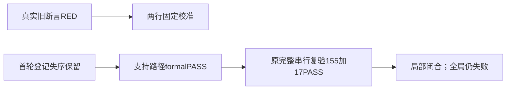

# T1183 独立最终实施复核

**局部 PASS：精确最终源码与合法正式登记后的完整LED018回归闭合。** timeout-policy公共入口仍 **exit1**，完整canonical仍 **27ERROR/1WARN／exit1**；历史正式登记失序保留，不签首编辑前formalPASS。

现SPEC SHA256 `e5df8ea59cf0fa1ec655675a71dac158a0e9b7de9c3c3db8e61135db21d5781a`、constitution `86bc2c8add6a01ebf5b2ecf9de05d448770ca14a4e0bdbbf376fffc6387e3800` 与原初审不变。当前单测试SHA `d76edcf3473a8e107e78495fee8c9173d97e11ad58f071bee3442e0f67e7014c`，原b344 Git SHA `3f41feccfe0ca367e49665592dc4f0af91344e77e2c31f736f378f15b22fe594`。实际完整diff与归档解压逐字一致（diff SHA `16d446d461f9458df13d8ef766fa16e124cffcaade6921e1e27719a48e7c544c`）。独立按原字节只替换审定旁注和固定期待两处，结果与当前文件完全相等：无其它编辑，原144例与单goto/零退避、全部重试/退避/原错透传断言、fake error和原错正则60000文本均保留。固定期待120000没有从产品常量或输出派生。

实际消费者原样导出worker的executionTimeoutMs合同；八个相关生产/公共入口/Rust/config文件与b344 Git字节相等。当前其它并行任务的route测试与控制文档修改不归T1183；本片没有生产、SDK、预算、guard或配置变化。

## 正式登记时序与历史发现

**PROCESS-H001（历史保留）：** 本独立初审实际01:58:13 UTC在首编辑之前已完成，不能等同正式record已完成。第一record于01:58:54因目标是legacy review拒绝，实际exit1；start随后实际exit0，仍发生首编辑与首轮完整命令，首轮真实exit0／60.232726375秒。这是实际时序偏差，不能把后来的PASS追溯到首编辑之前。

第二次01:59:42又因不支持的 `.reviewctl.md` 路径实际exit1。SOURCE_INPUTS与IMPLEMENTATION明确记载恢复两行至原内容并确认diff为空；本次只读材料中没有另外冻结恢复瞬间的独立命令receipt，因此本报告准确引用该记录，不以当前diff或后来的formal state倒签那个时点。支持的 `.T-1183.review.md` 在02:00:07实际record0，`PASS[REV:7b12a69947e9]`；review-event记录02:00:07.851，event hash `44dcfed828a6bec8286b36a6edee6b0991d3ead23f0572b0a9442fc47bf5d700` 与正式state一致。最终重新应用后的完整命令于02:00:24开始，确实晚于合法record。

三次record的原exit1／exit1／exit0、start、首轮、最终轮均有真实receipt与对应日志，全部归档与N原件字节/解压SHA匹配。原只读initial review保留，不改写初审或拒绝结果；历史发现不因最终局部PASS消失。

## 当场回归与范围

原RED完整命令exit1／154PASS1FAIL、原logSHA `5cfce07bbab012407ea7ebd846a30d83b0ed3751390836e3bb9ff16d96f326a1` 保留，当时Rust未执行。合法formal后最终原完整串行命令同原隔离环境实际exit0／6.640041667秒，前端155PASS，Rust `windows_` 子集17PASS、0FAIL、0ignored、259filtered，原6条编译警告保留；原log SHA `10c1743773960bdb6b784a4e1a30a9c47b54c886da5bfcdc47d63c69158c0ff6` 与receipt一致。这是本机当前源树回归，不是完整Rust、真实Windows安装或native客户端验收。

前端type实际0；boundary实际0但原5条基线保留；semantic实际0；orphan实际0并保原100条警告。IMPLEMENTATION记diffcheck0，本独评没有执行check，只核当前与归档diff、精确字节及无其它写集变化。

timeout-policy原公共入口实际30.225976875秒、exit1；七公共组实际PASS分别6+5+20+35+68+27+5=166，没有把入口写成0。静态扫描仍27FAIL；日志首段实际JSON与TIMEOUT_STATIC_ACTUAL逐对象相等，原log SHA `e7516195fa9347b04a4de3b4d300e42b25d28661f0138455c9f0c85a77228350` 对receipt一致。原owner T1081/T1066-timeout-policy/T1101-global-gates保留，不删门、不改预算、不凭公共组PASS清零静态失败，也不由该汇总重新诊断所有旧根因。

b344原完整canonical实际exit1／1158.662259833014秒、27ERROR/1WARN，原日志SHA `34e36c225d9ab3429c82470294d13ab8c3b7adb266919d6d1e65c09713c9caee` 保留。本次不重跑无关全系统，也不拿新局部PASS改写旧输出或原owner。

本轮只读及私有报告写入，没有运行测试/服务/CLI/验证器/DB/模型/浏览器或实验。仅签最终精确测试合同校准与post-formal完整回归，不签首编辑前formalPASS、超时全绿、完整Gate、真用户安装/native、模型/平台/全功能或T1181素材列表/研究恢复。2/2研究上限与暂停不变。完整实读路径/SHA及全部receipt-log对照见READ_SET.json。
