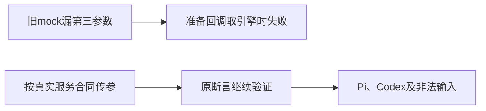

# T1184 独立 SPEC 初审

**PASS，仅准入 `route.test.ts` 的精确装配参数夹具校准与引擎输入回归；findings=[]。** 此结论不签实现结果，也不认定原29个失败已全部定位。

当前 SPEC SHA256为 `d691b14bbb4ac4e46c46cface4f32e2a16e7b17f808ef7ded841a21598a496de`，constitution为 `86bc2c8add6a01ebf5b2ecf9de05d448770ca14a4e0bdbbf376fffc6387e3800`，HEAD为 `b34447aaf7836e7798d4bd37c262eff2357aaf7d`。BACKLOG顶部T1184尚📋；代码未动。

原LED014 receipt实际exit1、28.671211499953642秒、147PASS/29FAIL，logSha256与实读原日志SHA256均为 `9998244e979afc2acd37ea0f3ce5d5ec6d42ed377a2bf051ae542eeb167d2519`；归档gzip解压与N日志逐字相同。route文件54例与retry x2保留。安全日志记录TypeError／context_preparation，不含完整内部原错栈；不能补造隐藏的异常文字。串行 `&&` 前端段失败，后端段未执行，不能签局部改稿公共服务已通过。

静态链可证这处夹具错误：旧mock第185行调用 `assemble(ctx,snapshot)`；真实backend `ChatPrepareOptions` 第18行要求第三参数 `{executionEngine:"pi"|"codex"}`，submit第87–88行解析/默认Pi后将该对象传给assemble。route第599行原样传请求引擎，第613行callback直接读 `options.executionEngine`，缺第三参数会在准备调用之前失败。它证明旧mock违约，不证明正常安装版聊天同样失败。原其它失败是否全部只因此仍待当场复跑；不能将总数或统一phase当作所有根因证明。

唯一代码写集是 `frontend/src/app/api/chat/route.test.ts`。准入用真实类型派生或本测试明确Pi/Codex联合类型，在公共mock传 `input.executionEngine ?? "pi"` 的第三参数；不改变原历史快照/源消息构造、附件、权限、去重、错误流、局部改稿锚点、原消息/任务恢复等54例断言。生产callback保持严格合同，不能改成容忍缺options。其它字段/旧mock漂移不得顺手校准。

新增输入回归范围足够：默认输入准备值为Pi；显式Codex必须在durable.submit请求与prepareChatReply输入都保持Codex；非法引擎必须400／CHAT_ENGINE_INVALID，createConversation、createMessage、durableSubmit、prepareChatReply全0。真实route早于身份/持久写入检查非法引擎，backend还验证显式枚举、冻结选定引擎并在原源消息重放时拒绝切换。原来源和owner、宿主审批只续原任务、取消/幂等、预算和配置守卫继续保留。默认请求中的未传/undefined不需要被产品改成显式Pi；新断言应验证实际准备默认，不改调用合同。

七个本轮实读test/runtime/helper/service/config文件与b344 Git字节相同。本次没有产品、UI、SDK、共享fixture、guard或预算修改。附件读取helper只读以确认既有边界，不在许可写集内；后续若残余附件或其它失败有不同原因，保旧断言、记录真实失败并另收敛/审核范围，不能扩大本初审。

验收要求保原精确route文件与完整LED014两段命令/双显式隔离PG环境，再核chat-turn-submission与chat-host-context真实持久服务合同、双端类型、boundary/semantic/orphan/diff以及独立实施复核。已读既有服务测试具有第三参数、引擎冻结、重放不再装配与拒切引擎断言，仍须当场运行原公共检查。模型准备mock或公开持久服务通过不等于真实付费模型或Codex进程验收。当前完整canonical仍27ERROR/1WARN、exit1，原T1015/T1018/各owner保留，不以此初审洗全局失败。

本轮只读审查并写私有报告，没有运行测试/服务/CLI/验证器/DB/模型/浏览器或实验。不签实现GREEN、后端后段、原生App/真用户安装、模型/平台/全功能、完整Gate或T1181研究恢复；素材研究2/2用尽继续暂停。详尽实读路径/SHA与范围见READ_SET.json，正式initial输入见review-input.json。
