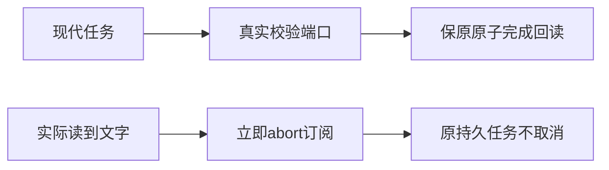

# T1185 独立 SPEC 初审

**PASS，仅两例测试前置条件校准；findings=[]。** 精确写集只有 `frontend/src/app/api/chat/route.test.ts`，不准改变产品或扩大其它夹具。

现SPEC SHA256为 `0642bd9881d4d45ce749722e763b34f9d1f60252b0ec74c756eda6592e258f47`，constitution为 `86bc2c8add6a01ebf5b2ecf9de05d448770ca14a4e0bdbbf376fffc6387e3800`。当前route测试SHA `6269300a553eb0b2f7554e3c840085a3dd12446ace2895ea20e3eb7bd4c9ac69` 与 `SOURCE_BEFORE_T1185.json` 一致；本次两例尚未动，上游T1184装配options及引擎回归作为冻结基线保留。

原focused文件虽命名 `t1184-exact-route-green`，实际receipt/log是 **exit1**、14.946611375024077秒，56例54PASS/2FAIL、retry x2。实读日志SHA `da63264f3f58aeb3916e8808e8ed7db13b3f1fa0477dd9cc219d0df885416a86` 与receipt一致；归档解压与N原件逐字一致。两失败分别是实际完成端口未装配的ConflictError，以及首次pull前abort使空串不含“已写”。原失败均保留，不因文件名误签GREEN。

现代submission真实payload保 `terminalPlanFailurePolicyVersion=1`。completion在租约事务内先校验owner、冻结来源/历史、调用回执与检查点，第46–47行对现代版本要求两真实validator；真实生产dispatcher第121行与backend测试第71行注入workbench-plan.service的 `validateTerminalPlanFailures`、`validateTerminalToolFailures`。已读两函数真实逻辑，它们校验失败步骤/不可重试工具原回执与可信输入绑定，可能抛ConflictError；不是固定返回空。完成例只补当前实际函数装配，不删payload版本、不改guard或注入假通过；原请求→任务→账本→checkpoint→assistant正文/用量/消息/业务任务/执行任务/结果/finish原子回读断言均保留。

真实 `chatExecutionResponse` 为 `highWaterMark:0`，仅在pull推进；第一次read先发start，后续read才推进订阅事件。旧测试在任何read前abort，源码立即关闭流/abort订阅，不会凭空产生未读取文字。准入让真实reader有限逐块读到“已写”后再立即abort，验证已读文字、后续done、真实订阅signal即时aborted，以及durable.command0。不能只读start就假称读到正文，不能恢复后台预读/延迟取消，也不能取消原持久任务。现有stream公共回归已经覆盖按需/零读取、读取后取消释放订阅与不发任务command，仍须当场复跑适用公共链。

原56例、上游引擎与历史快照/来源/附件/权限/幂等/恢复断言全保留。原model及测试预算不在本写集，不借本初审销超时旧债。八个实读生产/既有测试文件与当前b344 Git字节相同。本任务不改UI、SDK、config或共享fixture。

验收必须有精确route完整56例、原LED014双显式PG隔离的完整串行两段命令、真实submission/host-context/completion与相关stream宿主回归、双端类型/scans/diff和独立实施复核。任何不同旧backend失败保原日志/owner，另收敛范围，不删断言。本文件完整验收闭合前不能称T1184/T1185完成；当前完整canonical27ERROR/1WARN保留。

本轮仅只读与私有写，没有执行测试/服务/CLI/验证器/DB/模型/浏览器/实验。不签实现GREEN、付费模型/Codex进程、native/真用户安装/全功能、完整Gate或T1181研究恢复。研究2/2用尽继续暂停。实际路径/SHA/范围详READ_SET，正式initial输入详review-input。
