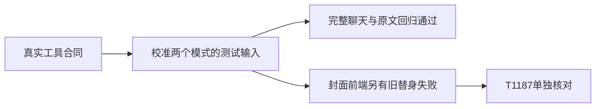

# T1186 当前工具样本校准的实际结果

本任务只修改 backend/src/modules/ai-runtime/chat-tools.test.ts 中现有 selected/project 两模式遍历用例。五个具名中性样本符合真实 strict Zod 合同；通用 sample 函数、循环外源码、原四个 typed 作品工具跳过及原 redfox 样本均保持原字节，无新增工具跳过。保留每工具合法解析、非对象、required 与多余字段拒绝，并增加真实 canvas revision/operation 及 system kind 的负例。不调用工具执行器，不修改产品、SDK、服务合同、guard、预算或配置。

原完整 LED014 的前端178 PASS、后端264 PASS/2 FAIL、exit1 保存在本目录 t1184-t1185-led014-complete-current 原 gzip/receipt，不能用后来结果覆盖。初审和 taskctl start 实际 exit0 后才实施本次精确写集。当前源码 SHA 见 SOURCE_AFTER.json；IMPLEMENTATION.diff.gz 为精确差异。

当前当场验证：

| 验证 | 实际结果 | 回执前缀 |
|---|---|---|
| 两模式 focused | 2 PASS/224按名称筛掉，exit0 | t1186-two-mode-current-focused |
| 原完整 LED014 串行命令 | 前端7文件178 PASS、后端实际3文件266 PASS，exit0；包含完整chat-tools226例。原后端四路径命令未改，不编第四文件 | t1186-led014-complete-current |
| 原完整 LED017 串行命令 | 后端2文件243 PASS、前端2文件67 PASS，exit0 | t1186-led017-complete-current |
| 原完整 LED020 串行命令 | 后端3文件274 PASS、前端66 PASS/18 FAIL，exit1；均在旧 live-session 替身缺 currentTaskId 方法处失败，另登记 T1187；不签封面整门PASS | t1186-led020-complete-current |
| 真实工具参数/画布/系统宿主合同 | 3文件35 PASS，exit0 | t1186-current-real-tool-host-contracts |
| 当前助手系统/采纳/画布服务公共链 | 3文件101 PASS/3条件跳过，exit0；不是104全PASS，也不是整套均在PG上 | t1186-current-real-assistant-owner-chain |
| 原3项PG父稿件锁专门子集 | 私有55422集群3 PASS/72按名称筛掉，exit0；先核实际data_directory，不接管已有角色；临时creatoros_t1074创建/删除真实exit0 | t1186-real-pg-parent-lock-check |
| 助手合同 | 首次contract默认配置未发现src文件，exit1；使用已有backend配置后7 PASS/exit0，两次原日志均保留 | t1186-current-assistant-contract / corrected |
| 双端类型 | 各exit0 | t1186-current-backend-type / frontend-type |
| boundary / semantic / orphan / diff | 各exit0；原boundary5条基线、orphan100条提醒保留 | t1186-current-* |

合同/公共链原输入在样本校准前已执行，UNCHANGED_REAL_INPUTS_BEFORE_EDIT.json 记录16个实际输入与HEAD一致，修改后再次核这些字节一致。PG子集独立补验不篡改原3项条件跳过。没有原生安装、付费模型、真实平台或新增上传实验的证据；产品未改，不重建同一运行时安装包。

当前样本校准的局部通过不替换 b344 完整 canonical 的27 ERROR/1 WARN，也不签本任务之后的完整对账已绿。当前控制审计仍有19项旧审核欠债，T1082/T1025/T916及其它原owner保留。上传研究两次用尽，仍等待额外一次隔离诊断的明确答复。最终独立实施复核、pmem、控制审计和完成事件另留实际回执。

