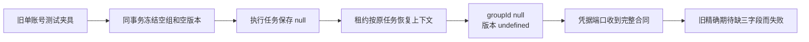

# T1190 定位生成请求上下文只读诊断

诊断时间：2026-10-10T02:53:56.957770+00:00。主工作树：`/Users/zyongzhu/.codex/worktrees/t1062-client-integration/Thirdspace-creator`。审读时实际HEAD：`b34447aaf7836e7798d4bd37c262eff2357aaf7d`；落盘时HEAD：`b34447aaf7836e7798d4bd37c262eff2357aaf7d`。文件来源哈希及实际审读范围见同目录 `READ_SET.json`。这是只读诊断，不是修复、独立SPEC审核、实现准入或新测试PASS。

## 结论

**当前唯一失败的直接原因已证明是旧测试的精确请求上下文期待未跟进已存在的账号组合同。最小候选只校准原测试的三个字段，不改产品。** 原日志收到 `groupId:null`、`groupVersion:undefined`、`membershipVersion:undefined` 与该夹具创建出来的legacy持久任务来源一致；这些值不是从页面、模型参数或猜测的组ID注入。

定位候选的专属normalizer、空关键词归一和前采候选身份，在同一用例第316行已通过，随后第317行的凭据端口上下文期待失败。没有证据显示这次生成因账号组字段而执行不了。该判断只解释这个已冻结失败，不能代签定位全部入口、真实模型、前端或安装版通过。



## 原证据与实际失败范围

- 原receipt：`/Users/zyongzhu/.codex/creatoros-verification/t1117-20261009/t1015-current-led058-diagnostic.json`；原日志：`/Users/zyongzhu/.codex/creatoros-verification/t1117-20261009/t1015-current-led058-diagnostic.log`。receipt中的日志SHA与现场文件SHA一致：`6fe139805f351d91feb9bf7a0afe0a1bc8bbc0b3b38bb7003ac70983fdfd0434`。原证据没有修改。
- 原串行命令于2026-10-10 02:34:46.336430 UTC开始，02:35:06.744349结束，20.407566834秒、exit1。Worker六文件54 PASS；后端五文件117 PASS / 1 FAIL；`&&`在后端失败处停止，前端三文件**未执行**。本诊断没有重复运行该命令或其它实验。
- 原日志27–50行指向 `execution-chat-generation.service.test.ts:317`。收到一次 `resolveCredential` 调用，除新增三字段外 userId、accountId、source、requestId以及后续 `positioning.generate`/ref/signal参数一致。日志19–20行记录该节点最终status=ok；同用例第316行候选结果断言位于失败断言之前。
- 日志先前两个structured status=error不能被删除或补签；原用例的回放/结构修复过程保留。本轮仅核最终明确的对象差异，不从日志标签推测其它生成缺陷。

## 合同及字段来源

| 层级 / 精确位置 | 实际事实 | 对本失败的意义 |
| --- | --- | --- |
| `contract/src/request-context.ts:25–35`；`backend/src/request-context.ts` | 唯一RequestContext有可选 `groupId?:string|null`、`groupVersion?:number`、`membershipVersion?:number`；backend只重导出这一类型 | 三字段合法；可选字段并不要求内存对象必须省略属性 |
| `contract/src/internal/chat-worker.ts:18–22,42` | 冻结聊天身份允许groupId及两version为nullable/optional，必须至少有组或真实账号范围 | 原account-only兼容不是全局数据视图，空组不扩大权限 |
| `frontend/src/lib/request-context.server.ts:211–221` | 原入口验证组的真实owner；有account时再验证当前member匹配组，返回实际group.version/member.version；无group保持旧base | 当前普通入口来自可信service，不让请求body/model填写授权版本；该fixture未经过这个HTTP解析层，不能说它模拟了真人绑定账号 |
| `execution-chat-generation.service.test.ts:19–25,45–53,109–136,187–190` | fixture给 `structured-u + structured-a-<seq>`、source=user；创建会话/源消息后走真实submit。没有创建平台账号、组或membership；端口/模型回执为确定性测试替身 | 原用例是legacy账号级集成夹具，不是显式账号组夹具；实际收到null组已由原日志证实 |
| `membership-lock.service.ts:19–32` | 初始化freeze为groupId/accountId取scope，versions为null。无显式group先按user+account锁真实账号；无账号行/无member保持旧freeze，不造组；已转出legacy组会拒绝 | 该夹具的null/null/null是原兼容分支，不该为了绿测补假组/账号/版本 |
| `chat-turn-submission.service.ts:90–110` | schema校验并转持久JSON；同Tx锁membership，将实际freeze写入modelInput、aiTasks；绑定原sourceMessage，提交唯一execution | 身份与来源在原事务冻结；不是resolveCredential阶段随当前页面改stamp |
| `persistent-task.service.ts:322–348`；`schema/intelligence.ts:140–145` | enqueue再经原membership端口；实际执行任务保存frozen group/account/versions，组及version列均可null | legacy任务row实际null值具有合同语义 |
| `execution-lease.service.ts:22–44` | admission前后重验scope、任务/父任务、status、attempt/fence、deadline和lease；context从锁定task固定创建 `groupId:task.groupId`、`groupVersion:task.groupVersion??undefined`、`membershipVersion:task.membershipVersion??undefined` | 从持久null转换到RequestContext number-optional即显式undefined；groupId保持null。不是产品丢失真实组版本 |
| `chat-host-context.service.ts:51–61` | 在原lease下核AI/execution映射、user/account/group、frozen modelInput摘要、会话/源消息/history映射及host/Skill owner与摘要 | 工具上下文必须由原真实任务恢复，不能用输入ctx/页面ctx替代 |
| `execution-chat-generation.service.ts:49–67,140–143,199` | base取reader返回context，prepareGeneration用其clone；resolveCredential再传同一context的clone及真实skill ID/ref；完成按positioning专属normalizeSuggestion投影，并保原discovery | 当前凭据端口收到这三字段是沿原可信消费链传递；normalizer不修改RequestContext |
| `positioning-runner.ts:177–212` | normalizeSuggestion保原trim/关键词补齐、真实downstream字段、空statusNote语义 | 第316行原候选/前采身份保护不应随ctx期待校准而改动 |

可复核Git来源：三项RequestContext字段和lease第40行来自 `125bc864d79f64891694ed0d630b6462fc7d7e26`（2026-10-05，“保存已授权账号组及主树改动供统一客户端验收”）；旧317行精确期待来自 `3e9a0069eeaadf3de9a0ac35e3d86caef13db37a`（2026-09-06，“接通共享结构化生成账本与拒绝恢复端口”）。这是当前可见代码演进证据，不把旧wip commit自述当产品验收PASS。

授权/规范方向并非凭类型猜测：账号组SPEC第63–80行明确RequestContext增加server解析组版本，任务冻结组/成员范围，恢复不重stamp，旧account-only只保历史范围；该文档仍有原候选/历史迁移待确认描述，本报告保留其状态。已采用的T1062 §范围补充第26–29行明确以group工作区落实用户已确认的组内可见，原平台account可空出处、membership Tx锁、跨组互斥和冻结任务回执不改；当前T1074第29/98行沿同一真实user/group/account-null及冻结来源核验。类型、实际源码和这些已登记范围互相一致，不能删字段“恢复”旧测试。

## 当前真实隔离守卫及反例保护（只读，未在本轮运行）

1. `workspace-scope.ts:9–24`：显式group按group过滤；legacy按account且仅NULL/该账号初始legacy组；requireWorkspace拒绝无范围。null不等价所有账号。
2. `membership-lock.service.ts:34–50`：显式组+account锁真实active账号与有效member，必须相同组/相同membershipVersion；纯组仍核真实owned active组；冻结account带group却无membershipVersion拒绝。`private-collector-admission.service.ts:27–41`在原可信业务映射下复用这条真实守卫，不因payload声称权限而授权。
3. `execution-lease.service.ts:22–44`保原Tx、随机fence/attempt、运行状态、绝对deadline/lease和调度父暂停/取消保护。恢复context仍读旧task范围，页面切组不改变它。
4. 本失败文件第207–247行拒绝改写模型请求、跳号、unknown/rejected伪完成、Worker自报候选、跨任务父凭据及取消后启动；第270–310行保同请求并发唯一子调用、鉴权/断流/丢ACK同原任务恢复。第316行保定位专属normalizer与前采candidate identity；第317行完整user/account/requestId/source/ref/signal仍必须精确断言。
5. `group-task-scope.integration.test.ts:31–53,79–105`已有纯组创建/读及跨组拒绝、task恢复仍原group、转组前后创建锁、stale member使send零调用；`execution-lease.service.test.ts:24–64`保旧fence、取消/暂停、新lease和过期拒绝。它们是当前静态反例来源，不属于本次receipt的已运行文件，不代签PASS。
6. `external-group-chat.integration.test.ts:132–159`保AI/business/会话组被改变、modelInput组篡改即便重算digest、旧fence/伪call/不准发布以及零proposal；`request-context.server.test.ts:343–359`保失效组拒绝与账号跨组拒绝/真实版本透传。它们保护当前合同，不允许改成宽松partial期望或删除。

精确边界：当前 `assertFrozenWorkspaceMembership` 会核member版本及组的owner/active，**没有比较冻结groupVersion与当前group.version是否相等**；groupVersion在当前链中传递原冻结值，并在AI/task映射匹配中比较。不能把它描述成已证实每次调用都执行“group version CAS”，也不能为修这个legacy期待擅自新增全局CAS门。此事实不构成本次317行失败原因；本诊断不扩展为产品权限改造。

## 最小候选及后续验证要求

当前候选产品写集：**空**。候选测试写集仅：

`backend/src/modules/execution/execution-chat-generation.service.test.ts`

只在原定位用例317行把现有完整期望补上该legacy夹具实际合同，示意如下；没有执行或应用此候选：

```ts
expect(f.resolveCredential).toHaveBeenCalledWith(
  {
    ...f.ctx,
    groupId: null,
    groupVersion: undefined,
    membershipVersion: undefined,
    source: "ai",
    requestId: `execution:${f.ref.executionTaskId}:${f.ref.attempt}`,
  },
  "positioning.generate",
  f.ref,
  undefined,
);
```

必须保 `toHaveBeenCalledWith`、全部原字段/四个参数及原316行结果/前采身份断言；不从actual mock args生成expected，不做JSON序列化抹undefined，不用objectContaining、删键或新增假group夹具使期待“自然一致”。保原17例及所有已有guard/恢复/预算测试，不删除/skip或改测试预算。

root将此精确测试校准作为正式SPEC候选独评后实施。实际验证至少原失败文件（真正执行原17例）和原receipt逐字节argv的完整LED058三段串行命令；原54/117/1失败receipt保留，新回执单独记录，前端只有实际执行后才能报告。与组冻结/租约相关既有反例可沿全局现有Gate复验，不修改这些测试/guard作为本校准写集；不得用仅helper绿或新采样替代原串行路径。

本诊断未执行context-plan/context-compile/reconcile/taskctl/CodeGraph刷新，因为父任务明确当前只读并禁止产品/测试/SPEC/状态改写；只读取skill3.29.0与project同版本、阶段router及manifest当前4-build。最早需先完成的本任务材料为来源诊断→正式精确SPEC→真实独立审核；没有在只读工件中自行准入实现或签PASS。研究2/2暂停照旧，新增实验次数0。

## 已证明与仍未知

**已证明**：原receipt/log字节一致；实际唯一失败位置/字段差异；canonical字段合法；lease明确选择属性存在的对象形状；该fixture legacy范围通过原服务冻结并传入凭据端口；旧断言早于组合同；normalizer及前采identity前置断言通过。

**未验证/不推断**：不接触测试数据库来查询原task行，组null的运行事实仅来自原mock调用日志并由夹具+真实创建源码解释；本轮不运行新测试，因此候选校准后原17/LED058是否全绿待实测；前端原三文件未执行，不报状态；真实定位服务/模型/平台/安装旅程未操作；其它任务、原研究暂停问题、未知外部副作用和完整组权限均不由本报告销账。不存在测试修改、产品修复或重新生成历史PASS。
