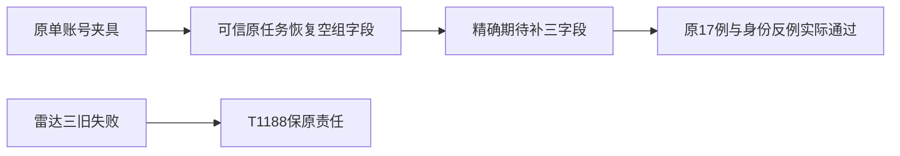

# T1190 实施与当场验证

正式独立初审和taskctl start均当场exit0后，只在原定位用例317的完整凭据上下文期待补groupId:null、groupVersion:undefined、membershipVersion:undefined。产品写集为空。撤去三字段与改前文件及Git HEAD逐字节相同，原17例、四参数、候选正文/前采身份和所有守卫未变；精确SHA与证明见TEST_ONLY_DIFF_PROOF.json。

大白话：当前服务会明确说明这条旧单账号测试任务“没有账号组”。旧期待漏了这三个字段；现在仍检查完整对象，没有把身份检查改成模糊匹配。

| 当场命令 | 结果 | 实际边界 |
| --- | --- | --- |
| 原execution-chat-generation.service完整文件 | 17 PASS，exit0，46.885436秒 | 不是实际模型或用户数据库验收 |
| 原完整LED058串行三段 | Worker54/后端118 PASS；前端142PASS/3FAIL，exit1，72.347340秒 | 前端三旧disabled-vs-hidden失败与T1188原日志同名/同位置，保失败，不签整串绿 |
| 真实group-task-scope与execution-lease | 后端12 PASS，exit0 | 原跨组、member、lease/fence/取消反例保留 |
| 真实request-context.server | 前端29 PASS，与上一命令串行exit0 | 当前上下文来源与拒绝反例 |
| 双端types、boundary、semantic、orphan、diff | 均exit0 | boundary保留5项旧基线；orphan保留原WARN，不写无债 |

完整原失败、修改前源码诊断、独立初审、record/start和每一轮原日志SHA/receipt/gzip都已归档本目录，没有覆盖原54PASS/后117PASS1FAIL/前未执行的RED。共享timeout-policy仍exit1：全部166项公共回归通过，原27静态失败列表与此前一致；不改预算、validator或产品洗绿。

独立实施报告、pmem/reconcile与taskctl完成必须按实际发生另行留证。本文件不代签本轮全仓、安装包、原生、模型、平台或上传研究；T1181/T1182两次研究耗尽及原全局审核/超时欠债保留。代码与证据需本地主分支提交，不push/tag/发布。

本轮完整pmem在开跑前真实exit0，完整reconcile现已真实完成：1371.561389秒exit1，23 ERROR/1 WARN，比原27项减少LED014/017/018/020四项且无新标识。原19审核链及LED042/054/058/053范围外旧失败、T1171警告明确保留，非全绿；实际原收据与gzip在本目录，对照见T1015/current-t1190-t1191-20261010。

该局部任务现已由taskctl complete真实exit0（2026-10-10T03:49:15.738935+00:00），原receipt/gzip附后；不是全功能完成。main提交随后发生，不补拍历史前置门。
