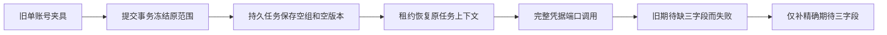

# T1190 独立 SPEC 初审

结论：**PASS，findings=[]**。这次失败是旧测试完整上下文期待缺少当前已有三项组字段。SPEC把改动限定到原精确断言，保持全部身份、任务、候选及恢复保护，方案可进入正式记录后的实施。这个结论只签 SPEC 初审，未签实现、功能、安装包、原生或全功能通过。

审读者：`/root/t1190_spec_review`。被审根：`/Users/zyongzhu/.codex/worktrees/t1062-client-integration/Thirdspace-creator`；HEAD：`b34447aaf7836e7798d4bd37c262eff2357aaf7d`。时间：2026-10-10T03:03:01.241628+00:00。

被审 SPEC：`docs/features/t1190-positioning-generation-request-context-test.md`，SHA256 `8ebfd3316843168588d31ab59f5478984bd3be016204bd6990727aa5c31d5a15`。真实宪法：`docs/产品定位.md`，SHA256 `86bc2c8add6a01ebf5b2ecf9de05d448770ca14a4e0bdbbf376fffc6387e3800`。目标测试改前 SHA256：`a52c2063e67aa0849b046ded2f2dc1c7b513af7f3e8ab0a8711c6a5696b2cb32`。所有实读文件绝对路径、全文字节 SHA256 和实际审读范围见同目录 `READ_SET.json`，没有复制诊断读集代签。

大白话：这套旧测试只建立账号范围，没有建立真实账号组。当前服务恢复原任务时，会明确携带“没有组”的字段；旧期待却只写了账号字段。补上这三个真实字段，使测试继续检查整个对象。

## 自行核实的依据

| 依据 | 读到的实际内容 | 判断 |
| --- | --- | --- |
| `contract/src/request-context.ts:25`及backend重导出 | groupId是可选string/null，两个version是可选number；单一定义 | 显式null/undefined属性合法。可选类型不要求对象必须省略属性。 |
| 目标测试1–190及313–318 | fixture仅建ctx、会话、用户源消息、原提交与租约；没有创建platformAccount/group/member。317原对象仅含ctx/source/requestId，仍检查四参数 | 当前校准针对原legacy夹具，不是将真组猜成null或扩大可见范围。 |
| `membership-lock.service.ts:19`、`chat-turn-submission.service.ts:90`及`persistent-task.service.ts:322` | 冻结初值为null版本；legacy无真实账号/member则保原账号范围。提交事务把freeze写入modelInput/AI/execution，源消息绑定唯一任务 | 原组上下文来自服务冻结，不取页面当前选择或模型参数。 |
| `execution-lease.service.ts:22`和39–42 | 前后membership准入、原task/父关系、attempt/fence/status/绝对deadline/lease；context明确groupId=task.groupId，两版本null转换undefined | 这三属性沿当前真实租约合同生成。 |
| `chat-host-context.service.ts:51`、`execution-chat-generation.service.ts:49`、140–143 | 在原lease下核业务映射、user/account/group、modelInput与history摘要、会话/源消息、host/Skill；base用reader.context，凭据端口传其clone、真实skill/ref/signal | 失败收到的完整ctx来自原可信消费链。 |
| `execution-chat-generation.service.ts:199`、`positioning-runner.ts:177`与测试316 | normalizeSuggestion投影原模型结果并保discovery身份；不修改RequestContext | 原316先于317失败，未抹候选内容或前采来源。 |
| DEC-GROUP-1022第5–23行、T1062第24–35行、T1074边界和来源核验 | 用户已有账号组方向及2026-10-04“开始执行”授权；冻结范围、组内可见、真实平台账号和非自动历史迁移边界已登记 | 不是凭类型或commit自述推定新授权。T1022文档历史候选/迁移待确认状态和正式验收阻塞保留。 |

直接核对Git blame：原定位用例及317期待来自`3e9a0069eeaadf3de9a0ac35e3d86caef13db37a`；组字段及lease赋值来自`125bc864d79f64891694ed0d630b6462fc7d7e26`。这只证明代码沿革，不证明那些提交已通过产品验收。

## 原失败的真实证明范围

已直接读取原`/Users/zyongzhu/.codex/creatoros-verification/t1117-20261009/t1015-current-led058-diagnostic.{json,log}`，重新计算日志SHA并与receipt一致：`6fe139805f351d91feb9bf7a0afe0a1bc8bbc0b3b38bb7003ac70983fdfd0434`。原argv与reconcile.config中的LED058完整三段串行一致。

原运行20.407566834秒，exit1。Worker六文件54 PASS；后端五文件117 PASS / 1 FAIL；目标文件17例中1失败，失败位置317。Received的一次凭据调用仅多groupId:null、groupVersion:undefined、membershipVersion:undefined；原userId、accountId、source、execution请求ID以及positioning.generate/ref/undefined参数保持。由于原命令使用&&，前端三文件未执行。原normalizer结果期待316已完成后才到317；前两个structured error日志仍是原回放事实，最终status=ok不能代签真实模型或所有定位入口。

本轮没有查询原数据库行；空组运行事实来自原mock调用日志，夹具和服务源码解释其产生路径。未在本轮执行新测试，也没有把此初审当作新的RED/GREEN或前端PASS。

## 通过的精确边界

产品写集为空。唯一测试写集：`backend/src/modules/execution/execution-chat-generation.service.test.ts`。只在原317完整`toHaveBeenCalledWith`期望对象加`groupId:null`、`groupVersion:undefined`、`membershipVersion:undefined`；保`...f.ctx`、source:ai、原execution requestId和完整四参数。撤去三字段后的文件必须逐字节等于改前SHA绑定的文件。

保留原316 normalizeSuggestion/discovery完整内容及原17例；不改fixture，不从mock实际值生成expected，不用objectContaining，不序列化消除undefined，不删、skip或放宽其它断言。RequestContext、组/成员/来源、父任务、attempt/fence、取消/暂停、deadline、预算、unknown/rejected、并发唯一性、SDK及配置均不改。

实际守卫和静态反例已读：workspaceFilter保持显式group与legacy账号NULL/初始组范围，不把null当全局；membership锁验证真实owned active组及当前member版本；group-task-scope原例覆盖纯组、跨组、原任务恢复、两种转组锁顺序及stale member零发送；execution-lease覆盖旧fence、暂停/取消、换租约与过期；external-group-chat及request-context.server原例覆盖篡改组、源映射、旧fence/伪call和跨组选号。它们本轮均未运行，不代签PASS。

精确承认当前限制：assertFrozenWorkspaceMembership核member版本和组owner/active，没有比较冻结groupVersion与当前group.version的全局CAS。原groupVersion沿冻结任务透传，AI/execution准入映射比较其一致性；不能为本测试校准新增CAS质量门，也不能把本初审写成已验证全部组版本保护。

## 实施后仍必须发生的验收

SPEC要求原17例、原LED058完整三段串行、既有group-task-scope/execution-lease与前端request-context.server反例、双端type、boundary/semantic/orphan/diff及独立实施复核，均须以当场真实收据记录；仅静态证明不替代实际执行。若前端原雷达三项活动任务呈现期待仍失败，沿T1188保留其完整退出码、日志及原owner，只能在本任务全部自身Gate实际完成后按AGENTS限定证据处置，不能宣称整串PASS。

父交接保留的全局旧27 ERROR/1 WARN、19项旧review债未由本报告重跑、复审或销账。T1181/T1182研究2/2已用尽和上传暂停已读，新增实验0。产品未变时不借本任务重打同一包；不触真实用户库/App/模型/平台，不push/发布。

流程核对：技能与项目均3.29.0，manifest当前4-build；本任务最早未完成步骤为本独立SPEC初审及root正式记录。按父任务只读边界没有执行context-plan/context-compile/reconcile/taskctl/reviewctl、测试、服务、应用CLI、CodeGraph刷新、数据库、浏览器或网络。只写指定私有目录三工件；未改W的SPEC、测试、产品、状态、Gate或配置，也未预建tool-owned相邻review文件。
