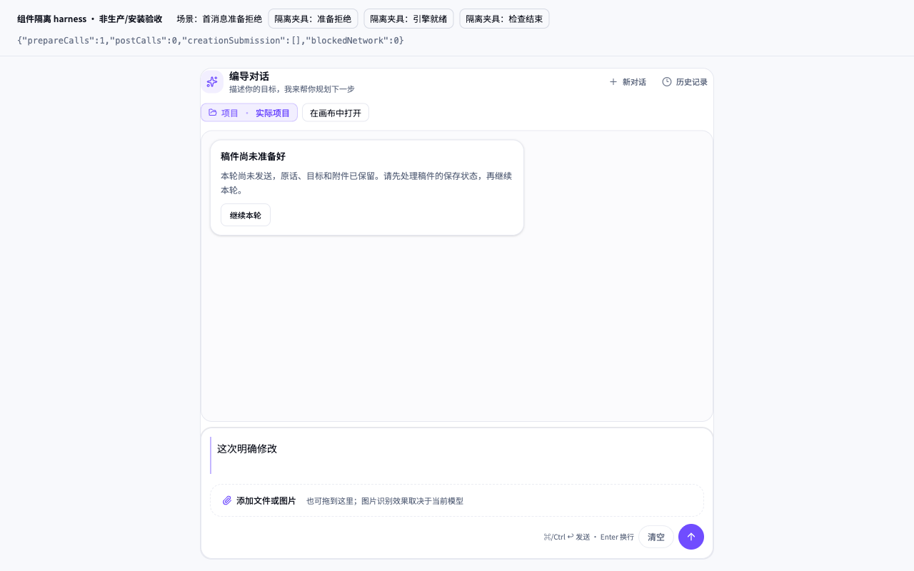
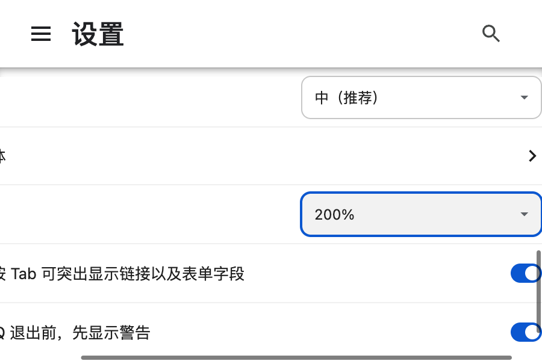

本次是 fresh 独立任务走查，按项目 oil-ui-pro 0.10.0 的 `references/visual-review.md` 执行。只看当前可点击页面、渲染内容、真实操作和只读隔离证据接口；未读产品源码、旧截图、旧评审或制作 driver，未改项目、调用模型/平台/真用户库/App、上传或启动子 Agent。未打审美分。

两个主要任务的窄范围行为完成：条件不足时零提交，夹具仅把条件改为就绪后仍零提交，用户明确继续后一次原话、原目标到达真实 SDK 的最终 fetch 边界。结果待确认任务只完成了“保留原请求、未自动重提”的观察；固定 503 未提供原会话回执，无法完成核对动作。因此不能写成三项全任务 PASS，也不能称模型生成、持久任务或真实后端成功。

| 范围 | 本次结果 | 证据 |
| --- | --- | --- |
| 准备失败 → 条件就绪 → 用户继续 | 首次鼠标、第二次键盘、900×600 复验均观察到 0 → 0 → 1；第二次及窄窗的原话和 editorTarget 全字段相等 | [02](02-prepare-refused-wide.png)、[03](03-prepare-ready-no-auto.png)、[11](11-prepare-keyboard-continue-focus.png)、[20](20-prepare-refused-narrow.png)、[21](21-prepare-continue-narrow.png)；receipt log 32/34/44/53、104/107/109 |
| 图文原请求引擎不可用 → 找处理入口 → 就绪 → 用户继续 | 首次鼠标、第二次全键盘、900×600 复验均观察到 0 → 0 → 1；第二次及窄窗的一次原话和 creationTarget 全字段相等 | [06](06-creation-entry-wide.png)、[08](08-creation-ready-no-auto.png)、[17](17-creation-keyboard-ready-focus.png)、[23](23-creation-ready-narrow.png)、[24](24-creation-submitted-narrow.png)；receipt log 80/88/97、114/116/119 |
| 提交后结果不明，核对原请求而不重发 | 首次和第二次都保持原话与 postCalls=1；原请求核对按钮禁用，未取得原会话回执，未激活核对，未声称完成 | [05](05-result-unknown-wide.png)、[13](13-result-unknown-second-use.png)；receipt log 55/56 |
| 真实全局宿主 200% | 实际 Chrome 设置值为 2（200%），没有 CSS scale 或 DPR 模拟。1280×800 实际 CSS 视口 640×400；900×600 实际 CSS 视口 450×300。两个视口关键键盘动作可达；prepare 两个视口及 creation 宽窗的原生滚轮可到完整 composer。creation 窄窗仅靠滚轮到完整底部没有证实 | [48](48-chrome-actual-setting-200-visible.png)、[29](29-global-prepare-200-submit-focus.png)、[31](31-global-prepare-200-continue-focus.png)、[37](37-global-creation-200-check-link-focus.png)、[40](40-global-creation-200-narrow-check-focus.png)、[43](43-global-prepare-200-narrow-submit-focus.png)、[44](44-global-prepare-200-narrow-continue-focus.png)、[46](46-global-prepare-200-narrow-native-wheel-bottom.png) |

入口是 `http://127.0.0.1:31591/normal/index.html?scenario=prepare` 和 `?scenario=creation`，100% 下使用 1280×800、900×600。全局宿主入口是 `http://127.0.0.1:31591/?scenario=prepare` 或 `creation`，没有夹具按钮，只检查允许动作可达。页面版本以本次实际运行的最终静态宿主为准；交接声明主源码为 60fe，执行者未独立做源码与静态包比对。浏览器为现有完整 Chrome for Testing；Playwright 使用现有安装，超时预算均为 120000ms，未 force 点击、JS 滚动或假点击。网络白名单只有本地 31591；所有 body 记录来自只读 `window.__HARNESS_EVIDENCE__`，不是后端接收回执。

按操作严重程度记录：

1. **卡住／环境限定，任务 3 未验**。A5/C5：用户主动继续后，页面先显示恢复中，随后显示“原请求结果待确认”。我预期有原会话回执后可以核对，实际核对按钮禁用，页面说明仍在等待回执。原话留在输入区，原 target 仍在只读证据，postCalls 保持 1，没有自动重发。我没有改用发送按钮。证据：[05](05-result-unknown-wide.png)、[13](13-result-unknown-second-use.png)，receipt log 55/56。固定 503 没有产生真实原会话 ID，因此这是本次环境的完成边界，不能推成产品核对链路失败或通过。需要有原会话回执的真实链路才能验证核对。

2. **走错／执行者误计 Tab 次数，已纠正**。G2.2：第一次 global creation 200% 批量计步把焦点停在“在画布中打开”，随后的 Enter 激活了画布链接；这是执行者未先核对焦点的错误，不归因于产品入口名称。隔离页只记录 `/canvases?projectId=protocol-project`，没有打开真实画布。证据：[34](34-global-creation-200-settings-focus.png) 的实际焦点是画布链接，receipt log 159–165。重开本次私有会话后逐项核对焦点，G2.3 正确激活了引擎处理链接，receipt log 172–178，[37](37-global-creation-200-check-link-focus.png)。

3. **犹豫／真实保存入口未验**。A2：提示明确告诉我尚未发送且要先处理稿件保存状态，但当前隔离页面没有可操作的保存页面。页内可见“在画布中打开”，我无法在本次授权范围内验证它能否完成真实保存；这次只用外部准备 Port 夹具改变条件。证据：[02](02-prepare-refused-wide.png)，A3 [03](03-prepare-ready-no-auto.png)。这处犹豫保留为范围限制，不用夹具操作代签真实保存体验。

4. **犹豫／200% 窄窗的滚动落点影响到达路径**。G2.5：900×600、200% 下，键盘能把引擎处理链接完整带到视野中并激活；第一次鼠标滚轮落在内层区域，只改变了卡片内位置，没有把外层 composer 滚到完整底部。证据：[40](40-global-creation-200-narrow-check-focus.png)、[41](41-global-creation-200-narrow-wheel-bottom.png)、[47](47-global-creation-200-narrow-wheel-bottom.png)。不能把这两张带“bottom”文件名的图当成完整底部 PASS。prepare 的外层滚轮后来确实到完整底部：[46](46-global-prepare-200-narrow-native-wheel-bottom.png)。本次不扩大实验，creation 窄窗 wheel-only 完整到达保留未验。

5. **多余的键盘停靠点／低影响**。G1.2：输入后 Tab 顺序为文件 input → 可见添加文件入口 → 清空 → 发送。第一次我按三次 Tab 只到清空，第四次才到发送；原话没有丢失，也未选择文件或上传。证据：receipt log 135–141 的 focused 记录，[28](28-global-prepare-200-keyboard-submit-focus.png) 实际是清空焦点，[29](29-global-prepare-200-submit-focus.png) 才是发送焦点。可考虑把文件操作的 Tab 路径收为一个可识别入口；是否应修改需由主 Agent 结合真实文件选择体验判断。

逐步记录（均从入口自行寻找，没有预先给产品按钮名称）：

| 步骤 | 当时看到什么、为何选这里 | 实际结果 |
| --- | --- | --- |
| A1 | 首屏当前项目和输入区；将“这次明确修改”写入输入，再用发送动作表达本次修改意图 | 原话进入输入；尚未提交 |
| A2 | 看见保存准备不足通知，先读是否已经发出 | prepareCalls=1、postCalls=0，原话仍在输入 |
| A3 | 通知要求先处理保存条件；隔离页只允许外部准备 Port 切换 | 准备就绪后仍 postCalls=0，没有自动发出 |
| A4 | 条件已就绪，通知中有继续原轮的动作，避免重新输入 | 用户点击后一次提交；出现原话消息和恢复状态 |
| A5 | 等待后显示原请求结果待确认，先找核对入口 | 入口禁用，无回执；保留输入，不重发，任务 3 未完成 |
| B1 | 从 prepare 入口重新开始，Tab 到输入，键盘写入原话，用页面显示的发送快捷键 | 同样拒绝、零提交 |
| B2 | Shift+Tab 回到外部条件夹具，Enter 切到就绪；Tab 回到原轮继续动作 | 就绪不自动提交，焦点清楚 |
| B3 | Enter 继续，读取只读 body 记录 | 一次原话；editorTarget 全字段等于 original target |
| B4 | 第二次仍查看未知结果状态 | postCalls 保持 1，原话保留，核对仍禁用 |
| C1 | creation 入口直接显示引擎未就绪，处理动作在通知内部 | 原请求状态 not-submitted、零提交 |
| C2 | 选择通知里的引擎处理链接，查看当前可观察结果 | 链接激活；只记导航，不是实际设置页验收 |
| C3 | 仅用夹具把引擎 available 改成 true | 通知变已就绪、继续可用，仍零提交 |
| C4 | 用原轮继续动作，避免从空输入另起请求 | 一次提交、submitted-unknown；503 未成功 |
| C5 | 第二次按 Tab/Shift+Tab/Enter 完整重走，包括链接激活和夹具切换 | 一次原话；creationTarget 全字段保持 original-pair / protocol-project / frozen-script-v |
| D1 | 900×600 从 prepare 入口重走 A1–A4 | 通知、输入和动作完整可见，0 → 0 → 1，原 target 一致 |
| D2 | 900×600 从 creation 入口重走 C1–C4 | 不可用零提交，就绪仍零提交，用户后一次原 creationTarget |
| G1 | 在真实 Chrome 外观设置里选择 200%，进入无夹具 global prepare，原生滚轮下移，Tab 输入并到发送 | 真实设置和 metrics 一致；底部、发送、拒绝后继续可达；条件仍拒绝，所以没有 POST |
| G2 | global creation 宽窗及窄窗，Tab 到引擎处理链接，核对焦点后 Enter；原生滚轮检查其余内容 | 正确设置链接记录可得；宽窗完整 composer 可见。窄窗允许的引擎处理链接可达，wheel-only 完整底部未证实 |
| G3 | global prepare 900×600、200%，键盘输入、到发送、触发准备拒绝，再 Tab 到原轮继续；原生滚轮下移 | [43](43-global-prepare-200-narrow-submit-focus.png)、[44](44-global-prepare-200-narrow-continue-focus.png)、[46](46-global-prepare-200-narrow-native-wheel-bottom.png) 证明允许动作可达 |

只读 body 核对详见 [summary.json](summary.json)。四组检查均通过原话字符串相等、原目标 JSON 全字段相等及一次提交检查；这只是 fetch 边界事实。浏览器 request 监听没有捕获真实 POST，因为最终 fetch 在隔离页中固定返回 503；不把 counter、`submitted-unknown` 或无出网当成真实任务成功。

未验清单：真实保存页与保存完成、真实设置页、附件恢复（本次未上传）、真实模型成功、后端接收／原会话回执／核对原请求、持久任务恢复成功，以及 creation 窄窗 200% 仅靠滚轮到完整底部。设置链接仅证明导航激活 `/settings?highlight=assistant-engine`。

环境事件保留在 [environment-events.json](environment-events.json)：31591 曾返回连接拒绝；浏览器临时会话的 Chrome 设置尝试及一次 global creation 后续调用发生 browser closed。根因均为 UNKNOWN，不归因于产品或主 Agent 清理。原始失败没有改写为 PASS。`14-creation-keyboard-settings.png` 实际是连接拒绝页；`28` 实际为清空焦点；`34` 实际为画布链接焦点；`35`、`41`、`47` 没有证明完整底部。报告以上述实际画面和 receipt 内容判断，文件名不是判据。

本次私有产物：[报告](report.md)、[成功操作与只读body记录](receipt.json)、[范围摘要](summary.json)、[环境失败摘要](environment-events.json)、[本次新建走查driver](driver.cjs)、[只核对本次证据的脚本](check-evidence.cjs)。
