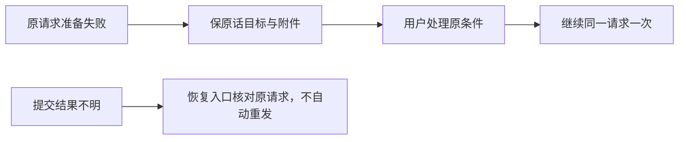

# T1191 实施与最终源验证

大白话：请求还没发出时，保存准备失败或引擎未就绪现在保留原话、目标和附件，给出实际继续入口。结果已不确定时，恢复入口只核对原请求，不自动另发；普通输入框回填同句及发送暗示仍由T1193继续处理。切组、切页或开始新会话后，旧准备结果不能写到新目标。

唯一产品文件是 frontend/src/features/copilot/ai-copilot-content.tsx；测试是同目录原文件，T1187五项隔离替身接口补充独立保留。最终产品SHA60fe11f9b68530fbe22a0e282e1eca182659c5e917dba281a04d0eaaa9adc1da；测试SHAe6163928151eb6cb23b364571131b709d680337c06a510b69047cc72b1d301f8。未修改backend/contract/worker、SDK、任务/归属/期限或研究暂停。

原20例的14PASS/6FAIL、首轮TDD16PASS/12FAIL、澄清TDD29PASS/2FAIL都保持原receipt/log/gzip。完整本文件最终31PASS；新增用例检查可信准备失败/引擎、旧SDK错误优先、普通SDK恢复不错误重发、原附件/目标、新会话与切组/epoch晚回写、准备pending期间不消耗自动恢复预算。原1/2/4秒间隔、三次预算、source/lease/owner与严格保存链均保。旧SDK替身未调用fetch不当作已发送，不制造networkStarted。

第1–6项两轮独立SPEC及真实record均在对应修复前发生，LOGIC_IMPLEMENTATION_REVIEW/READ_SET签346cf源及当前测试的局部PASS。第7条原实际global200裁切、仅Tab候选false及标准wheel候选证据冻结；独立VIEWPORT_REVIEW签38bfa86d SPEC且产品仍346cf。正式recheck record实际03:24:40 UTC exit0以后才在content根加现有overflow-y-auto。没有缩字、删消息下限、改宿主/全局CSS或用强制滚动。

| 实际最终源Gate | 结果 | 限定 |
| --- | --- | --- |
| 原完整LED020 | 后端274/前端95 PASS，exit0，19.217534秒 | 前端含完整copilot31/route56，不是模型/native |
| 原完整LED047 | 174 PASS，exit0，13.475260秒 | 原8文件导航/局部弹层/工具交互 |
| 原完整LED059 | 后端20/前端67 PASS，exit0，10.669286秒 | 原参数/严格准备/任务控制/交互 |
| frontend tsc | exit0，9.740721秒 | 原后端type前一轮实际0、产品后端未变 |
| 前一轮真实live session/control/consumer/interactions | 4实际文件83PASS，exit0 | 真正资源生命周期独立于空观察替身 |
| 前一轮严格准备与作品卡公共链 | 7实际文件46PASS，exit0 | 真正consumer路径已执行，保第一轮错路径记录 |
| 前一轮boundary/semantic/orphan/diff | exit0 | 保原5边界基线、100 orphan warning |

扩大真实owner/worker公共链4实际文件11PASS/4FAIL，原log SHA267b6238360e59d74dec23f43279a9ec859dac187f8064dea221fb3bf2e38043保持。两联合旧严格parse失败归T1092，两精调完整message期待失败已建T1192；失败之后的采纳assertion没有执行，不签采纳通过或正文相等。timeout-policy仍exit1，166公共例PASS、27静态失败与原列表一致；不签整个Gate绿。

最终maker报告及全部原日志/图在UI_COMPONENT_WALK；fresh视觉18张当前图报告在FRESH_VISUAL_REVIEW，保未知输入歧义/字号/短高阅读三建议，已登记T1193及只读源码诊断，不签视觉零问题。fresh任务报告在FRESH_TASK_WALK：四组0→0→1且原话/target全字段相等，第二次/键盘/窄窗及实际Chrome200允许动作取证；未知无真实会话回执，核对禁用而未完成，creation窄窗wheel-only完整底部未证实，环境断连/browser closed与误计Tab原样保留。服务Port/engine/只读列表为明确中性边界，固定503无成功任务或伪造回执，不签三任务全PASS、真实保存/模型/安装版。maker70项原字节69匹配/自身输出log0→2225差异保原JSON，最终字节与PNG尺寸测量另附ADDENDUM，不倒签原清单全闭包。全仓reconcile本轮正在执行，结果待真实记录；仍未构建新的包，旧包/native不代签。main提交、新本地包与随包隔离smoke按正式Skill执行，用户要求无备份。真实用户App/数据、真人微信和上传研究2/2原暂停均不改。

最终独立复核原文件见FINAL_IMPLEMENTATION_REVIEW：报告SHA 2e2a5b8d455bf31ad66d94fe4f3467d111a7043834023f38b21790516cf78871、读集SHA da2d9326eed3111a6f52f73fc1f92d9dc4b51cd78a97c11f1f2963a5ee1a72e3；精确当前60fe/e616源与已发生测试局部PASS，仅作main包前输入，不代签完整UI、新包、原生、任务完成或新canonical。原maker清单FAIL、fresh三任务未全部完成、T1193普通生成状态与全部旧欠债保留。

本轮完整pmem在开跑前真实exit0，完整reconcile现已真实完成：1371.561389秒exit1，23 ERROR/1 WARN，比原27项减少LED014/017/018/020四项且无新标识。原19审核链及LED042/054/058/053范围外旧失败、T1171警告明确保留，非全绿；实际原收据与gzip在本目录，对照见T1015/current-t1190-t1191-20261010。
