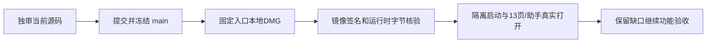

# 当前本地包与实际隔离验证

源码 main 提交：4b10e89e226cd16ed12744d6c885931d3a09f0dd。完整源冻结清单为真正构建前记录；四份版本均1.2.0，origin/main以来9038个对象当场扫描，3个既定合成夹具精确接受，未知/改动反例18个拒绝，未发现新密钥形状。旧已审源码以来13个增量路径按各自独立报告逐项绑字节，当前产品60fe/测试e616源签局部PASS。

大白话：本次包已包含编导准备失败后的继续入口。它实际能启动隔离本地服务并打开工作区，主要页面及助手弹层也打开成功；这还不是生成、剪辑、发布和真人安装的全部验收。

| 当场项目 | 结果与边界 |
| --- | --- |
| 四项打包基本文件 | 4文件45PASS，exit0 |
| 固定desktop:package-local | 369.819818秒exit0；明确CREATOROS_LOCAL_SKIP_INSTALL=1，无App/数据备份 |
| DMG | /Users/zyongzhu/Downloads/CreatorOS-1.2.0.dmg；841223134字节 |
| DMG SHA-256 | d91079d6542407a6f5c3232f35cd815cfaff259c51fa9e40e5ccf030eb10a1d1 |
| 包一致性与签名 | hdiutil verify/codesign deep strict均0；readonly挂载已卸载；tar与当前runtime相同；冻结的14947个tracked源0变化；六项关键随包文件精确核SHA |
| 签名状态 | 本地ad-hoc，未Apple公证；不是正式公证发布 |
| 真实随包启动 | 独立数据/auth及随机宿主注入；实际Node/full Chromium1223，HTTP200、页面JS错误0 |
| 公开原错误恢复 | 无握手真实accountGroups.list403显示中文；补本次中性Rust格式握手、用户式点击原重试后list200，错误清除 |
| 新包主要入口 | 真实UI创建中性隔离组后，13个导航逐个点击、路由/DOM加载；0页面脚本错误。每页时间包含等待/截图，不是现有大数据性能基准 |
| 同页AI弹层 | 真实链接打开；pathname仍/；无document/RSC整页请求；Esc关闭及焦点回入口均实测；未发送模型提示 |
| 实际滚动 | 新包首页→雷达填满→首页同容器；360px内层真实滚轮到217px，外层0；不是200%任务所有滚轮路径PASS |

两次隔离probe都正确关闭自己的浏览器并SIGTERM结束自己的sidecar（记录code143），不是原生崩溃。smoke.noop不是登记操作，实际返回404；只用于确认公开入口没有模块加载500，不将它描述为业务成功；有真实200的accountGroups.list及UI建组另行留证。

保留：T1191 fresh无真实回执核对未执行，creation窄窗200% wheel-only完整底部未证；T1193已提交结果待确认时输入回填和普通生成可点；owner/worker扩大链11PASS4FAIL归T1092/T1192；本轮canonical23ERROR/1WARN、19旧审核链和雷达/Worker/超时欠债均未洗绿；上传2/2研究暂停等待明确决策，真人微信研究不接管。原安装App、真实库/激活、真实模型/平台以及每页内部的全部动作没有本轮PASS，T1191完整界面/功能验收仍未完成，不由本包强行taskctl complete。

原日志/receipt/驱动/结果/截图为原字节归档；ARCHIVE_CHECKS逐项记录SHA。根只实际看了新包恢复首页、AI打开与总览三张图，不把其余截图存在签成全页面视觉审查。没有push、tag、GitHub Release或公开分发。新包源码HEAD与后续文档证据提交分别记录，不能把文档提交冒称重新构建。
