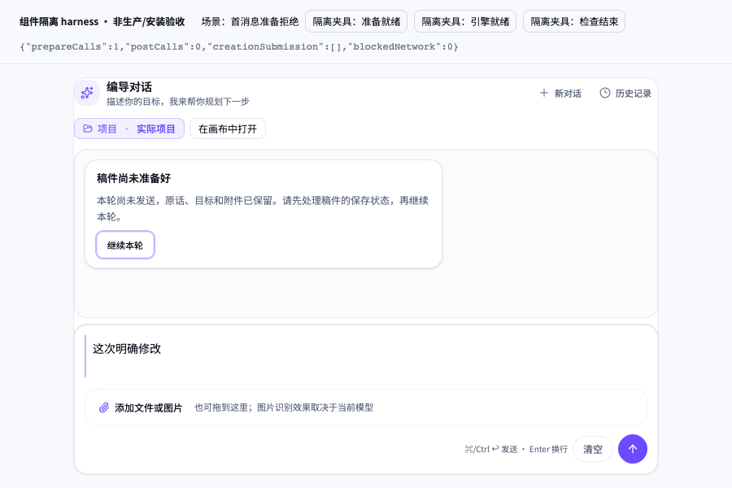
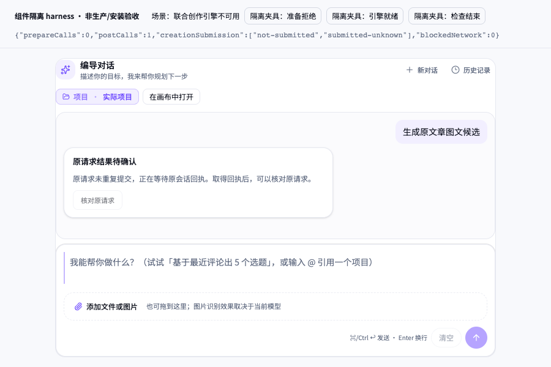
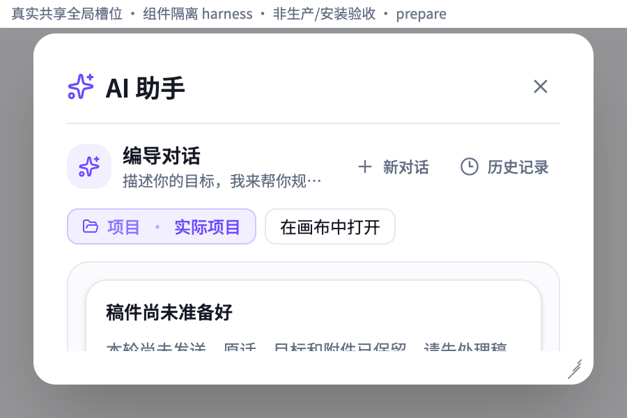
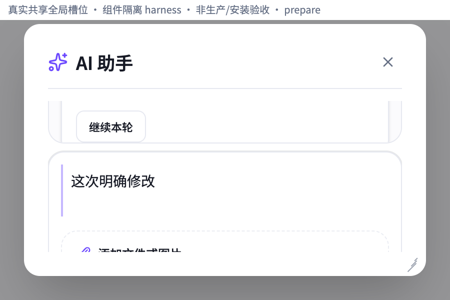
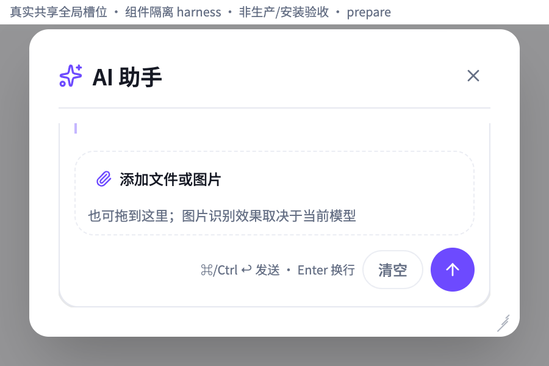

# T1191 final-source 最终产品源真实组件走查

最终产品源在两场景、两视口的 100% 真实按钮走查中保留原请求：失败时与条件就绪后均零 POST，用户以 Tab/Enter 继续后各产生一次 SDK 私有 transport POST，原话与原 target 不变；503 后显示“原请求结果待确认”，没有成功任务或 source/conversation 回执。真实全局宿主在实际浏览器 200% 下可通过正常 Tab 加一次原生滚轮完整到达输入与可用动作，无横向溢出，全部零 POST。

这是 harness 制作人的真实组件走查，不称 fresh 独立验收、安装服务或生产 PASS。原基线、after1、after2 裁切、候选、仅 Tab 边框未全入视及 PIL 缺依赖失败全部保留；root 另派 fresh 视觉/任务执行者。

## 来源与未注入证据

- `AICopilotContent` SHA256：`60fe11f9b68530fbe22a0e282e1eca182659c5e917dba281a04d0eaaa9adc1da`。
- 原测试 SHA256：`e6163928151eb6cb23b364571131b709d680337c06a510b69047cc72b1d301f8`，Provider SHA256：`0685de879b73d5293ba627700642601c32ddf518b8f0eadd3b9810211b198730`。
- [原宿主 manifest](final-source-source-manifest.json) 构建时间 `2026-10-10T03:25:12.701Z`；[真实全局宿主 manifest](final-source-global-source-manifest.json) 构建时间 `2026-10-10T03:25:50.245Z`。时间均真实 UTC。报告时再次核源码 hash 与构建一致。
- 最终全局构建使用 `global-main.tsx` + `global-index.html`。入口 HTML 无 `ai-copilot-content` selector、无候选 `overflow-y:auto` 规则；真实组件根类名来自产品源 `overflow-y-auto`，计算值为 `overflow-y:auto`。未使用 `candidate-inner-scroll-index.html`。
- 冻结 `final-source-dist`、`final-source-global-dist`；[机器报告](final-source-REPORT.json) 保存入口 HTML、CSS、JS 和图片 hashes、截图实际像素尺寸及 28 张已实际阅读图片。

## 100% 同数据真实按钮

| 原场景 | 1280×800 与 900×600 结果 |
| --- | --- |
| prepare 拒绝 | 输入原话“这次明确修改”，真实发送后显示“稿件尚未准备好/继续本轮”，prepareCalls=1、POST=0。仅将外部 Port 设就绪，仍 POST=0；Tab 聚焦、Enter 一次继续后 prepareCalls=2、POST=1，原 editorTarget 完整相同。 |
| creation 引擎不可用 | 原 creationTarget 请求显示“编导引擎尚未就绪”，继续禁用，回调 not-submitted；设置链接真实 href 为 `/settings?highlight=assistant-engine`，Tab/Enter 激活由最小 next/link 宿主记录。仅设引擎 ready，仍 POST=0；Tab/Enter 继续一次后 POST=1，原话“生成原文章图文候选”和原 creationTarget 完整相同，回调 not-submitted→submitted-unknown。 |
| 两场景提交后 | SDK 私有 fetch 返回 503，显示“原请求结果待确认”，核对原请求因缺原 source/conversation 回执而禁用，未重发。输入完整在视口内、无横向溢出、无 pageerror/外部请求。没有模型或后台成功证明。 |

原目标及实际 POST body 在 [100% 逐步轨迹](final-source-walk-browser-receipt.json) 中完整记录，包括真实时间、Tab 次数、焦点、零自动提交、回调、设置 href 和未知状态。网络“POST=1”指实际 SDK 调用了浏览器私有 fetch 边界，并非真实 HTTP 请求出网。





## 真实全局宿主实际 200%

直接挂载真实 `OverlayController` + `AICopilotDialog`，保留源面板尺寸、头部、focus trap、消息 min-height=120 和 composer shrink=0。外置固定 20px 夹具标签不占面板高度。先在 100% 进入原失败状态，再在第二个浏览器 `chrome://settings/appearance` 选择网页缩放 200%，保留原产品实例；实际 DPR=2、逻辑视口减半，未用 CSS zoom/设备比例/CDP scale 代替。

每个场景只走一次有界 Tab 焦点循环。Tab 到输入边框未全入视时，鼠标移至实际可见交集，执行一次标准 `mouse.wheel(0,100)`；没有 JS scroll、scrollIntoView、force 点击或提交。四个场景均完整到达输入五个命中点；后续可用继续/清空/发送或设置动作按 Tab 到达，creation 的禁用动作按真实状态跳过。完整 [200% 逐步轨迹](final-source-global-browser-receipt.json) 保留初态、仅 Tab 与滚轮后三种状态。

| 物理视口 / 实际逻辑视口 | 一次原生滚轮后的输入 | 滚动边界 |
| --- | --- | --- |
| 1280×800 / 640×400 | y=276 至 328，根槽 clip y=101 至 352，五点命中且完整入视 | 产品根 scrollTop=52.5；全局 panel scrollTop=0 |
| 900×600 / 450×300 | y=164.5 至 216.5，根槽 clip y=101 至 252，五点命中且完整入视 | 产品根 scrollTop=164；全局 panel scrollTop=0 |

两平台场景的 prepare/creation 数据一致，200% 全程 0 POST、无 pageerror/外部请求/横向溢出。100% 真实全局宿主根 scrollHeight=clientHeight、scrollTop=0，没有新增滚动。

仅 Tab 后 textarea 边框仍未全入视，原 rect 与截图保留，不宣称仅 Tab PASS。规范第 7 条允许正常键盘/滚轮完整到达，不要求所有长内容同屏；初态长错误卡没有同屏完全出现，不以此定性消息不可读。没有缩减原消息槽或修改宿主测量标准。







## 真实边界与当前交接入口

真实 React、AICopilotContent、Provider、Chat/useChat、live-chat-session、后代组件、原 tokens/font 直接构建源文件；全局对照追加真实 OverlayController/AICopilotDialog。最小替身为 next/navigation、next/link 导航记录、contract-client 空只读、engine hook 外部输入、EditorPort 与 fetch 503 边界。未替换产品恢复状态或注入假成功任务。

原宿主 100% 当前入口：

- `http://127.0.0.1:31591/normal/index.html?scenario=prepare`
- `http://127.0.0.1:31591/normal/index.html?scenario=creation`

真实全局当前入口：

- `http://127.0.0.1:31591/?scenario=prepare`
- `http://127.0.0.1:31591/?scenario=creation`

`/normal/` 从本轮冻结 `final-source-dist` 复制；JS/CSS/原宿主相同，只有入口 HTML 的资源 URL 增加 `/normal/` 前缀。root 路径继续保持真实全局构建。服务 PID 74414、port 31591 保持供 fresh 执行者，未开新服务。网络仅 GET 自有源资源；私有 POST 返回 503，其他 fetch 拒绝、CSP connect-src none，未触碰真实 App/DB、平台、模型、原上传 2/2、native 或研究实验。

fresh 任务者的夹具说明单列 [FINAL_HANDOFF.md](FINAL_HANDOFF.md)，只说明外部故障切换与用户目标，不提供产品动作选择步骤。完整报告和 maker driver 应待 fresh 执行结束后再用于证据比较。

本轮实际命令：

```sh
HARNESS_BUILD_TAG=final-source node build.mjs > final-source-build.log 2>&1
HARNESS_BUILD_TAG=final-source node capture.mjs > final-source-capture.log 2>&1
HARNESS_BUILD_TAG=final-source node walk.mjs > final-source-walk.log 2>&1
HARNESS_BUILD_TAG=final-source-global HARNESS_ENTRY=global-main.tsx HARNESS_INDEX=global-index.html HARNESS_HOST=global node build.mjs > final-source-global-build.log 2>&1
HARNESS_BUILD_TAG=final-source-global node final-global-wheel-compare.mjs > final-source-global-browser.log 2>&1
node final-report.mjs > final-source-report.log 2>&1
```

已完成这组约定复核，没有扩大测试或重复捕获。产品源只读；本执行者唯一写入私有 N。
