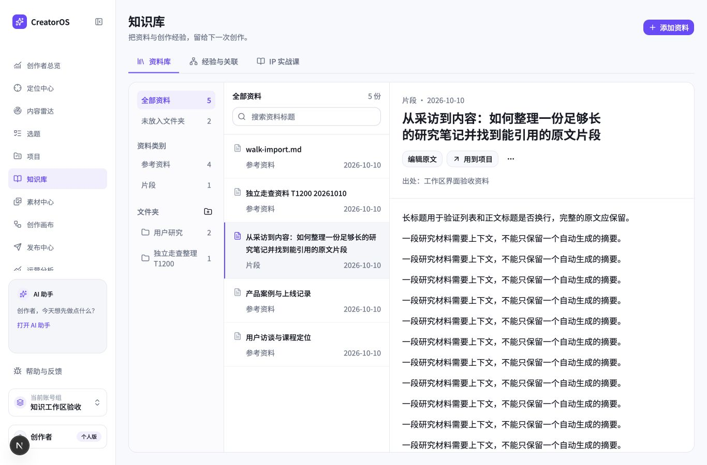
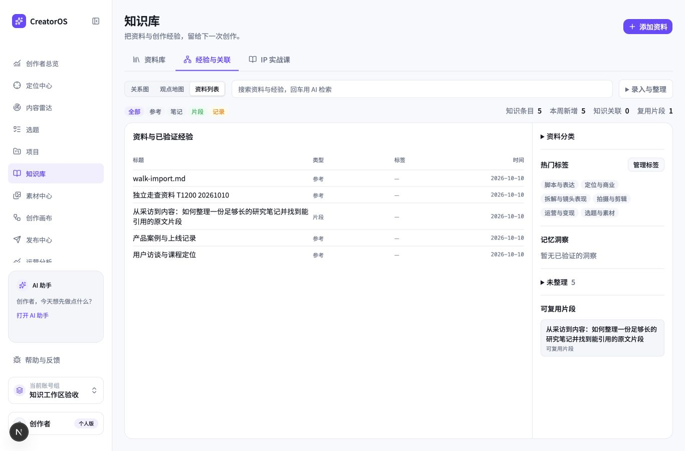

# T-1200 知识库整体重设计实际验收

2026-10-10，使用 oil-ui-pro 0.10.0，沿原版紫色工作台重排整个知识页。资料库、经验与关联、IP 实战课共用导航与页头；删除新旧页面选择器和旧黑色胶囊导航。目录、检索列表、全文阅读服从剩余工作区高度；整理入口可折叠但保留草稿及在途状态。没有迁移或删除知识数据。

## 已验证

- 知识域 19 文件 148 例通过。首次旧原始异常断言失败另登记 T-1201，保原失败后按既有人话错误合同加强断言，不改图谱产品代码。
- 独立真实任务走查完成手录、完整正文编辑、刷新读回、建文件夹/移动、建项目/确认引用/项目刷新读回、Markdown 导入及原文件严格对比。
- 三导航、add=1 一次消费、整理折叠保草稿、课程进度刷新、输入错误保草稿、空筛选与清旧详情实际通过。
- 1366×900、1280×800、1920×1080，以及 683×450 窄视口实际操作。最终经验页 1280×800 无横向溢出，Tab 焦点可到添加资料；最新类型检查通过，LED-047 174 例通过。
- 三轮独立视觉复评 7.8 → 8.4 → 8.7，达到最多三轮后结束；不是 9 分，不伪造满分。

## 尚未覆盖

实际浏览器 200% 缩放工具探针无可观察效果，不能以 683×450 窄视口代签。已验证 learning 的真实只读 UI、真实网络失败、跨组 HTTP、重复引用与大量条目分页未做完整 UI 旅程；相应现有单测不能冒充真机。禁止真实模型调用的 AI 提炼、评论回流、找关联/采纳链路没有执行。新安装包功能验收未发生，T-1200 保持进行中。

完整独立 [任务走查](task-walk.md) 与三份视觉报告保留。私有原日志在 `/Users/zyongzhu/.codex/creatoros-verification/t1200-20261010/`。全局对账及旧静态欠债单独报告，不声明全绿。

第三轮后核对实际样式发现 text-2xl 对应32px，改为现成 text-xl 对应24px，落实原页面规范。新实际 computedStyle 为24px；1366×900及1280×800无横向溢出，未开始第四轮评分。最终截图为 after-library-title24-1366x900.png / after-advanced-title24-1366x900.png / after-advanced-title24-1280x800.png，旧三轮图保留。

本轮完整 reconcile --concise 实际退出1：29ERROR/0WARN，原输出省略24项，不能假称与旧24项相同；明确看板RUNAWAY及旧review receipt问题。统计有LED041/057等新增触发，完整根因登记T-1204，未在本次修复或代签。T1199/T1200保持待验；T1201/1202实现通过但尚未宣布全局收尾完成。
