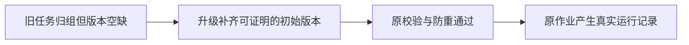

# 自动化409修复与真实证据

原因：0128升级只填旧作业的groupId，漏填groupVersion/membershipVersion；私有采集准入严格核空值与当前成员v1，拒绝合法作业。公开CLI req-f394bff8-1525/1527确认两个真实抖音组12条旧作业均如此，没有修改或手动触发真实平台采集。

修复：追加0132，仅给同user真实账号、已归初始legacy组、当前唯一成员v1且无任何其它历史的旧作业补版本。原任务身份、归属、排期、开关、更新时间及旧运行/AI/execution冻结数据不变。错误版本、转组又返回、跨用户/组或缺证明不补；原执行权限校验保留。

|验证|当场结果|
|---|---|
|隔离旧库RED|2失败8通过；真实runNow先重现同409，缺版本修复与定时链预期失败|
|专项最终矩阵|17/17通过，含真实public typed client→controls→AI→job run→execution、重复防重、105/106历史升级/重开、归档、错误证明及两个真实PG转组并发顺序|
|调度相关原回归|3文件110/110通过，含startup-group-collectors真实PG，无条件跳过|
|原多来源迁移双启动|4通过；用名称过滤其余18未执行，不冒称全迁移通过|
|后端typecheck|exit0|
|物理边界|无新增违规，原5条基线保留|

原RED、两次后续失败、最终GREEN和原回归分别保留日志；没有删测、缩预算、禁用归属门或重建真实任务。后续打包/安装结果将在实际发生后补入。本报告此刻不代表安装版已修复或外部平台采集已成功。

