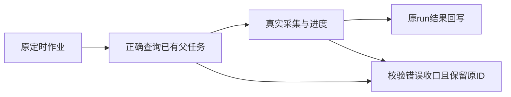

# 自动化消费修复当场验证

T1209已消除旧作业归属版本409，但安装版原两组采集仍未进入执行。T1210新增正常真实组公共调度链，内存数据库及隔离PostgreSQL均当场RED：已有父子挂接，consume却报缺唯一父任务。原因是findScheduledParent把整行execution child传给workspaceFilter，kind=ai_task被误当WorkspaceKey，child.id被当账号ID，合法父任务查询返回零。

修复只传显式groupId/accountId，原user/job/time/唯一父/reverse/停止校验全部保留；补齐comments来源注册。消费初验、中途与心跳拒绝按同一原ID/current attempt/fence收口，记录固定机械原因，错误modelInput不能拿来更新其它run；未知调用保unknown_result不重发，取消、暂停、宿主退出、新fence不被覆盖。原统计、历史、预算与排期均保留。父子生命周期锁按ID升序，心跳单在途且退出后等清理。

|实测|结果|
|---|---|
|正常链初始RED|内存原首轮8失败1PG未执行；修正诊断夹具后完整RED9失败1通过无PG跳过；隔离PG单链1失败|
|仅父查询/comments修复|9通过5失败，异常收口尚未修及一条夹具断言问题；全部原日志保留|
|消费初修|13通过1失败（心跳错误码）；未据此签全通过|
|核心消费最终回归|14/14通过，无skip，含双数据库的指标/评论真实group→resolver→controls→driver→父子attach→runner→结果→父对账|
|补充物理归属|2/2通过，其余14按名称筛除未再执行；坏run ID只收口原run，错owner不改两份业务记录|
|后端类型|本轮最终typecheck exit0|
|相关飞轮绑定/账号并发原回归|两文件42/42通过；首命令还传入不存在的child测试名，未把该文件冒签通过，另用正确路径实跑|
|相关父子/执行/driver原回归|原32通过2失败保留；T1211仅三个夹具请求号加原fixture ID，复验三文件34/34通过|
|6730修复前原child基线|10通过3失败：两条请求号冲突、一条父查询根因；保原失败|
|打包四项基本测试|45/45通过|
|边界|无新增，旧5条保留|
|超时规范|exit1，旧27静态项继续保留；动态入口各段真实通过，未改预算或缩帽子|

独立只读reviewer分别给诊断范围、精确产品三文件、真实正常链scope修复和最终实现PASS；结果只签这些范围，不代签测试/安装。其最后非阻断建议已采纳：finally等心跳后重新读中止状态，避免晚停控漏确认。context-compile实际exit2缺task binding；未声称产生有效Task Packet，原失败留存，root按明确SPEC写集整合。

完整reconcile仍以当场最终退出结果为准，待记录；原T1204全局欠债不由局部通过抹除。当前报告尚未签本轮安装或外部平台采集成功，后续新包原任务续跑单列真实证据。

