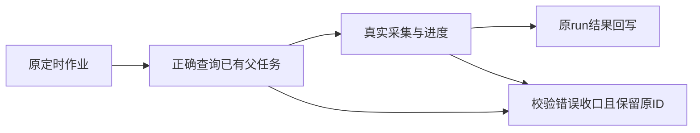

# 自动化消费修复当场验证

T1209已消除旧作业归属版本409，但安装版原两组采集仍未进入执行。T1210新增正常真实组公共调度链，内存数据库及隔离PostgreSQL均当场RED：已有父子挂接，consume却报缺唯一父任务。原因是findScheduledParent把整行execution child传给workspaceFilter，kind=ai_task被误当WorkspaceKey，child.id被当账号ID，合法父任务查询返回零。

修复只传显式groupId/accountId，原user/job/time/唯一父/reverse/停止校验全部保留；补齐comments来源注册。消费初验、中途与心跳拒绝按同一原ID/current attempt/fence收口，记录固定机械原因，错误modelInput不能拿来更新其它run；未知调用保unknown_result不重发，取消、暂停、宿主退出、新fence不被覆盖。原统计、历史、预算与排期均保留。父子生命周期锁按ID升序，心跳单在途且退出后等清理。

|实测|结果|
|---|---|
|正常链初始RED|内存原首轮8失败1PG未执行；修正诊断夹具后完整RED9失败1通过无PG跳过；隔离PG单链1失败|
|仅父查询/comments修复|9通过5失败，异常收口尚未修及一条夹具断言问题；全部原日志保留|
|消费初修|13通过1失败（心跳错误码）；未据此签全通过|
|核心消费最终回归|14/14通过，无skip，含双数据库的指标/评论真实group→resolver→controls→driver→父子attach→runner→结果→父对账|
|补充物理归属|原2/2通过、14筛除；安装后按冻结e5c源码完整16/16一次通过，无skip，含隔离PostgreSQL；坏run ID只收口原run，错owner不改业务记录|
|后端类型|本轮最终typecheck exit0|
|相关飞轮绑定/账号并发原回归|两文件42/42通过；首命令还传入不存在的child测试名，未把该文件冒签通过，另用正确路径实跑|
|相关父子/执行/driver原回归|原32通过2失败保留；T1211仅三个夹具请求号加原fixture ID，复验三文件34/34通过|
|6730修复前原child基线|10通过3失败：两条请求号冲突、一条父查询根因；保原失败|
|打包四项基本测试|45/45通过|
|边界|无新增，旧5条保留|
|超时规范|exit1，旧27静态项继续保留；动态入口各段真实通过，未改预算或缩帽子|

独立只读reviewer分别给诊断范围、精确产品三文件、真实正常链scope修复和最终实现PASS；结果只签这些范围，不代签测试/安装。其最后非阻断建议已采纳：finally等心跳后重新读中止状态，避免晚停控漏确认。context-compile实际exit2缺task binding；未声称产生有效Task Packet，原失败留存，root按明确SPEC写集整合。

完整reconcile当场exit1、27ERROR/0WARN，打印前5项、其余22项未展开；统计触发集合与T1209对比另存reconcile-statistics.json，不假定全部范围外。原T1204全局欠债不由局部通过抹除。当前报告尚未签本轮安装或外部平台采集成功，后续新包原任务续跑单列真实证据。

## 新包与安装（当场证据）

冻结e5cdb440627551584a5e6b1bfe979ad3f5e90832，干净复用构建树，四版本1.2.0；13121个提交blob扫描，四个精确去敏测试夹具已独评分类，无未分类凭据形状，完整跟踪文件哈希构建前后不变。最初私有冻结探针Cargo包名/子串误匹配/逐对象进程开销保留失败记录；只校准私有验收驱动，未改产品、仓库Gate、断言或候选。官方入口成功，冻结树45/45打包基本测试通过。

DMG：`/Users/zyongzhu/Downloads/CreatorOS-1.2.0.dmg`，SHA256 `12d544e274c16724c8091dab5c913aab4b73418d17beadf2d7bd8aa17541e6fa`；runtime SHA `eec88fbbf3f5f3c127e596b03e9cd9d4b4ec10989821f69547578e82dffe2d79`。hdiutil verify、构建App及DMG内App codesign均通过，二者runtime/shell哈希一致，0132迁移与journal源码精确一致。仅本地ad-hoc，未公证。

原安装helper已替换`/Applications/CreatorOS.app`并启动，未做备份。新原生PID90836，直属服务PID91089、HTTP60862，真实HTTP首页完成事件、公开CLI connected及runtime stamp与本轮tar一致；不是tauri启动页代签。12条原job所有字段、ID/排期/目标/归属均与安装前完全一致，未调用真实runNow。

原第三空间run/AI/execution已succeeded，新增/更新0；原始导出确有2行，明细落库0，保留真实0，不冒签非零。月明原任务已进入fetch→export并持续心跳，当前尚待终态，后续观察另补。原配置同步CHANNEL_RUNTIME_DIGEST_MISMATCH/502、两条旧intelligence.sync失败依然存在，由T1196保留，不算本次修复。未进行原生Appium或全功能截图代签。

## 后续真实终态（2026-10-11）

月明原run于03:01:15.875Z失败，公开错误明确平台modal-wrap拦截投稿作品点击，另登记T1214。原定时系统自行创建下一次run，并于03:09:57.952Z成功新增86条作品、更新0；未手动重发。第三空间原run成功0保持真实记录。此证明原消费进入真实平台及结果落库，不能推定所有平台任务成功。证据见../t1214/installed-before-fix.json。
