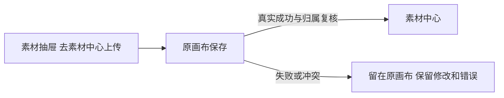

# T1220 素材抽屉上传导航前置独评

2026-10-11，已先读 Task Packet/SPEC，并加载项目内 oil-ui-pro 0.10.0、存量项目/交互状态参考和账号组 UI_RULES。只读 CanvasAssetPicker、CanvasEditor/saveNow/leaveCanvas、现有测试、T1069/T1101/T1117 合同，以及提供的三份 t1207 原 trace。**精确候选范围 PASS，可以开工；未签 GREEN、视觉或实际操作通过。** 本轮仅写本评审，不改产品/测试，不启动 Next 或浏览器测试。

## 事实与可复用链

T994 原要求无素材时可导航素材中心上传；T1069 明确改成全库 image/video library 搜索、cursor 无 total，已覆盖旧“搜索已加载 N”的 bounded 计数语义。后续 T1101/1117 明确保留空态/原动作，未读到取消上传可达性的确认。当前 drawer 的 CanvasAssetPicker 确无该链接，page 来源已有上传表面，不需再加。

补读原 trace：T993 的新建画布确实 strict-mode 匹配两个按钮；T1021 旧合并名称按钮因 30 秒外层帽超时；T994 停在 5 秒“搜索已加载0”断言，后续上传链接断言未执行。因此上传缺口依据是当前源码与仍有效的产品合同，不能声称原 trace 已实际点击缺失链接或验证保存失败。

CanvasEditor 的 `saveNow` 已串行复用 savePromise，读取当前 doc/title/project 与原 revision 保存，回执核原 epoch/归属，并继续保存期间的新编辑；失败/冲突重抛。原 `leaveCanvas(href)` 等保存完成、assertLive 后才 router.push，失败保当前内容和错误，navigating 防重复。这条真实路径已经用于画布库、返回作品和模板照片上传，不需要另造直接导航或保存机制。

## 精确准入要求

- 仅 drawer footer 且有实际 `onUpload` 时展示低强调、可见的真实链接“去素材中心上传”，真实目标为 `/assets`，普通点击与键盘激活须阻止裸 href 导航并交给该回调。默认无 callback 不渲染；page 不加重复入口，不把回调存在推断为上传已成功。
- editor 唯一实际 drawer 使用点传原 `leaveCanvas('/assets')` 及导航禁用状态。链接本身不能原生 disabled，需 `aria-disabled` 和事件实际拦截；导航在途不得再回调/裸导航，不能仅用 CSS 或 aria 标记。禁用只管新增上传动作，不扩成共享图库插入/搜索的禁用规则。
- 不改 shared AssetPicker、公共端点、库存统计、归属、CAS/revision、saveNow、原超时或模型行为。不以 `router.push('/assets')` 直跳绕保存，不因保存错误自动重试/清空文档。保旧模板上传和画布库等既有路径。
- 沿现有紫色 tokens/图库/圆角和已有次级动作样式，新增 footer 不抢素材选择主任务。局部低风险恢复沿既定方向，无需新风格探索；实际目标视口看链接和相邻内容、窄窗/滚动及键盘可达性后再签视觉与交互。

## 必要验收与写集边界

现有 `canvas-editor.test.tsx` 增补真实组件入口：先 dirty 标题/节点，再点击上传；用延迟真实 service-port 回执证明保存期间无导航、禁用且重复点击不再发起操作，成功回执后唯一 `/assets` 导航。保存拒绝/冲突时核不导航、标题/文档保留和恢复可用；原版本冲突、换 owner 拒迟到、精确文件及成功保存断言全部保留。默认无 callback、page 不渲染新入口可在该已有测试文件核，不能造假按钮。先当场 RED，再 GREEN。

`creative-canvas.spec.ts` 仅 T994 空态用例，在 T1219 完成同文件修改后串行实施：旧统计断言按已确认 T1069 改为实际搜索控件与真实空态，保上传导航要求并强化真实点击 `/assets`、正常公共 canvas.get 回读原组 ID/标题/节点、返回原画布保持内容。公共回读和截图分别证明保存与画面，不拿截图代替落库。保存失败可用受控保存端口故障证明，并明确其它保存/get/归属是真实隔离服务，不冒签模型或真人素材上传。

只使用 Packet 的两个产品路径、现有组件测试、该 E2E 用例和任务证据目录；不修改其它 selector/旧断言，确需范围变化先记录。不制造无 total 的统计、不删 skip 外的用例、不放宽 guard。执行当前 frontend 类型、相关组件/浏览器、边界及 diff 检查，保原失败与全局债；未发生的安装版/原生/实际上传不代签。

## 实现只读复核（2026-10-11）

**实现与当前聚焦测试范围 PASS，未发现范围内阻断；真实浏览器/视觉验收仍待结果。** 核对当前 git diff：两个产品点只增加 CanvasAssetPicker 的可选 onUpload/uploadDisabled 及 drawer footer 条件链接、editor 原 drawer 使用点的 leaveCanvas('/assets')/navigating 接线。原 saveNow、leaveCanvas、shared AssetPicker、page 模式、归属/版本/预算均未改。链接 onClick 无条件 preventDefault，再按 uploadDisabled 决定是否调用；实际 aria-disabled 配事件拦截，默认无 callback 或 page 不渲染。

原组件测试全文保留，末尾新增延迟保存成功一例及保存失败/冲突两例。成功例确有 pending save Promise、dirty 标题、尚未导航、重复点击只保存一次、回执后唯一 /assets；失败两例保标题、无 push、入口恢复。这里“画布版本冲突”一例是保存端口拒绝的错误样例，不据此声称新增完整服务器 CAS 竞争测试；旧冲突/换组/CAS 回归仍保留。未用孤立回调测试替代真实 CanvasEditor 入口。

`red.log` 实际 3 FAIL / 38 skipped 是 -t 只跑新增用例；`green.log` 实际完整两文件 46/46 PASS，没有 skip。`typecheck.log` 原四个 testing-library exact 属性错误保留；当前 diff 已移除这些新增错误选项，`typecheck-final.log` 无诊断，主会话报告对应命令实际 exit0（空日志本身不作为 exit code 证明）。`boundary.log` 明确无新增违规，原五项基线仍保留，不签全局无债。

当前 creative-canvas.spec.ts 的 T1220 增补只在 T994 空态：真实搜索/空态取代已被 T1069 覆盖的虚假 bounded total，保真实 link；增加两个视口截图、标题 dirty 后上传导航、公共 canvas.get 原 ID/项目/标题/revision/空 nodes 回读与返回原画布。其余差异属于已独评 T1219 的精确 header/card selector，原保存/预览/刷新/隔离断言未删除。回读 revision 证明真实保存，组件 pending Promise 另外证明必须等待保存，不能只凭浏览器标题回读判断等待顺序。

尚未将 3903 正在运行的 13 画布 + 2 新建项目记成 PASS，也未观测本轮最终两视口截图、键盘可达性或真上传。默认无 callback/page 不显示可由当前条件直接确认，本轮未新增独立组件用例覆盖这两分支；真实浏览器操作/截图通过后方可签 UI 与完整链验收。
