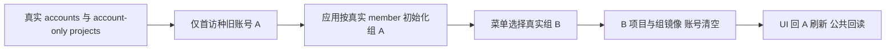

# T1221 旧双账号 E2E 合同校准前置独评

2026-10-11。只读 SPEC、当前 Task Packet、原 zz-account-isolation.spec.ts、真实 AccountSwitcher/resolveCurrentGroup、HTTP/RSC scope 与 cookie、账号组资源合同及原失败 trace。未编辑测试、产品或控制面，未启动 Next/浏览器，也未运行新测试。

**精确测试范围准入 PASS，可以校准原用例；不签实测/GREEN/权限功能修复。** 写集保持原一份 E2E 测试和 T1221 证据目录。下述一次初始化要求属于保留原 A 真实初始化的测试夹具校准，不能跳过或改成预置组选中。

## 源码与旧失败证据

`account-switcher.tsx` 的 load 经公共 accountGroups.list 收集真实组，`resolveCurrentGroup` 按当前有效组优先、否则 legacy account 的唯一实际 active membership 选择组，不解析名字或 ID 前缀。原 A account-only cookie/localStorage 首访应走这条应用初始化链，不能由测试直接设 groupA 绕过去。

当前菜单真实属性是 `data-testid=account-switcher-item` + `data-group-id`，没有 data-account-id。原保存 trace 的失败调用确是等待 `data-account-id=acct-a65785f2-4494`，随后 30000ms 外层超时；这证明旧定位器不适配，不能据此签 A/B 权限链已有缺陷或已通过。原 trace/screenshot/index 保留，新增结果另落目录。

真实 performSwitch 经原 requestVideoLeave 后调用 writeCurrentGroupId，广播 accounts-changed 并在 animation frame router.refresh。`http-transport.ts:229` 写 current-group localStorage/cookie，同时 remove current-account 并删除其 cookie；`creatorApiHeaders` 默认用 current group 并镜像 cookie，RSC `session.server.ts:34` 读取两 cookie 经真实 account/group ownership 校验。`request-context.server.ts:207` 公共 group header 优先于 cookie，仍核真实用户拥有组。因此“选 B 后仍要求 current-account=B”是旧错误合同，应改为真实组 B/账号选择空。

## 准入中的实施要求

1. 保留 accounts.create 两个真实登记账号，以及只带 x-account-id 的两个 projects.create；保存返回原 project IDs。不得改为空组 fixture、直接组项目创建或 hardcode `grp_legacy_`。
2. 公共 accountGroups.list 用响应真实 members.accountId/leftAt=null 找到 A、B 的唯一 active 组，断言各恰一、组 ID 不同。列表如分页必须覆盖完整结果或明确证明目标已唯一；不只取第一个组、不按昵称匹配。公共 helper 可补真实类型/generic 支持数组、项目回读，不能丢掉 HTTP 成功/真实返回断言。
3. 首访仍种原 accountA cookie/localStorage，不种 group。**原 addInitScript 每次页面加载无条件写 A，必须校准为仅在尚无 current-group 的原始首访时种入 A，组一旦应用真实初始化后就不再重写 account。** 否则回 A 后 reload 会重新塞回已被真实切组清空的 account，并可能由后续 RPC 重写其 cookie，这是夹具污染。不能在刷新后再主动清 account 来制造断言 PASS；用例必须观察产品自身清理。
4. A 项目可见/无 B 后，可读回确认应用已真实选择 groupA。菜单定位使用已有 menu 内精确 data-group-id=实际 groupB，断言唯一再 click；核 B 可见、A count0、current-group localStorage/cookie=groupB、current-account localStorage=null 且 cookie 不存在。等待真实页面切换与存储状态，不 fixed sleep、不 `.first()`/force、不通过测试写存储代替 UI 切换。
5. 同真实菜单回 A，核 A 可见/B count0，再 reload 核相同数据、groupA 镜像及账号仍空。用正常 projects.get 带真实组 scope 回读原 A/B 项目的原 ID/title/group；不得通过私有 DB、跨组宽查或仅比标题签原实体。能进一步保留跨组 public get 拒绝断言则更强，但不允许移除原 UI 无残影证明。
6. 原请求/页面观察短 30 秒帽按已审诊断配置改为至少 120 秒，不改产品超时/成员/route/scope/保存 guard。复用真实隔离库及网络门、单 Next 串行、零 retry，保原失败证据。若实际项目 account-only 兼容、刷新或组隔离仍失败，保 FAIL 并登记产品任务，不能洗成 selector 修复已成功。

## 尚需实际验收

当前 Packet 的基础 eslint/tsc/diff 命令不替代 SPEC 的真实公共浏览器链、逐阶段截图与结果独评。必须发生完整 accounts/projects/member 初始化→B UI→A UI→刷新→公共回读，确认两实体、组/账号 cookie/localStorage；测试 diff 不得删掉旧创建、可见与不见对方标题断言。当前只签测试合同前置准入，不签原生 App、真人平台绑定/扫码、采集/模型或全功能全局 GREEN。

## 当前 SPEC 补充复核

主会话已将仅无 current-group 时种 legacyA、真实初始化后 reload 不再写 account，以及 accountGroups.list 按真实 meta.total 完整分页/唯一 member 关系写入正式 SPEC 末段。已当场只读确认。**含该补充的正式 T1221 测试范围准入 PASS，无剩余前置范围阻断。** 可在原测试文件实施，仍不更换账号登记/旧项目入口、不预签实际结果。

## 实施 diff 只读复核（2026-10-11）

**当前测试实现范围 PASS，无范围内阻断；3912 实际 E2E 尚待终态。** 已核当前原文件完整 diff：accounts.create 两个原账号、只传 x-account-id 的 projects.create 两原项目不变，新增保存返回 ID；移除 input 中 undefined 键不改变序列化后的公共请求。HTTP 成功断言保留、原 A/B 可见与对方 count0 全部保留并用 exact 标题增强精度；没有改产品、skip、retry 或归属 guard。

公共 accountGroups.list 按 meta.total 整数校验、累计数不得超 total、非末页必须有进展；读完整列表后按真实 members 的 accountId/leftAt=null 唯一找 A/B，不同组 ID 明确断言。initScript 仅无 current-group 才种 legacy A，仍首访只加原 accountA cookie，没有测试预置 group 或刷新后主动清 account。真实 UI menu 内 data-group-id 数量 1 后 click，依次原 A、B、回 A/reload 核原项目、组 localStorage/cookie 镜像和 account localStorage=null/cookie 消失；三个阶段另存截图。

原 projects.get 新增双公共回读，各显式真实 group header，核原 project ID、title、groupId 后留附件；不靠查询私有数据证明，也不把同用户拥有两组误称跨组权限拒绝。原无残影 UI 断言仍是切组隔离验收依据。公共请求、locator/navigation/expect 本测试均至少 120 秒；外层仍由既审诊断配置决定，未改产品执行预算。

eslint/typecheck 日志当前无输出；主会话已工具确认两命令实际 exit0。空文件本身不代签退出状态，本评审未另跑检查。3912 单例正在另 Agent 执行，未把改定位器或检查通过写成 E2E PASS；若真实旧入口或镜像失败仍保 FAIL。

## 首轮实际 FAIL 与合同校准复评

只读核对当前 SPEC 末段、首轮 REPORT/browser.log/after、真实 `contract/src/resources/projects.ts:88` 及项目 owned-root 查询/HTTP 错误映射。**补充测试校准范围准入 PASS；首轮实际仍是 1 FAIL，不签 GREEN。** 前段实施 diff 评审接受了自定义 `groupId` 回读比较而未核到公开 ProjectResource 没有该字段，此点纠正；不把缺少公开未承诺字段判成产品隔离故障。

3912 首轮在 readA 的 groupId toMatchObject 失败；该行之前 A 初始化、B 切换、回 A/reload、三阶段组镜像/account 清空及原项目无残影断言均已执行。两个正向 projects.get 请求已返回 200，失败 diff 明确原 A ID/title 正确；B 的回读断言因 A 失败尚未执行，不能把 B 对象断言记成 PASS。报告依据 trace 记录其 B 响应 ID/title，不替代新一轮测试断言。

校准只在原同测试使用真实 `ProjectResource`（必要时用公开 projectResource parse）核原 ID/title，删除不属于 DTO 的 groupId 假字段比较。为保留真实归属证明，必须新增 A project 配 groupB、B project 配 groupA 的两个正常 projects.get 负例：原存在的 ID、真实另一组 header、没有 account header，HTTP **严格 404**，建议同时核现有 OwnershipError error code，不接受任意 !ok。正向两组 200 与同 ID/title 仍保留。`projects.repository.ts:278/285` 的 owned-root 按 userId+workspaceFilter 查 project；缺该组记录抛 OwnershipError。dispatch 使用 ERROR_HTTP，`contract/src/envelope.ts:66` 已定义 OwnershipError=404，故无需产品 schema 或映射改动。

不减少原 accounts.create/account-only projects.create、members 唯一关系、UI A/B 无残影、current-group 镜像、current-account 空、回 A/reload 或截图；不主动替产品清 cookie、不修 guard/权限/公开资源字段。首轮 trace/log/图/HTML 原样保留，新复测独立目录、原诊断预算与零 retry，待真实两正向和两错误组负例均完成再签。当前 T1217 产品窗口期间不启动 Next。

## 另批 3911 七例只读证据核对（不作为 T1221 验收）

执行方最终 `t1208/20261011-next-journeys-report.md` 已落档，原日志实际 7 passed（2.7m），test-results/.last-run.json=passed/failedTests=[]；本评审按 URL 3911 找到七条 NDJSON，均 passed/captured、图片存在、externalNetworkAttempts=[]、errors=[]，没有 pageClosedBeforeCapture。**可签这七例已有断言覆盖的隔离公共回归 PASS**：四例自动化列表/筛选/切组返回/归档历史与空态，一例中性本地视频导入/Tab/保存刷新/导出，两例手工文章/图文版本回读与 NoteRelay 导出。不是平台计划执行或全功能 GREEN。

只读核实际导出 HTML=7,853 bytes；ZIP=279,958 bytes，解包校验无坏成员、四张 PNG；MP4=139,153 bytes，ffprobe 实际 H264 1920×1080、12.066667 秒。HTML 中内嵌报告 zip 的原 JSON entry `bec6dd24d6704d74c8bc.json` 两个计时附件，与 media-timing-extraction 的 sourceSha256/bodySha256、两提取文件原字节均一致。原计时共同起点到素材可操作为 4,143ms/4,418ms，每文件 209,277 bytes；保存原公共回读 revision=1/editable。仅签这两个小样本，不能拆成各阶段耗时或代表大视频导入性能。

报告诚实保留 Next ECONNRESET 根因未知，以及运行覆盖旧 t1208 HTML 未预存的证据保全偏差；旧失败日志/trace/场景图仍在，不冒签所有旧制品完整保全。浏览器外网尝试空不等于服务器 egress 全审计；不签真人账号、模型、平台发布/采集、安装 App 或大型视频性能。该七例与 T1221 首轮 FAIL 分开记录。

## 校准后 3913 公共单例最终独评

2026-10-11，**T1221 精确测试实现及实际隔离公共链 PASS**，仅覆盖该单例；不代签 T1217 或其它功能。本轮独评只读测试 diff、REPORT、原日志、last-run、NDJSON、HTML 内嵌原 ZIP、公共回读附件、三张原截图与前后产品 hash，未启动 Next/测试或改产品/控制面。

当前 zz-account-isolation.spec.ts SHA256 `d3c1a982870b4bd36c45a8ed2f3fff2b53093862fadb8fc8e173ee2de05b5a18`。两次回读采用真实 `ENDPOINTS.getProject.response.parse(await dispatch<unknown>(...))`：contract/src/operations/projects.ts 的 getProject 实际 response 就是原 ProjectResource schema；不是自造 DTO、非导出深 import、unchecked cast 或弱化 schema。两个 schema 文件无本轮 git diff。原假 groupId 断言由完整真实 schema 解析后原 ID/title 比较替代，额外 A 项目在 B 组及 B 项目在 A 组均严格 HTTP 404 + ErrorCode.OwnershipError。原两账号 accounts.create、只带 account header 的 projects.create、真实 member 唯一分组/完整分页、仅无 current-group 首访种 legacy A、真实 UI A→B→A 与 reload、全部对方标题 count0、组 cookie/localStorage 镜像及旧 account 清空全部保留；没有测试主动写 group/事后清 account、skip/force/新增 retry 或产品修改。

`browser-final-3913.log` 实际 1 passed（33.9s），测试本身 6.4s；末尾两个真实 dispatch 404 与 OwnershipError 对应负例。final-output/.last-run.json 为 passed/failedTests=[]。原隔离 PGlite、单 worker、0 retry、既审 120 秒请求/观察诊断配置保持；不以较短实际耗时修改生产预算。eslint-3913.log/typecheck-3913.log 为无输出日志，REPORT 与主会话工具结果明确实际 exit0；空日志自身不充当退出证明，本评审未重跑。包根未导出 ProjectResource/projectResource 的 TS2724 和错误 ENDPOINTS['projects.get'] key 的 TS7053 两轮日志均实际读取并原样保留，未冒称首次类型检查通过。

公共附件独立从 HTML 原 data:application/zip 解码复核：内嵌 ZIP 与 browser-final-report-export.zip **原字节相同**，ZIP integrity 检查无坏项；SHA256 `f77b2fd9face7f747ba0facc16ce6e26de4073c5dff1d690215ab3532b483f88`，5294 字节。entry `c30d334f01c06de6caf2.json` 的“真实双组项目回读”body 与 public-readback-3913.json **原字节相同**，1392 字节、SHA256 `91ac9d83b624641ac792c90e83dd9334143c7fba9615c21793c1bac843ab6171`。实际账号 acct-3ac06df3-6/-9、组 grp_legacy_acct-3ac06df3-6/-9；对应 projects 原 ID project-3ac06df3-12/-23、原甲/乙标题，rejected 数组两条为反向组的 404/OwnershipError。正向附件无 groupId，依据完整 schema 与真实负例证明边界。

实际查看三张 1536×1024 图：A 初始及回 A/reload 都只显示甲号项目，B 图只显示乙号项目，侧栏当前组分别为 @e2e-iso-a/b/a。图文件 SHA256 分别为 `35d8aa47a019a2596e57095f4c3c67c5c78d81556f9b8feb548b8eee6e33a5a9`、`accf00dabc955b0f26a7bec77343010cdee578e82fa28192aefebca463976a44`、`407bdfaa6fbdb9511117a2b58c6c3efcbc3fa04af65ad96f4e354509f555b6eb`。最后自动场景图与第三图及 HTML 附件字节一致。NDJSON 的唯一 3913 行为 passed/retry0/captured、pageClosedBeforeCapture=false、screenshotError=null、errors=[]、externalNetworkAttempts=[]；这只证明浏览器记录未发生外网尝试，不泛称服务端 egress 全部已审计。

3912 的原 FAIL 行仍指向独立旧图副本，SHA256 `6bf5fc3d781b2200410cba0f84ddd5818096d1fbf7a76df4edd56b2809a3f769`，旧 trace/HTML/日志/阶段图保留；T1207 原 timeout 归档也保留。t1217-product-hashes-3913-before.txt/after.txt 五条记录逐字节相同，证明本次运行窗口五产品文件没有变化；不将此推广为之后 writer 产品窗口的树仍冻结。只签真实登记账号/工作区切换及公共项目隔离读取，不签真人扫码/模型/采集/发布、原生 App、全功能或 T1217 新实现 GREEN。
