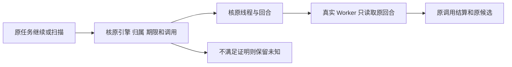

# T1238 原 Codex 回合只读恢复证据

本轮修复使“继续”和过期租约扫描读取原 Codex thread/turn，沿原 task/call 结算。没有新的 turn/start、重试调用、supersede 或期限续期。原 native binding 不可信、未知外部工具、取消、预算耗尽及过期任务继续保留真实状态。continuous 的原 null 期限仍是 null；有界任务缺期限不取得恢复许可。



聊天子节点只恢复已冻结的结构化提案、开场和原稿保真授权。宿主核验原模型提案、父摘要、准备版本及摘要、原无秘密模型身份、唯一原子调用和 native binding；Worker 只消费宿主名单。原父工具恢复到当前 lease，子模型仍保留 original startedAttempt。原稿继续原 CAS/事务保存，重复 ACK 读取同一结果，不重复创建子任务。已结算 Host 工具的真实调用和输入卡保留，可与原未知子模型一起回放；普通未知外部效果不获得恢复权。

## 当场测试

- `codex-read-recovery.integration.test.ts`：独立评审于 2026-10-11 19:54:17 实际 **26 PASS / 0 FAIL**。原 text/image 的公共 PersistentTask command/resume 或扫描 → 真实 Worker subprocess → thread/read；三类完整聊天 Worker，包括已结算 Workbench Host 读取前缀、真实权限检查和工具卡投影；七类准备/身份/提案/turn/binding/归属损坏拒绝；三类真实后端 ACK/身份重读及原稿 CAS 重放。
- `codex-read-recovery.test.ts`：`codex-recovery-owner-green.json` 实际 **3 PASS**，保留 topic_preview/transform、script_candidate/project 及 scheduled.flywheel 原冻结 identity/binding 的只读恢复，拒绝错误 owner/组/引擎。
- 当场早期 `codex-recovery-regression.json`：**180 PASS / 2 FAIL**。两项失败定位为默认执行路由补入持久 payload 后原请求幂等比较未剥离该宿主字段。已窄修仅未显式传 route 的原请求；显式 route 仍严格比较。新增原请求在偏好切换后复用原 ID/原引擎与显式换引擎拒绝。最终 `codex-recovery-final-green.json` 三文件 **41 PASS / 0 FAIL / 0 SKIP**（26 integration + 3 owner + 12 状态机）；`codex-recovery-regression-green.json` 七文件 **183 PASS / 0 FAIL / 0 SKIP**，包括原 Pi 暂停恢复、生成/开场/原稿、资产和持久状态机。两组有重叠，不能相加。
- Worker 类型检查实际 exit 0。最后一轮 backend 类型检查启动于新偏好测试 fixture 补全必填默认字段前，历史结果保留；主线程统一检查当前源码。
- `git diff --check` exit 0；boundary 无新增违规（5 条基线）；orphan 0 error / 100 既有 warning；semantic boundary PASS，文本分别见 `codex-recovery-boundary.txt`、`codex-recovery-orphan.txt`、`codex-recovery-semantic.txt`。

运行参数均为 test/hook 180000ms、retry 0、maxWorkers 1：

```bash
cd backend
pnpm exec vitest run src/modules/execution/codex-read-recovery.integration.test.ts src/modules/execution/codex-read-recovery.test.ts src/modules/execution/persistent-task.service.test.ts --testTimeout=180000 --hookTimeout=180000 --retry=0 --maxWorkers=1
pnpm exec vitest run src/modules/execution/chat-model-pause-recovery.test.ts src/modules/execution/chat-generation-recovery.test.ts src/modules/execution/execution-chat-generation.service.test.ts src/modules/execution/execution-chat-hooks.service.test.ts src/modules/execution/execution-chat-script-draft.service.test.ts src/modules/execution/execution-asset-result.service.test.ts src/modules/execution/persistent-task.service.test.ts --testTimeout=180000 --hookTimeout=180000 --retry=0 --maxWorkers=1
```

## 证据限制及失败保留

这是协议 fixture 回归：只替换原生 session RPC，真实 Worker/provider/IPC、后端权限、调用账本、图片对象存储、候选和原稿 CAS 均走实际代码；RPC fixture 拒绝任何新提交，只响应原 thread/read。测试输入 resolver 返回已冻结 Codex 规格；API 守卫未触发。该证据不代替主线程的生产组合根及官方账户 E2E。

原 text 恢复曾因未知旧模型调用的 appendStreamEvents 拒绝而实际失败，修复为只读回收直接结算，不伪造新流事件。图片初次失败来自测试 resolver 包缺 kind:image；已补真实 credential 包，未放松 strict 执行 schema。聊天准备 fixture 的 nextId/无秘密 identity 和 Workbench descriptor 缺失均按真实契约修正。混合 Host 前缀及原稿 ACK 的真实失败也保留原报告；修复未放开未知工具执行。

所有 `codex-recovery-first/second/third/fourth/fifth/image-sixth/chat-*/closed/final-closure` 失败报告保留，不补写为前置 PASS。隔离 bundle 位于临时 `ai-worker/dist/t1238-recovery-*` 并测试结束删除，不覆盖整体 dist，不使用真实用户库或官方账户，不执行发布。
