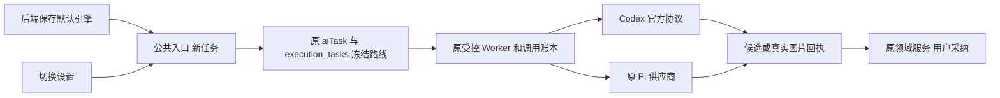

# T-1238 逐功能覆盖矩阵

2026-10-11 当前独立工作树的源码与当场证据快照。范围来自 FR/AC-1238-1～7，完整功能没有按版本切割。官方账户已实际验证结构化文本、独立生图、参考图编辑和图片理解四类调用；真实公共设置与宽窄界面操作已留证。23类功能没有逐族全部跑完真实模型，安装版也未验。unknown恢复混合工具投影、独立FINAL_REVIEW复核、最终类型及全局Gate仍由主线程收尾，不能据此签上线完成。

大白话：选 Codex 后，设置只选择一个引擎。每个新任务记住创建时的选择，后续步骤与恢复继续使用同一选择；模型只交付候选，原服务负责保存。下面逐项区分代码已接通、隔离协议通过、真实账户公共入口已验证。

## FR 与 AC

| 需求/验收 | 当前源码与当场隔离证据 | 真实公共/账户证据与剩余事项 |
|---|---|---|
| FR/AC-1 后端默认偏好、迁移和隔离 | 原 user_preferences 新字段，PATCH compare-write。客户端3、Hook11、设置卡3已实际PASS；旧浏览器值不覆盖已读服务值。后端 codex-engine-preferences 用例负责真实用户隔离。 | 公开PATCH→GET和存储读回已执行；[真实设置10项](/Users/zyongzhu/.codex/worktrees/codex-text-image/Thirdspace-creator/docs/verification/t1238/ui-final.json)保存Pi/Codex、刷新与双窗口同步已通过，[模型任务服务偏好读回](/Users/zyongzhu/.codex/worktrees/codex-text-image/Thirdspace-creator/docs/verification/t1238/public-image-preferences-fifth.json)为Codex。两用户隔离以真实后端数据库用例验证，未另做第二真人浏览器登录。 |
| FR/AC-2 文本和图片理解 | 原结构化/Agentic/后台/知识端口选择冻结联合规格，Codex 不解析 API token。知识四路由断言宿主 API resolver0，Worker Codex fixture12PASS。 | [公共知识归类](/Users/zyongzhu/.codex/worktrees/codex-text-image/Thirdspace-creator/docs/verification/t1238/public-knowledge-second.json)真实结构化成功；[图片理解第三原任务](/Users/zyongzhu/.codex/worktrees/codex-text-image/Thirdspace-creator/docs/verification/t1238/public-image-understanding-state-third.json)ai-task-7f12bd42-50 / 原exec已succeeded，[真实分类结果](/Users/zyongzhu/.codex/worktrees/codex-text-image/Thirdspace-creator/docs/verification/t1238/public-image-understanding-results-third.json)识别原group绿圆PNG并写原素材。素材旧account门原RED→2项PGlite绿、SDK7图片base64误计预算→3项绿，两原失败保留；其余功能仍未逐族真机。 |
| FR/AC-3 全生图 | 原资产/封面 Worker 接官方内置生图媒体回执，原归属与 checksum/大小/暂存/lease回收。 | 公共asset.generate第五轮原ai-task-a46c818b-48→原group采纳→assets.get/downloadUrl→[真实PNG 1041054 bytes](/Users/zyongzhu/.codex/worktrees/codex-text-image/Thirdspace-creator/docs/verification/t1238/public-image-blob-group-after-adopt-fifth.json)；参考图原ai-task-a46c818b-74同样采纳并[下载PNG 1414662 bytes](/Users/zyongzhu/.codex/worktrees/codex-text-image/Thirdspace-creator/docs/verification/t1238/public-image-reference-blob.json)，主线程目视蓝圆改绿圆。[官方账本](/Users/zyongzhu/.codex/worktrees/codex-text-image/Thirdspace-creator/docs/verification/t1238/public-native-ledger.json)记录真实gpt-6.1-sol、usage、原thread/turn与settled call。四次原失败保留；封面/图文/文章/聊天各族尚未逐项真实回收。 |
| FR/AC-4 冻结/继承/恢复 | route-freeze相关、新任务排期、原Pi不覆盖、跨用户/组/时刻拒绝已有当场回归；视频原冻结端口2PASS。知识蒸馏原绝对期限、未知只恢复原turn。 | 日选题预检已贯通原 aiTaskId，归因转父scope；新增actual组合根4PASS验证日选题、两类素材和归因：原Codex→切Pi无key，API resolver0。不能仅凭创建冻结测试签全部消费者。 |
| FR/AC-5 能力失败和不回退 | 设置状态失败、未登录、图片能力false与保存失败当场组件PASS；知识 unknown/取消/已启动恢复与未结算不交全文PASS；Codex fixture不触碰PiHTTP。 | 实际登录能力GET已由主线程验证文本/理解/生图true；真实套餐/额度失败及账户取消/未知恢复未逐项真机执行。 |
| FR/AC-6 原边界不削弱 | 知识真实ID/active/401/404、原候选、不直接建知识；PGlite/Worker/Pi整链验证原账本。图文/文章保原CAS/来源校验；Agentic候选7、研究2隔离PASS。 | 原 checkpoint24仍有4个既有request-id/幂等失败保留；真实参考图与候选采纳下载已通过，公共并发保存仍未做真机重复竞态；其账本/旧fence/保存ACK丢失有实际服务回归。 |
| FR/AC-7 设置免文本/图片配置且Pi兼容 | 模型区域6当场PASS：Codex无两卡，ASR/视频保留，切Pi显示旧配置且不重写模型配置；设置3文件共20PASS。 | 已保留1366与390宽旧界面基线；实际浏览器7项已通过(ui-final.json)，真实PATCH切换Pi/Codex、刷新和双窗口同步，390宽控件可完整操作。保存失败为明确标注的503故障注入，保留原服务Codex值。宽窄截图主线程已目视。 |

## 功能入口与真实执行

所有结构化类入口的共同消费者是受控 `structured-worker-generation`→`createDurableStructuredModelFactory`→`provider-factory`；Codex 模型必须同时拥有原 Worker ports 和 call authority，不能在宿主直接调用。表内“未验”是实际账户公共整链未验，不代表删除了该功能。源码存在的旧 direct-model runner 不能单凭文件名算活跃缺口；本表以当前组合根挂载及真实消费者为准。

| 功能 | 当前任务/Skill | 主要源码 | 当前验证与限度 |
|---|---|---|---|
| 文章、视频脚本正文 | `wechat.article-draft、script.draft` | [backend/src/application/generation/writing.ts](/Users/zyongzhu/.codex/worktrees/codex-text-image/Thirdspace-creator/backend/src/application/generation/writing.ts:33) | 共享受控结构化Worker；原正文/来源/CAS测试存在。真实文本原生探针与knowledge.classify已通过，但本行文章/脚本公共功能未逐个账户模型执行。 |
| 主张、创作约定、大纲 | `planning.thesis、planning.contract、planning.outline` | [backend/src/application/generation/writing.ts](/Users/zyongzhu/.codex/worktrees/codex-text-image/Thirdspace-creator/backend/src/application/generation/writing.ts:64) | 共享结构化节点及原分步；未逐个公共 Codex 真机。 |
| 脚本审核、平台改写、复盘洞察 | `script.review、publish.platform_adapt、review.analyze` | [backend/src/application/generation/writing.ts](/Users/zyongzhu/.codex/worktrees/codex-text-image/Thirdspace-creator/backend/src/application/generation/writing.ts:69) | 共享结构化节点；正常链与空稿明确拒绝分开，见下文。 |
| 图文文本 | `graphic.post-text` | [backend/src/application/generation/creative-post.ts](/Users/zyongzhu/.codex/worktrees/codex-text-image/Thirdspace-creator/backend/src/application/generation/creative-post.ts:35) | 原 immutable base 与候选 CAS 保留；未逐个公共 Codex 真机。 |
| 文章分段修改 | `wechat.article-text` | [backend/src/application/generation/creative-post.ts](/Users/zyongzhu/.codex/worktrees/codex-text-image/Thirdspace-creator/backend/src/application/generation/creative-post.ts:138) | 读取当前真实归属/冻结版本；未逐个公共 Codex 真机。 |
| 发布物料文本 | `publication.text` | [backend/src/application/generation/creative-post.ts](/Users/zyongzhu/.codex/worktrees/codex-text-image/Thirdspace-creator/backend/src/application/generation/creative-post.ts:172) | 原 frozen input 验证和候选保留；未逐个公共 Codex 真机。 |
| 朋友圈 | `moments 文本` | [backend/src/application/generation/moments-model-root.ts](/Users/zyongzhu/.codex/worktrees/codex-text-image/Thirdspace-creator/backend/src/application/generation/moments-model-root.ts:1) | 创建/执行路由冻结回归已当场通过；真实 Codex 整链未验。 |
| 作品审核 | `work review` | [backend/src/application/generation/work-review-root.ts](/Users/zyongzhu/.codex/worktrees/codex-text-image/Thirdspace-creator/backend/src/application/generation/work-review-root.ts:1) | 原入口并入冻结结构化执行；相关原测试通过，真实模型未验。 |
| 选题、补充、偏好、定位、标定 | `topic.generate/enrich/preference、positioning.generate、calibration.diagnose/score` | [backend/src/application/generation/discovery.ts](/Users/zyongzhu/.codex/worktrees/codex-text-image/Thirdspace-creator/backend/src/application/generation/discovery.ts:35) | 共享受控结构化 Worker；逐功能 Codex 公共模型未验。 |
| 素材调研、来源相似性、编导建议 | `research.gather_material、script.source_similarity、copilot.assist` | [backend/src/application/generation/discovery.ts](/Users/zyongzhu/.codex/worktrees/codex-text-image/Thirdspace-creator/backend/src/application/generation/discovery.ts:34) | 共享 Worker；Codex research 证据端口隔离测试2PASS，真实联网研究整链未验。 |
| 素材分类、素材文本提取 | `asset.classify、material.extract` | [backend/src/application/generation/media.ts](/Users/zyongzhu/.codex/worktrees/codex-text-image/Thirdspace-creator/backend/src/application/generation/media.ts:25) | actual root两类adapter冻结任务→切Pi无key预检不跳过/API0。素材原group/文件/版本门RED→2绿；官方图片理解第三原任务已succeeded并写原素材，真实分类见下方；material.extract完整模型链未逐项真机。 |
| 视频决策、素材匹配、项目重建 | `video.decisions、material.match、reconstruct.project` | [backend/src/application/generation/media.ts](/Users/zyongzhu/.codex/worktrees/codex-text-image/Thirdspace-creator/backend/src/application/generation/media.ts:27) | 每阶段原预算/原调用权，Codex/Pi 切设置后身份端口2PASS；真实成片整链未验。 |
| 知识归类 | `knowledge.classify` | [backend/src/modules/ai-runtime/knowledge-generation-business-adapters.ts](/Users/zyongzhu/.codex/worktrees/codex-text-image/Thirdspace-creator/backend/src/modules/ai-runtime/knowledge-generation-business-adapters.ts:1) | 四公共路由 fixture21PASS（含group-only/跨组）；真实临时公共入口+实际登录Codex已返回真实分类，见 public-knowledge-second.json。 |
| 全文蒸馏、关联、评论提炼 | `knowledge.distill、knowledge.relate、comment.qa-sift` | [backend/src/modules/ai-runtime/knowledge-generation-business-adapters.ts](/Users/zyongzhu/.codex/worktrees/codex-text-image/Thirdspace-creator/backend/src/modules/ai-runtime/knowledge-generation-business-adapters.ts:1) | 实际 PGlite+Worker 子进程+Pi HTTP整链6PASS；Codex ALS/账本协议 fixture12PASS；这三类真实账户公共 Codex 尚未逐项执行。 |
| 雷达、灵感文本生成 | `intelligence generation` | [backend/src/modules/intelligence/intelligence-generation-bridge.ts](/Users/zyongzhu/.codex/worktrees/codex-text-image/Thirdspace-creator/backend/src/modules/intelligence/intelligence-generation-bridge.ts:51) | 冻结 payload 选择 Codex，原独立账本预约通过受控 Worker；真实账户公共整链未验。 |
| 归因、收藏、对标等定时飞轮 | `scheduled flywheel` | [backend/src/modules/ai-runtime/scheduled-flywheel-execution.service.ts](/Users/zyongzhu/.codex/worktrees/codex-text-image/Thirdspace-creator/backend/src/modules/ai-runtime/scheduled-flywheel-execution.service.ts:101) | actual归因adapter→原scheduledFlywheel.run/lease预检当场通过：原Codex→切Pi无key，API0；真实账户飞轮模型生成未验。 |
| 每日自动选题 | `scheduled.topic.daily` | [backend/src/modules/ai-runtime/daily-topic-business-adapter.ts](/Users/zyongzhu/.codex/worktrees/codex-text-image/Thirdspace-creator/backend/src/modules/ai-runtime/daily-topic-business-adapter.ts:29) | 原owner遗漏已修；actual root公共偏好/aiTask/adapter preflight在切Pi无key后不跳过，resolver0。未执行实际账户自动选题生成整链。 |
| ASR 后的文本整理 | `transcribe postprocess` | [backend/src/modules/execution/execution-transcribe-postprocess.service.ts](/Users/zyongzhu/.codex/worktrees/codex-text-image/Thirdspace-creator/backend/src/modules/execution/execution-transcribe-postprocess.service.ts:108) | 文本后处理继承原 execution；相关新增路由通过。原 bundle 曾因缺 dist 失败，保留；ASR 本体仍原配置。 |
| 独立生图 | `asset.generate image` | [ai-worker/src/execution/codex-image-generation.ts](/Users/zyongzhu/.codex/worktrees/codex-text-image/Thirdspace-creator/ai-worker/src/execution/codex-image-generation.ts:1) | 第五轮原ai-task-a46c818b-48已实际生成→原group采纳→assets.get/downloadUrl→PNG1041054bytes；[官方call账本](/Users/zyongzhu/.codex/worktrees/codex-text-image/Thirdspace-creator/docs/verification/t1238/public-native-ledger.json)与真实字节checksum一致。前四轮原失败保留，成功是另有明确attempt的第五轮，不篡改或重发原失败。参考编辑原任务亦已采纳并下载1414662bytes。 |
| 封面、图卡、文章配图、系列图 | `cover.generate、graphic.card.generate` | [backend/src/application/generation/creative-post.ts](/Users/zyongzhu/.codex/worktrees/codex-text-image/Thirdspace-creator/backend/src/application/generation/creative-post.ts:73) | 文本 brief 与图片模型规格分开；原引用图 checksum/归属/lease保持。各族真实公共Codex 图片回收尚未逐项验。 |
| 聊天本身 | `chat.run Codex` | [ai-worker/src/execution/external-chat-worker-run.ts](/Users/zyongzhu/.codex/worktrees/codex-text-image/Thirdspace-creator/ai-worker/src/execution/external-chat-worker-run.ts:1) | 随包官方native聊天消费者与原ACP兼容恢复，最新Worker8文件60PASS见[聊天工具闭环报告](/Users/zyongzhu/.codex/worktrees/codex-text-image/Thirdspace-creator/orchestrator/probes/T-1238/chat-tool-closure/README.md)；未知root只按后端证明名单恢复、原图片附件/回收与ACK丢失隔离回归通过。真实账户完整聊天工具链未验。 |
| 聊天触发子任务、工具目录、候选采纳 | `chat tools / external call tree` | [backend/src/modules/execution/execution-codex-chat-tool.test.ts](/Users/zyongzhu/.codex/worktrees/codex-text-image/Thirdspace-creator/backend/src/modules/execution/execution-codex-chat-tool.test.ts:1) | 最新[聊天工具闭环报告](/Users/zyongzhu/.codex/worktrees/codex-text-image/Thirdspace-creator/orchestrator/probes/T-1238/chat-tool-closure/README.md)：目录23PASS、frontend2文件63PASS、backend5文件102PASS/0SKIP、Worker8文件60PASS/0SKIP；图片输入、完整plan/Workbench目录、原Pi冻结及ACP只读消费者均有隔离证据。原unknown公共恢复完整26项PASS，独评CR-003已复核关闭；真实完整账户工具链未验。 |
| 成片可选视觉审核 | `video.visual-review` | [backend/src/modules/execution/execution-video-visual-review.service.ts](/Users/zyongzhu/.codex/worktrees/codex-text-image/Thirdspace-creator/backend/src/modules/execution/execution-video-visual-review.service.ts:1) | 详见 [视觉专项报告](/Users/zyongzhu/.codex/worktrees/codex-text-image/Thirdspace-creator/docs/verification/t1238/VIDEO_VISUAL_REVIEW.md)，最新service/executor/driver42PASS、entry打包/启动7PASS（互不与旧报告相加）；实际Worker subprocess+PiHTTP图片请求、Codex native fixture、原父期限/unknown不重发，可选不可用保安全导出。官方账户成片审核未验。 |

## 正常链与空稿拒绝

T1227 前端 `chat-task-submission.integration.test.ts` 索引7/10是 `review.script` / `publish.package` 的 `empty=true`；同测试正常非空且工具失败0/1均通过。空稿工具已明确拒绝，当前 `toolFailureReceiptVersion:1` 要求父任务保留 `partial`，与 `terminalToolFailurePolicyVersion:1` 的重复相同工具两次终止规则不同。旧用例先统一断言 `succeeded` 才进入 empty 分支，更像断言没有随合同迁移；本审计没有改该测试，也不签“已修复”。正常非空链的证据不能覆盖空稿拒绝，空稿拒绝也不能自动算正常链不可用。

## 当场证据目录与失败保留

- [知识当场后端48/Worker12与红测](/Users/zyongzhu/.codex/worktrees/codex-text-image/Thirdspace-creator/docs/verification/t1238/knowledge/README.md)：原PGlite+实际Worker进程+PiHTTP；Codex官方协议fixture，各数不混称账户真机。
- [前端7文件44PASS与原16FAIL](/Users/zyongzhu/.codex/worktrees/codex-text-image/Thirdspace-creator/docs/verification/t1238/frontend/README.md)：实际React与HTTP handlers，后端响应fixture；初次错误包名没有运行测试，另存。
- [冻结路由证据](/Users/zyongzhu/.codex/worktrees/codex-text-image/Thirdspace-creator/docs/verification/t1238/ROUTE_FREEZE.md)：红/绿各JSON含重叠测试，不能总和冒充独立数量。2个PostgreSQL行锁条件未配置环境为SKIP。原转录bundle缺构建产物失败保持原样。
- [真实公共知识成功](/Users/zyongzhu/.codex/worktrees/codex-text-image/Thirdspace-creator/docs/verification/t1238/public-knowledge-second.json) 与 [第一轮失败](/Users/zyongzhu/.codex/worktrees/codex-text-image/Thirdspace-creator/docs/verification/t1238/public-knowledge-first.json)：第一轮未带实际账号不改写。
- [公共图片第一轮失败](/Users/zyongzhu/.codex/worktrees/codex-text-image/Thirdspace-creator/docs/verification/t1238/public-image-state-first.json)、[第二轮失败](/Users/zyongzhu/.codex/worktrees/codex-text-image/Thirdspace-creator/docs/verification/t1238/public-image-state-second.json)、[第三轮原执行失败](/Users/zyongzhu/.codex/worktrees/codex-text-image/Thirdspace-creator/docs/verification/t1238/public-image-state-third.json)：前两轮是prepare，第三轮已进原exec并停止待诊断；[第四轮原失败](/Users/zyongzhu/.codex/worktrees/codex-text-image/Thirdspace-creator/docs/verification/t1238/public-image-state-fourth.json) 归因为持续Worker进程加载旧bundle，主线程仅停止本次隔离dev准备重启。保原失败任务/exec id，不续期或自动重发冒充修复。第五轮与参考编辑随后均已真实公共采纳/下载成功；该成功来自完整公共证据，不由原生单点PNG代签。
- [本代理唯一后端类型检查原失败](/Users/zyongzhu/.codex/worktrees/codex-text-image/Thirdspace-creator/docs/verification/t1238/frontend/backend-types-observed-failure.txt)：图片规格kind、工具effect、视觉测试repository参数的当时exit2原报告保留，不作为当前仍存在的断言；后续独立检查曾exit0，但最后并行恢复修改后的全局类型以主线程最终运行决定。
- 前端接续4文件33PASS（旧route8、新四route21、实际root预检4），与44重叠不相加；新增文件后完整frontend tsc实际exit0。实际context组成员服务仍为route fixture，不能签真实组数据库授权。成片视觉最终 `video-visual-complete.json` 42PASS/0FAIL（service6+executor26+driver10）；预算不足真实unavailable重验 `video-visual-honest-skip.json` 6PASS/0FAIL 与前报告service6重叠。打包entry构建/复制、实际隔离启动和缺entry检查 `video-visual-runtime-final.json` 7PASS/0FAIL。旧runtime-green的6PASS/1FAIL来自被触及的启动测试硬编码30秒，按120秒startup/180秒test修复；原scope25PASS/1FAIL、parent-expired1PASS/1FAIL/8selectorSKIP、runtime5PASS/2FAIL红测保留。scope-green为34PASS/0FAIL，纠正先前口头41数字。聊天工具最新统计转[聊天工具闭环报告](/Users/zyongzhu/.codex/worktrees/codex-text-image/Thirdspace-creator/orchestrator/probes/T-1238/chat-tool-closure/README.md)：contract23、frontend63、backend102、Worker60；这些是各次实际报告，含之前子集合不可相加。SDK7图片预算另独立3PASS，不混称同批105。所有Codex成片视觉仍是native协议fixture，未验官方账户完整成片。
- 视频生成、ASR原始转录、Embedding与确定性宿主服务保持原供应商/能力归属，Codex免文本/生图配置不代表这些外部能力也可零配置。
- 安装版/打包版、主迁移、边界、孤儿、超时、完整 reconcile 与任务完成状态由主线程实际Gate决定；本矩阵不签全系统全绿。

## 最新公共证据与剩余范围

| 证据 | 已实际验证 | 限度 |
|---|---|---|
| [无独立文本配置7项](/Users/zyongzhu/.codex/worktrees/codex-text-image/Thirdspace-creator/docs/verification/t1238/public-model-config-empty.json)、[服务Codex读回](/Users/zyongzhu/.codex/worktrees/codex-text-image/Thirdspace-creator/docs/verification/t1238/public-image-preferences-fifth.json) | 七项provider/model/secretReference为空、hasSecret=false；官方调用使用已有Codex登录。 | 此处“7项”是实际配置项数量，不是7个模型功能整链；图片免配置由官方公共生图/参考图/理解事实证明。ASR/视频/Embedding仍原能力。 |
| [原生结构化文本](/Users/zyongzhu/.codex/worktrees/codex-text-image/Thirdspace-creator/docs/verification/t1238/native-text.log)、[公共知识归类](/Users/zyongzhu/.codex/worktrees/codex-text-image/Thirdspace-creator/docs/verification/t1238/public-knowledge-second.json) | 实际gpt-6.1-sol文本探针返回JSON，input15141/output20/total15161；真实公共知识归类返回有效title/summary/tags。 | 原生单点与公共知识入口是两类证据，不代签23功能文本全族。第一轮账号缺失原失败保留。 |
| [公共生图第五原任务](/Users/zyongzhu/.codex/worktrees/codex-text-image/Thirdspace-creator/docs/verification/t1238/public-image-state-fifth.json)、[同task/group采纳](/Users/zyongzhu/.codex/worktrees/codex-text-image/Thirdspace-creator/docs/verification/t1238/public-image-adopt-group-fifth.json)、[同group下载URL](/Users/zyongzhu/.codex/worktrees/codex-text-image/Thirdspace-creator/docs/verification/t1238/public-image-download-group-fifth.json)、[实际blob](/Users/zyongzhu/.codex/worktrees/codex-text-image/Thirdspace-creator/docs/verification/t1238/public-image-blob-group-after-adopt-fifth.json) | 原ai-task-a46c818b-48→原exec模型succeeded→候选→同task采纳succeeded→assets.get/下载，真实PNG1041054bytes；[图片](/Users/zyongzhu/.codex/worktrees/codex-text-image/Thirdspace-creator/docs/verification/t1238/public-image-fifth.png)由主线程目视。 | 前四原失败文件保留，后续明确第五attempt不覆盖失败；封面、图卡、文章、系列、聊天生图尚未逐族公共真机。 |
| [参考编辑原任务](/Users/zyongzhu/.codex/worktrees/codex-text-image/Thirdspace-creator/docs/verification/t1238/public-image-reference-state.json)、[原group采纳](/Users/zyongzhu/.codex/worktrees/codex-text-image/Thirdspace-creator/docs/verification/t1238/public-image-reference-adopt.json)、[实际下载](/Users/zyongzhu/.codex/worktrees/codex-text-image/Thirdspace-creator/docs/verification/t1238/public-image-reference-download-success.json)、[字节/摘要](/Users/zyongzhu/.codex/worktrees/codex-text-image/Thirdspace-creator/docs/verification/t1238/public-image-reference-blob.json) | 原ai-task-a46c818b-74沿已授权原图生成、原group采纳；PNG1414662bytes；[参考编辑图片](/Users/zyongzhu/.codex/worktrees/codex-text-image/Thirdspace-creator/docs/verification/t1238/public-image-reference.png)主线程目视白底蓝圆改绿圆。 | 验证本轮真实image_to_image族，不能代签所有业务引用图/CAS并发场景。 |
| [官方原调用账本](/Users/zyongzhu/.codex/worktrees/codex-text-image/Thirdspace-creator/docs/verification/t1238/public-native-ledger.json) | 生图与参考编辑两原task/call均succeeded/settled、engine Codex、真实gpt-6.1-sol与thread/turn；生图input33703/output144/total33847，参考input37595/output168/total37763，图片checksum与下载字节一致。 | usage是原官方回执，并不拿预留估算冒称费用；不是所有功能的用量证明。 |
| [图片理解第三原task](/Users/zyongzhu/.codex/worktrees/codex-text-image/Thirdspace-creator/docs/verification/t1238/public-image-understanding-state-third.json)、[实际理解结果](/Users/zyongzhu/.codex/worktrees/codex-text-image/Thirdspace-creator/docs/verification/t1238/public-image-understanding-results-third.json) | 原ai-task-7f12bd42-50 / exec_f87c6a87-facb-4864-871e-667b4be782dd已succeeded；实际读取原group绿圆PNG，tags图表，description“白底中央绿色实心圆，可用于状态标识或几何概念讲解。”并写原素材。 | [原001失败](/Users/zyongzhu/.codex/worktrees/codex-text-image/Thirdspace-creator/docs/verification/t1238/public-image-understanding-first-current.json)、[原002失败](/Users/zyongzhu/.codex/worktrees/codex-text-image/Thirdspace-creator/docs/verification/t1238/public-image-understanding-second-current.json)保留。旧account门和SDK7图base64误计预算分别有真实红/绿回归，不能把回归fixture当真机；真机成功以第三原任务为准。 |
| [真实设置10项](/Users/zyongzhu/.codex/worktrees/codex-text-image/Thirdspace-creator/docs/verification/t1238/ui-final.json)、[宽窗](/Users/zyongzhu/.codex/worktrees/codex-text-image/Thirdspace-creator/docs/verification/t1238/settings-model-after-wide.png)、[窄窗](/Users/zyongzhu/.codex/worktrees/codex-text-image/Thirdspace-creator/docs/verification/t1238/settings-model-after-narrow.png)、[保存失败](/Users/zyongzhu/.codex/worktrees/codex-text-image/Thirdspace-creator/docs/verification/t1238/settings-save-failure.png) | fresh隔离实际浏览器、临时数据库10项通过：保存Pi/Codex、刷新、双窗口同步、1366×900/390×900操作、503保存失败保持原服务Codex、加载防重复、未登录、生图不可用与移除注入后实际Codex连接；截图主线程已目视。[相关4文件24PASS](/Users/zyongzhu/.codex/worktrees/codex-text-image/Thirdspace-creator/docs/verification/t1238/frontend-final-configuration.txt)当场通过。 | 503、未登录与生图不可用是明确故障注入，非真实生产故障；单测试用户，第二真人登录未另验。原HMR代理阻断失败及webpack依赖编译失败留存，不签webpack构建绿。 |
| [素材workspace真实红](/Users/zyongzhu/.codex/worktrees/codex-text-image/Thirdspace-creator/docs/verification/t1238/asset-processing-group-red.txt)、[修后2项绿](/Users/zyongzhu/.codex/worktrees/codex-text-image/Thirdspace-creator/docs/verification/t1238/asset-processing-group-green.txt)、[聊天工具闭环报告](/Users/zyongzhu/.codex/worktrees/codex-text-image/Thirdspace-creator/orchestrator/probes/T-1238/chat-tool-closure/README.md) | 原account门拒绝本组图确实红；修为workspaceFilter后原group/file/version/跨组2项真实PGlite通过。SDK7图片真实reservation红1→绿2，再加production尺寸1414662bytes/输出65536/预算1M，最终独立3PASS。 | 每图65536是预留策略，不冒称官方计费硬上界；图片仍完整参与摘要。预算3项与backend5文件102不同批，不相加。 |
| [聊天工具闭环报告](/Users/zyongzhu/.codex/worktrees/codex-text-image/Thirdspace-creator/orchestrator/probes/T-1238/chat-tool-closure/README.md) | contract目录23、frontend附件/聊天2文件63、backend5文件102/0SKIP、Worker8文件60/0SKIP；Worker tsc实际exit0。原Pi、hooks/draft、Workbench、图片附件、未知root严格恢复与ACK丢失消费者有隔离协议/真实服务证据。 | 不是真实账户完整聊天工具E2E；公共unknown恢复混合工具投影最后回归与独立消费复核仍收尾。先前子集/重复同文件不得相加。 |

当前真实官方四类调用已留证，但尚不能宣称23功能逐族账户真机、官方账户成片视觉审核、真实套餐/额度失败、公开unknown生命周期真机或安装包已验。只有已发生的证据记录为通过。

独立[FINAL_REVIEW](FINAL_REVIEW.json)已完成，5项源码发现复核关闭，恢复整链独立26PASS/0FAIL；原失败保留。主线程最后frontend/backend/worker/contract类型检查实际exit0；完整迁移26项、核心预算与真实公共链路已有原证据。最终门卫见 [GATES.md](GATES.md)，全局历史失败不签全绿。
