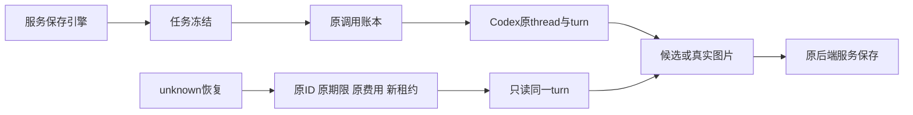

# T-1238 最终独立源码审查（源码发现已复核关闭）

审查工作树：`/Users/zyongzhu/.codex/worktrees/codex-text-image/Thirdspace-creator`。实现只读，全部发现先通知主代理。采用独立人工源码审查与当场隔离测试；可用 `mcp__code_review` 仅有PR检查查询，没有源码审查保存器，未调用SPEC工具冒充源码评审。

5个稳定源码发现均已复核修复，当前没有未关闭的可复现源码阻断。最后恢复回归独立实际26PASS/0FAIL。本报告不代签全部真实账户功能或全系统验收PASS。

大白话：新任务记住创建时的引擎，候选和图片由原服务保存。未知结果只读取原回合，保留原任务、期限与费用。简单文本/图片、continuous和严格子工具的原回合恢复，已贯通实际授权、Worker、原CAS与工具卡服务。

## 覆盖与发现

已按SPEC写集核对合同、设置schema与0133主迁移、偏好比较写入、创建/显式引擎、事务父子继承、排期、dispatcher/authority/lease、structured/agentic/intelligence/flywheel/video/asset/cover/transcribe/processing实际消费者、知识四个同步Worker、可选视觉审核、调用账本模型和usage、官方RPC与真实媒体byte/checksum回收、聊天动态工具目录与原调用树、前端免配置区域。追加的开发HMR排除仅针对Next内部升级路径，知识与dispatch保护规则保持。新增asset-processing原workspaceFilter修正仍核user/group及原asset/file版本；图片SDK封装预留修正仅计量协议图片，原摘要/费用边界保持。

| ID | 状态 | 原问题及复核结果 |
|---|---|---|
| CR-001 | 已复核修复 | 公共预检曾把Codex安全错误写成API模型未配置。全部相关catch保留安全枚举，四个UI消费者给出对应中文说明。 |
| CR-002 | 已复核修复 | JPEG/WebP曾被保存为PNG。现在原call/checksum匹配后按同一真实字节嗅探PNG/JPEG/WebP，不扩路径或权限。 |
| CR-003 | 已复核修复 | 原unknown曾无法进入只读恢复。公开resume/scan、continuous原null期限、后台原冻结身份、strict原父名单、实际授权/Worker/CAS/投影均已贯通；混合已完成host前缀仅只读保留，未知工具不得借恢复重发。最后26项实际通过。 |
| CR-004 | 已复核修复 | 原Pi后台阶段曾解析当前Codex偏好。intelligence/flywheel明确使用原Pi解析器，聊天传真实owner并阻止Pi身份被当前Codex替换。 |
| CR-005 | 已复核修复 | 通用文本、图片和聊天曾缺live usage预算守卫。现在先保存原usage再返回原预算判定，只interrupt/cancel原turn/session，保unknown；ACP真实累计不被last/cache统计覆盖。 |

固定编号、FR/AC锚点、精确源码与复现约束见 [FINAL_REVIEW.json](/Users/zyongzhu/.codex/worktrees/codex-text-image/Thirdspace-creator/docs/verification/t1238/FINAL_REVIEW.json)。所有当场缺陷保留历史，不以修复后结果抹去。此前猜测HOST_PORT_TIMEOUT会触发网络重试没有生产证据，已明确撤回；最新Codex显式关闭unconfirmed retry作为合同防御已复核。

## 独立当场验证

- native-turn、asset-codex-worker-run、codex-agentic-worker-run：3文件19PASS。
- Codex资产服务：4PASS/54 selector SKIP，含三个真实MIME、新lease原图恢复及缺native绑定拒绝。
- CodexCallService：3PASS，真实PGlite原usage/预算绑定。
- ACP/nativechat/native-turn/tools：4文件31PASS，含原ACP只读恢复、inline授权附件、合法工具及累计费用接续。
- 最新durable-model/external-recovery：2文件8PASS，含Codex保原call及strict hooks/draft名单消费。
- 核心恢复首次：13项11PASS/2FAIL，图片fixture缺kind:image而被真实服务拒绝；接续16项13PASS/3FAIL，新增聊天fixture缺nextId未入链。两个独立红测均保留。
- 最后完整恢复：2026-10-11 19:54:17独立实际26PASS/0FAIL，真实PGlite+Worker+授权/投影/原CAS；含text/image原回合、continuous/取消/未完成回合、三类子工具、混合已完成host前缀、7类损坏证明拒绝及3类ACK/身份重读，原call/期限/费用不变且子任务不重复。
- SDK7图片预留：独立真实服务3PASS；实际图片data封装计视觉预留，完整字节摘要和原输出预算不可改，非图不能借此绕预算。
- 独立后端类型检查曾exit0；后续源码有改动，不能代签主代理最终类型检查。

所有成功数量按每次命令记录，重叠测试不相加。首次错误使用不支持的minWorkers没有运行测试，失败已保留；两轮独立恢复红测不改写，最后绿测另记。这里RPC端点是隔离fixture，PGlite与Worker进程是真实执行，不称实际账户未知回合验收。

## 已读的真实公共证据与限度

已独立读取知识归类第二轮真实结构化候选；独立生图第五轮原任务awaiting_confirmation/runtime succeeded，经明确原group采纳后succeeded，blob200、PNG1041054bytes，并实际查看为蓝色圆形白背景。参考图编辑同原task/group采纳succeeded，PNG1414662bytes，已实际查看蓝圆改为绿圆。前四轮失败和省略group首次采纳409均保留；省略group的409不能代签跨组拒绝。

真实图片理解第三轮原task/exec succeeded，对同一已采纳PNG给出“白底中央绿色实心圆”的模型描述；001保存归属失败留下unknown、002图片封装预算拒绝均保留。

已读取ui-final.json中的实际服务GET/PATCH、刷新与双窗等7项设置证据；保存失败明确为503故障注入，截图由主代理目视。本审查没有执行独立视觉审美评审。public-model-config-empty.json七类真实API配置为空，无provider/model/secret。

逐功能真实账户公共整链、套餐/额度失败、unknown生命周期真机、聊天完整工具真机及安装版/完整全局Gate未由本审查执行。已有公共图片或共享fixture成功不能代签这些族；最终验收由主代理保存真实证据并完成原Gate/reconcile流程。
