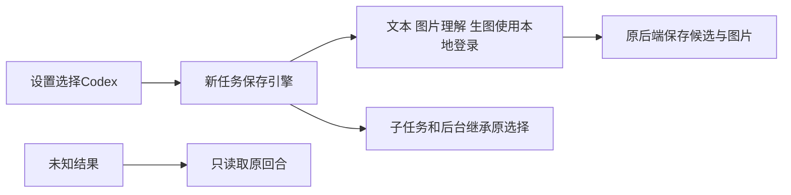

# T-1238 验收门卫与实际限度

任务合同独立复核 PASS[REV:6b70a2a85595]。最终源码独立审查5项发现均修复，26项原回合恢复整链当场通过；见 FINAL_REVIEW.md、CODEX_READ_RECOVERY.md。

- 真实公共链路：七项模型配置为空；Codex文本、知识归类、独立生图、参考图编辑、图片理解已使用官方本地登录成功。蓝圆1041054字节和编辑后绿圆1414662字节经原group采纳、下载校验与目视；原call/thread/turn/实际模型用量保留。原失败不覆盖。
- 浏览器：fresh隔离数据库/真实Chromium，设置10项通过（1366×900、390×900、保存/刷新/双窗）；未登录、生图不可用、503明确为故障注入，移除注入后实际Codex连接。见 ui-final.json、FRONTEND_REPORT.md。
- 类型：contract、Worker、backend、frontend最后各自实际exit0；见 *typecheck-final*.txt。Worker最终构建见 worker-build-final-2.txt。
- 回归：恢复三文件41PASS；旧Pi与资产等七文件183PASS（和41项重叠，不相加）。聊天工具contract23、frontend63、backend102、Worker60按独立命令记录，不叠加为总数。完整迁移与预算26项、成片可选视觉42项、打包7项、素材原group2项、SDK7预留3项都有原始回执。
- boundary：无新增，保留基线5；semantic PASS；orphan 0 error、100条全局既有PLANNED warning。见 boundary-final.txt、semantic-final.txt、orphan-final.txt。
- 超时完整验证实际exit1：22条原参考编辑器、Workbench和抖音诊断短超时在本任务范围外，后续回归分组通过；保留 timeout-current.txt，不加扫描豁免，不签全绿。
- pmem sync 已当场运行；完整reconcile原始输出见 reconcile-final.txt。该原回执32ERROR包含本次相关夹具回归，不能全部称旧债；逐组修后回执与最终完整对账另存，范围外环境/控制面欠债沿用T1204登记。

23类功能已盘点并接入统一冻结路由，共享/逐族隔离测试不替代每一族的真实账户完整旅程。安装发行版未验证，本任务交付源码与本地构建。语音转写、视频和Embedding继续各自原能力；已有Pi/在途/恢复任务保持原引擎。

## 共享目录整合复验

源码已按三方合并写回 `/Users/zyongzhu/Workbase/Thirdspace-creator`，保留其它会话的正文模式、模型连接测试与窄窗网格导航。Codex模式显式禁用独立文本连接测试。共享源码三包类型检查exit0；真实隔离设置10项通过；原正文/Worker两文件51PASS；原Codex恢复两文件31PASS；Worker build exit0。整合阶段解析冲突、共享.env的PG登录失败与Pi对账多一次预留的原失败均保留，修后另存绿测。测试隔离显式清空DATABASE_URL，只使用本轮临时库；没有成功连接或写入原PG。

额外严格正文标签兼容在原intelligence owner下红2→绿5，Flywheel不放宽。独评追加只读复核无新问题；Pi恢复在reserve前保持原拒绝。共享工作目录其它会话变更未被提交或清理。T-1238的提交与验收记录以独立工作树为可核查证据，共享目录存在其它会话未提交的设置页改动，不将其冒充当前HEAD已绑定的UI回执。

进度生成器实际尝试 `progress.mjs done T-1238:implementation --commit 1e727464c`，被既有T-1026非法write_set拒绝（见progress-final.txt）；未手改步骤为done。BACKLOG状态仍只由taskctl写入。该全局控制面欠债继续登记T1204。

共享Worker完成重建后，浏览器最后一步额外强制断言真实“文本与生图可用”，10项通过（integrated-ui-journey-built.txt / integrated-ui-final-built.json / integrated-settings-connected-built.png）；不是仅检查“已连接”。此前截图中的暂未就绪状态保留，不把旧bundle探针算为最终能力通过。

## 全量失败逐根因修验

原32ERROR不覆盖。T-1238真实评审事件从共享目录原始hash链完整前缀导入并用当前真实snapshot核验，review-audit-final-2.txt已无T-1238错误，不补造历史PASS。LED054/058/059及聊天consumer修后完整组绿，详见COVERAGE新增段；生命周期遗漏resolver修后1PASS，完整LED061已实际exit0：contract7、Worker113、backend72、frontend132/28，共26文件352PASS/0FAIL。真实100次串行/并行返回liveBuffers0，停止后sweep2/2、timer0，原内存观测文件由门恢复。见full-led061-fixture-fixed.txt。五份测试夹具修复提交d60d6391e，前端连带类型检查final-fixture-types.txt实际exit0。

范围外检查已独立实际复跑：LED052缺显式55422隔离PG变量，按原门拒绝，不以skip为PASS；LED018前端浏览器组通过但Cargo在缺少binaries/creatoros-server-aarch64-apple-darwin构建资源前置失败；LED057同一缺包资源前置失败。原命令、退出与错误见full-led-052/018/057-remaining.txt。不造可执行文件或放宽打包校验。这些未验与22条范围外短超时及旧review/backlog/progress欠债交T1204继续，不签全局全绿。

五份修后fixture已按共享文件未漂移对照整合，共享目录实际再验frontend4文件139PASS、backend正式chat-worker-entry25PASS/0SKIP，原断言和真实子进程保留，见integrated-fixture-frontend-final.txt、integrated-fixture-chat-final.txt。

原checkpoint24项20PASS/4FAIL不是被26/31恢复整链替代：已另做准确原单文件实际红→24PASS/0SKIP。仅fixture两行恢复请求号按task.id隔离，同请求重投和所有风险/水位/ACK断言保留，生产服务不改。修后backend typecheck实际exit0（final-checkpoint-types.txt），原红及新绿均保留。

共享目录准确原checkpoint单文件同样24PASS/0FAIL/0SKIP（integrated-checkpoint-fixture-final.txt）。

偏好加载护栏已真实红→绿，三文件43PASS/0SKIP，frontend tsc实际exit0。独立只读终审实际canonical defaultProbe ready/原testSession、公开服务成员映射与原PUT边界无新增阻断；不恢复任何未公开服务ID或供应商/实现信息。新增真实浏览器延迟本轮GET验证pending独立文本/图片卡和引导不存在，原GET放行后真实Codex读回，10项通过、default/image独立探测请求0。见ui-final.json.preferenceLoading和settings-preference-loading.png。初次测试route撤销竞态及共享Next dev锁失败保留（ui-pending-route-race-failure.txt、integrated-pending-ui-lock-*）；修测试器等待当前拦截结束并隔离真实Next配置的编译目录，不影响他人开发服务。

第二次完整对账reconcile-after-fixture-fixes.txt实际25ERROR/0WARN：LED014/042/047/054/058/059/061均当场绿，但包含本任务stage误写approved（合法值为passed）的控制面错误，不能归旧债；现按真实已过Gate修正为passed。最终稳定源码再执行完整对账，保留原25和原32回执。

## 最后加载护栏与验证环境复验

独立/共享源码各三个设置文件实际43PASS/0SKIP，共享原defaultProbe与testSession保留；Codex及偏好未读完均不发独立文本/图片探测。两边真实设置旅程各10项再次通过，延迟真实GET1次、独立模型探测0次，末步实际“文本与生图可用”（ui-cleanup-reviewed-final.txt / integrated-ui-cleanup-reviewed-final.txt / integrated-ui-pending-final.json）。测试前后tsconfig.json和next-env.d.ts的实际SHA及字节一致，独立前端类型检查frontend-types-after-ui-cleanup.txt实际exit0。

独立只读复核新增PR001：测试器next-env整文件回退可能覆盖启动期间并发注释；这是本轮真实发现，原报告保留。ebd31b714改为只替换本轮独有类型import，不再整文件回退。ui-cleanup-concurrency-proof.cjs执行当前测试器原清理块，以真实临时文件覆盖before-ready/after-ready两类并发编辑，注释及tsconfig字段保留、本轮路径清除，ui-cleanup-concurrency-proof.txt实际exit0。这是文件状态交错验证，不冒充两个真实编辑进程竞争的E2E。新清理代码已随上述两轮真实浏览器执行，未删除他人服务或编译缓存。详见PENDING_GUARD_REVIEW.md。

共享目录清理后前端类型检查integrated-frontend-types-after-ui-cleanup.txt也实际exit0；两边类型检查均发生在临时类型入口清理完成后。

最终完整reconcile-stable-final.txt实际exit1、25ERROR/0WARN：backlog-health1、旧review19、LED052/018/057/053四项，以及阶段记录日期陈旧1项。日期是本轮控制面问题，已更新为真实2026-10-11；manifest-date-recheck.txt重新执行原日期护栏exit0。没有再签完整24ERROR回执；其余24项按本次完整错误清单保留给T1204。完整执行中LED014/042/047/054/058/059/061均当场OK，相关产品回归不再报错。记录更新与测试器清理之后未改产品源码。

## 严格任务完成回执

独立工作树在产品源码提交ebd31b714上实际执行taskctl complete T-1238 --evidence docs/verification/t1238/FRONTEND_REPORT.md，exit0，task-completion-final.txt和原events.ndjson保留：report_sha=77b939320ddf、verification_executed=true、真实旅程输出98bytes/sha3f44ddbbbd77、10个验收项及10份可见文案。完成命令再次启动隔离真实服务并跑浏览器，不以旧报告替代执行；结束后临时类型入口无改动。frontend-receipt-after-completion.txt实际验证该报告PASS。

共享目录源码已整合、43项设置回归与真实10项/类型检查各自通过。共享目录有其它会话未提交的watched-path修改，未提交它们、未手改共享BACKLOG为完成，也不将独立工作树的HEAD绑定回执冒充共享HEAD。独立工作树任务由taskctl正式完成并提交，源码与证据同步回共享目录；发行安装包没有改动或宣称上线。
