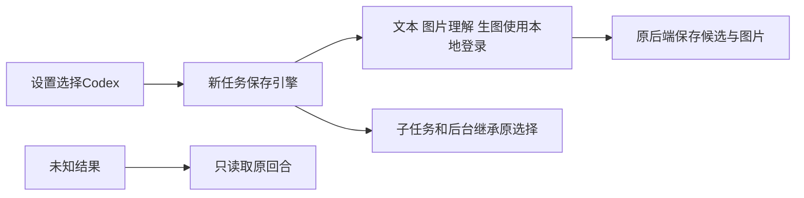

# T-1238 验收门卫与实际限度

任务合同独立复核 PASS[REV:6b70a2a85595]。最终源码独立审查5项发现均修复，26项原回合恢复整链当场通过；见 FINAL_REVIEW.md、CODEX_READ_RECOVERY.md。

- 真实公共链路：七项模型配置为空；Codex文本、知识归类、独立生图、参考图编辑、图片理解已使用官方本地登录成功。蓝圆1041054字节和编辑后绿圆1414662字节经原group采纳、下载校验与目视；原call/thread/turn/实际模型用量保留。原失败不覆盖。
- 浏览器：fresh隔离数据库/真实Chromium，设置10项通过（1366×900、390×900、保存/刷新/双窗）；未登录、生图不可用、503明确为故障注入，移除注入后实际Codex连接。见 ui-final.json、FRONTEND_REPORT.md。
- 类型：contract、Worker、backend、frontend最后各自实际exit0；见 *typecheck-final*.txt。Worker最终构建见 worker-build-final-2.txt。
- 回归：恢复三文件41PASS；旧Pi与资产等七文件183PASS（和41项重叠，不相加）。聊天工具contract23、frontend63、backend102、Worker60按独立命令记录，不叠加为总数。完整迁移与预算26项、成片可选视觉42项、打包7项、素材原group2项、SDK7预留3项都有原始回执。
- boundary：无新增，保留基线5；semantic PASS；orphan 0 error、100条全局既有PLANNED warning。见 boundary-final.txt、semantic-final.txt、orphan-final.txt。
- 超时完整验证实际exit1：22条原参考编辑器、Workbench和抖音诊断短超时在本任务范围外，后续回归分组通过；保留 timeout-current.txt，不加扫描豁免，不签全绿。
- pmem sync 已当场运行；完整reconcile原始输出见 reconcile-final.txt。既有全局失败沿用T1204登记，不以本任务成功抹掉。

23类功能已盘点并接入统一冻结路由，共享/逐族隔离测试不替代每一族的真实账户完整旅程。安装发行版未验证，本任务交付源码与本地构建。语音转写、视频和Embedding继续各自原能力；已有Pi/在途/恢复任务保持原引擎。

